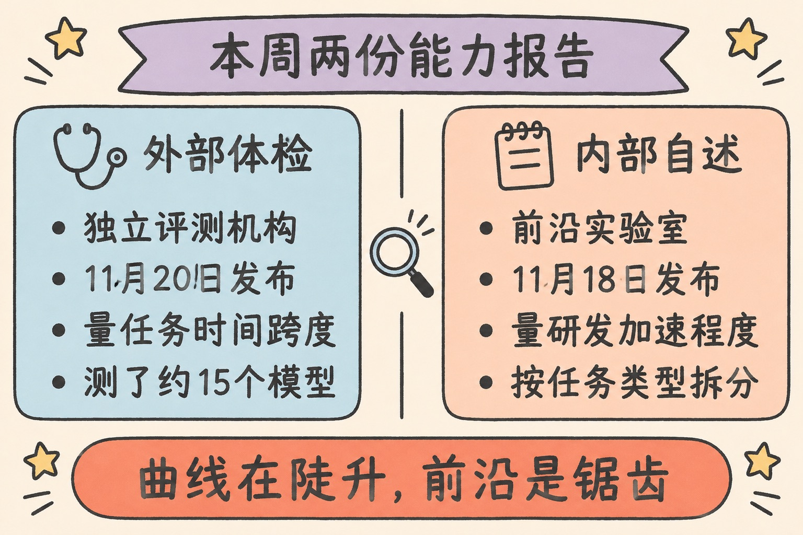
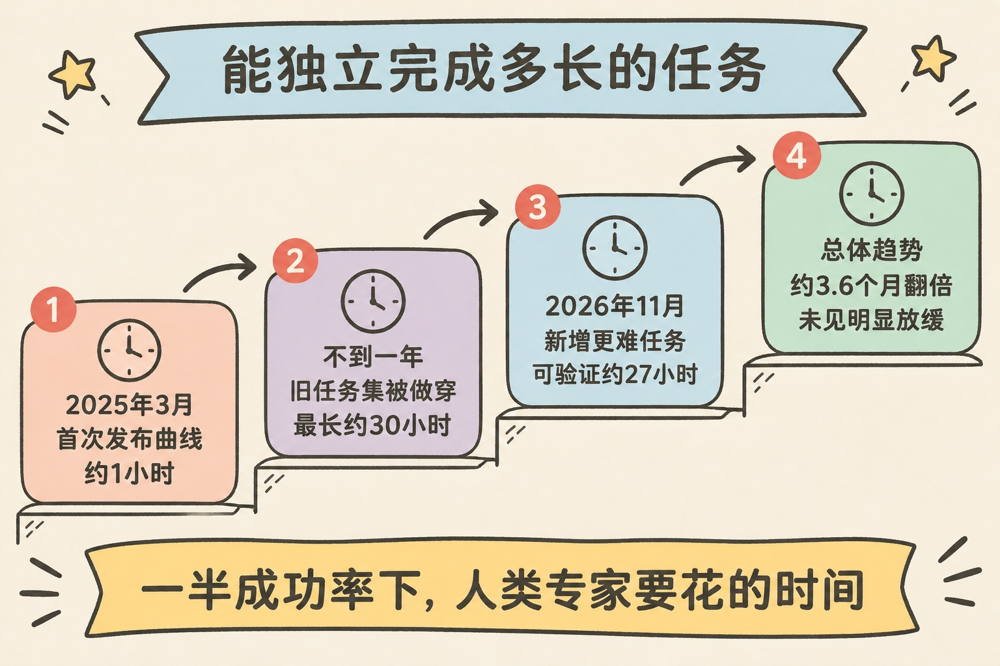
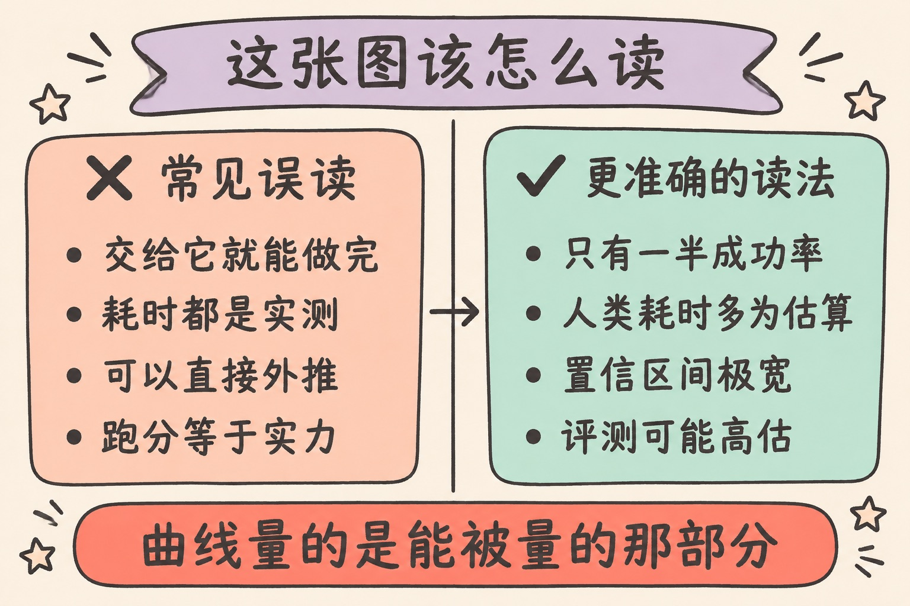
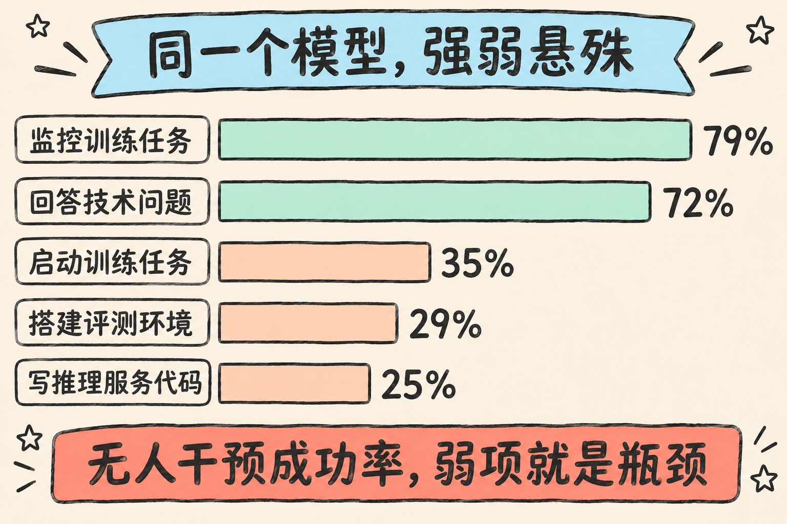
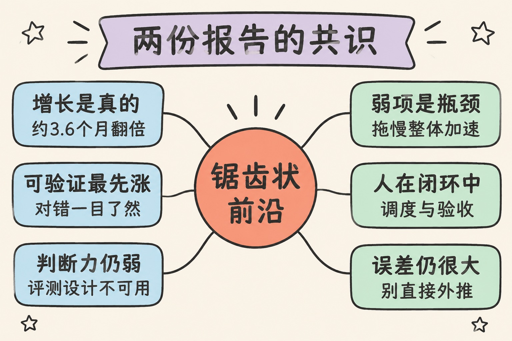
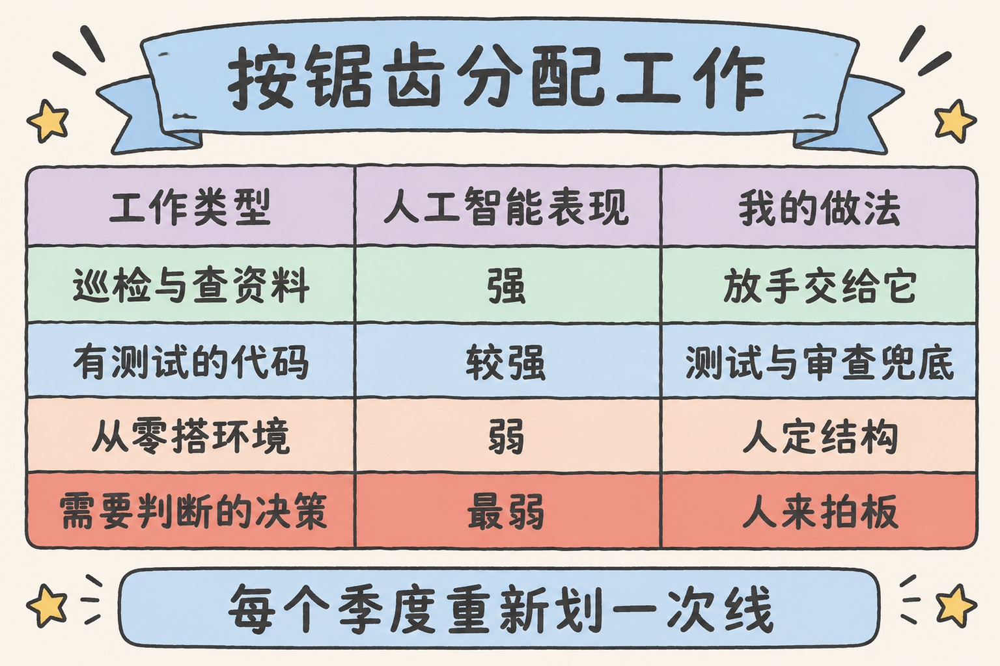

> 本周 AI 圈最值得读的不是又一个新模型，而是两份「量体温」的报告：一份说 AI 能独立完成的任务还在每三四个月翻一倍，另一份说这种能力在不同任务上高低悬殊——**曲线在陡升，前沿是锯齿。**

---

## 先讲结论

1. **趋势没有放缓**：METR 11 月 20 日的更新显示，在合并任务集上，前沿模型能完成的任务时长大约**每 3.6 个月翻一倍**，在可验证任务上已经达到「人类专家最多约 27 小时的工作量」量级。
2. **能力是锯齿状的**：OpenAI 11 月 18 日的报告里，Agent 在「监控训练任务」上无人干预成功率 79%，在「写推理服务代码」上只有 25%。同一个模型，在相邻的工作上能差三倍。
3. **短板决定上限**：两份报告都在说同一件事——判断力、难验证的任务、搭建新环境，是 AI 目前最弱的环节，也是人最该守住的位置。

---

## 背景：这一周发生了什么

11 月第三周的 AI 新闻密度很高：OpenAI 发布了 GPT-6.2 Astra 和 Sol，Google DeepMind 发布了 Gemini 4 Neon 并开放了 Genie 4，各家又宣布了一串行业合作。

新模型发布每周都有，但它们回答的是「谁更强」。这一周还有两份报告回答了一个更重要的问题：**AI 到底在以什么速度变强、强在哪里、弱在哪里？**

| 报告 | 发布方 | 时间 | 回答的问题 |
|------|-------|------|-----------|
| AI R&D-relevant model capabilities are improving rapidly and are getting harder to measure | METR（独立 AI 评测机构） | 2026-11-20 | AI 能独立完成多长的任务？趋势有没有变？ |
| Research acceleration: The jagged frontier | OpenAI | 2026-11-18 | 编码 Agent 让 AI 研发本身快了多少？哪里快、哪里慢？ |

一个是外部「体检」，一个是内部「自述」，放在一起读，能拼出一张比任何发布会都真实的能力地图。

---

## 什么是「时间跨度」曲线？

### 一句话定义

**时间跨度（time horizon）= 一个 AI 模型能以 50% 成功率完成的任务，换成人类专家要花多长时间。**

### 人话解释

不问「模型考了多少分」，而是问「它能独立接下多大的活」。一个任务人类专家要做 2 小时，模型做成的概率是一半，那它的时间跨度就是 2 小时。

### 类比理解

就像评估一个新同事：不看他背了多少八股文，而看你敢把多大的任务交给他、不用中途过问。从「改个错别字」到「独立交付一个模块」，跨度越长，越像一个真正的同事。

### 曲线这次怎么更新了

METR 在 2025 年 3 月首次发布这条曲线时，最好的模型（Claude 3.7 Sonnet）时间跨度大约 1 小时。原来那套任务集（TH1.1，最长的任务约 30 小时）不到一年就被模型「做穿」了，所以这次 METR 新增了一批更长、更开放的任务（TH2），并测了截至 Opus 5.5 和 GPT-6 Astra 的约 15 个模型。

关键结论：

- 在 TH1.1 + TH2 的合并任务集上，时间跨度**大约每 3.6 个月翻一倍**；
- 在 TH2 的可验证子集上，当前公开的前沿模型估计时间跨度**最高约 27 小时**；
- 在公开前沿上，METR **没有看到明显的加速或减速**；
- 但一些厂商内部的趋势可能有变化，而 METR 自己也说对这些发现「不确定」，因为结果对方法选择很敏感。

---

## 最容易被误读的地方

MIT Technology Review 把这条曲线称为「AI 领域最被误解的一张图」。原因是它的度量方式本身很绕，随手转发时很容易丢掉前提。结合 METR 报告自己写的限制，下面几种读法值得警惕：

| 常见读法 | 更准确的理解 |
|---------|-------------|
| 「AI 已经能干 27 小时的活了」 | 是**50% 成功率**下、**可验证任务**上的估计值，不是「交给它就一定能做完」 |
| 「27 小时」是实测出来的 | 新任务的人类耗时**大多是估算**，METR 说直接用人类实测基线的只占 9% |
| 曲线能直接外推到明年 | METR 自己说置信区间「极其宽」；受访学者也表示还不确定该如何外推 |
| 跑分高 = 实际工作能力强 | METR 担心容器化、好跑的评测**可能高估真实世界能力** |
| 什么任务都在同步变强 | 需要判断力的任务明显更弱，这正是本文第二份报告的主题 |

> 一个很能说明问题的细节：METR 让模型设计评测任务，**没有一个 AI 设计的评测被 METR 员工认为可用**；在哲学论证任务上，模型也落后于人类。曲线在涨，但它量的是「能被量的那部分」。

METR 的 Matt Putz 说得很直白：难验证、需要判断的任务本来就更难研究，更难量化，他不认为能为它们建立像可验证任务那样干净、稳健的趋势。

---

## 锯齿状前沿：OpenAI 自己的数据

如果说 METR 是外部体检，OpenAI 这份报告就是一份内部「工时日志」：编码 Agent 进入日常研发之后，研究员的工作到底变了多少。

### 强的地方很强

| 指标 | 数据 |
|------|------|
| 人类需 2~4 小时的研发任务，Agent 无人干预成功率 | 3 月 23% → 10 月 46% |
| 人类需 4~8 小时的任务 | 3 月 13% → 10 月 35% |
| 每位研究员每天使用的「Agent 工作日」（1 个 = 8 小时 Agent 使用） | 0.5 → 5.7，约 11 倍 |
| 10 月中旬同时运行 ≥4 个 Agent 的研究员占比 | 超过三分之二 |
| 每位活跃实验者近四周的实验数 | 2025 年基线的 1.68 倍 |

OpenAI 的原话是：Agent 现在能独立完成**将近一半**的 2~4 小时研究任务。

### 弱的地方很弱

但按任务类型拆开，差距一下子出来了：

| 任务类型 | 无人干预成功率 |
|---------|--------------|
| 监控训练任务、发现问题 | 79% |
| 回答技术问题 | 72% |
| 启动训练任务 | 35% |
| 搭建评测、强化学习和 Agent 环境 | 29% |
| 写推理与服务栈代码 | 25% |

按大类看：沟通类 69%、分析类 58%、构建类 43%。

这就是「锯齿」的含义：**模型不是在所有任务上同步变强的**。看、查、答很强；从零搭建、需要准确判断的工作明显更弱。OpenAI 的研究员在访谈里也说，Agent 会写出「AI slop」式的 PR、产出不可用的数据、做出无效的分析假设；它通常没法一次性提出「自己也解不了的好问题」。

OpenAI 自己的判断是：只要模型在不同研发任务上的表现这么不均匀，**弱项就会成为整体加速的瓶颈**。这个结论和 METR 的「判断力更差」完全对得上。

---

## 两份报告放在一起，说明了什么

把两份报告叠在一起，能得到三个比单份报告更有用的判断。

### 判断一：增长是真的，而且速度不慢

一个外部机构、一个前沿实验室，用完全不同的方法得到了同方向的结论：在可验证的工程任务上，AI 能独立承担的工作量在快速增长。3.6 个月翻一倍意味着一年大约翻 10 倍。这不是营销话术，是有方法、有误差范围的测量。

### 判断二：「能被验证」是能力的分水岭

可验证任务（有测试、有分数、能自动判对错）进步最快，因为这类任务最容易被做成训练环境。METR 甚至发现，越难做成强化学习环境的任务，模型表现越差——即使控制了任务时长。**换句话说，AI 最先吃掉的，是那些「对错一目了然」的工作。**

### 判断三：人的位置正在上移，而不是消失

OpenAI 报告里最有分量的一句话是：人类仍然是 AI 研究闭环的核心部分。研究员没有被替代，而是从「写代码的人」变成了「同时调度多个 Agent（超过一成的人日常峰值在 16 个以上）、负责判断和验收的人」。这和我在 [智能体时代的软件开发范式](/posts/agent-native-software/) 里说的「从写代码变成养员工」是同一个方向。

---

## 对普通工程师意味着什么

这两份报告研究的是 AI 实验室，但结论对任何用 AI 干活的人都直接适用。我自己的做法是按「锯齿」来分配工作：

| 工作类型 | AI 的表现 | 我的做法 |
|---------|----------|---------|
| 巡检、监控、查资料、答疑 | 强 | 放手交给 Agent，只看结果 |
| 写有测试覆盖的代码 | 较强 | 让 Agent 写，用测试和代码审查兜底 |
| 从零搭环境、设计评测 | 弱 | 人来定结构，Agent 填细节 |
| 需要判断的决策（选题、取舍、优先级） | 最弱 | 人来做，Agent 只提供材料 |

举个最近的真实例子：我在手机上让家里的 Agent 巡检了 33 个代码仓库（过程见 [用 Telegram 遥控本机 Claude Code](/posts/claude-code-telegram-remote/)），它几分钟就找出了一个四百多个文件没提交、也从没推送过的分支——这是典型的「监控与发现问题」，正好落在锯齿的高点。但「这个分支要不要合、两份重复的克隆以哪份为准」，它只能提醒，决定仍然要我来做。

另外两条实用建议：

- **给任务配上验证手段**。既然可验证任务是 AI 的强项，那就尽量把你的任务改造成可验证的：先写测试、先定验收标准。这和 [Agent 与 Harness](/posts/agent-harness-guide/) 里讲的「Harness 决定能力上限」是一回事。
- **每隔一个季度重新评估一次分工**。按 3~4 个月翻一倍的速度，今天「交不出去」的任务，半年后可能就能交了。分工表不是一次性的。

---

## 风险与边界

- **这些数据都有不小的误差**。METR 的置信区间很宽，OpenAI 的部分数据来自研究员自述和小样本问卷（101 人和 28 人），花费类数据还受过一次 harness 改动的干扰，两家都在报告里主动说明了这些问题。
- **OpenAI 的报告是「自评」**。它衡量的大多是「活动量」（Agent 使用时长、实验数、代码行数），而不是「研究进展」本身，OpenAI 自己也承认这只是「更全面、但仍然局部」的图景。
- **历史趋势不一定能预测未来**。OpenAI 提到数学领域最近出现了突然的突破，并表示在监测深度学习领域是否会发生类似的跳变。曲线可能被打破，向上或向下都有可能。
- **自我加速是需要被盯紧的事**。OpenAI 在报告中主张，AI 实验室应被要求跟踪并公开报告「递归自我改进」的指标。当 AI 开始加速 AI 本身的研发，透明度就不是可选项了。

---

## 总结

1. **曲线在陡升**：AI 能独立完成的任务时长约每 3.6 个月翻一倍，在可验证任务上已经达到人类专家一天以上的工作量。
2. **前沿是锯齿**：监控、问答、分析很强，搭建、评测设计、需要判断的工作明显更弱，而弱项决定了整体能走多快。
3. **人的位置在上移**：把可验证的工作交给 AI，把判断、取舍和验收留给自己，并且每个季度重新划一次线。

### 参考阅读

- METR：[AI R&D-relevant model capabilities are improving rapidly and are getting harder to measure](https://metr.org/blog/2026-11-20-q4-2026-capability-update/)（2026-11-20）
- MIT Technology Review：[The most misunderstood graph in AI just got a major update](https://www.technologyreview.com/2026/11/20/1149399/the-most-misunderstood-graph-in-ai-just-got-a-major-update/)（2026-11-20）
- OpenAI：[Research acceleration: The jagged frontier](https://openai.com/index/research-acceleration-jagged-frontier)（2026-11-18）
- [Agent 与 Harness：模型是发动机，Harness 才是整台车](/posts/agent-harness-guide/)
- [智能体时代的软件开发范式](/posts/agent-native-software/)
- [把 Agent 装进口袋：我用 Telegram 遥控本机 Claude Code 的完整实践](/posts/claude-code-telegram-remote/)
