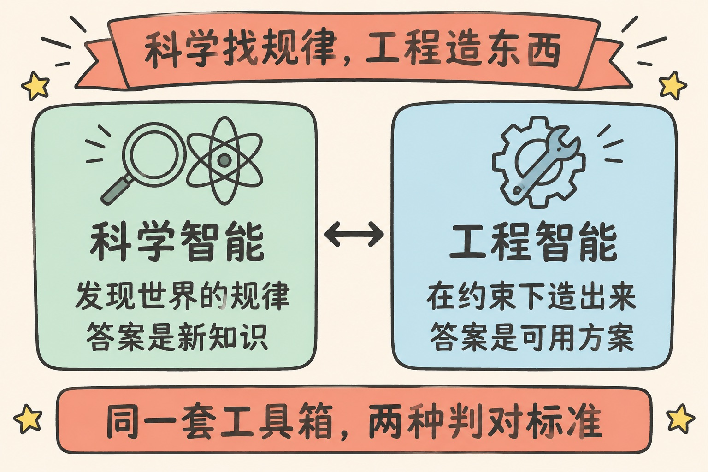
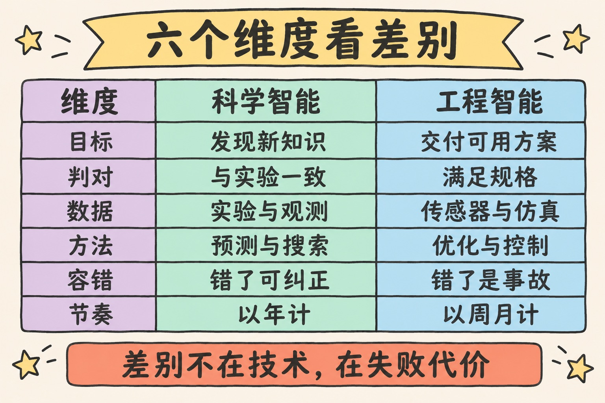
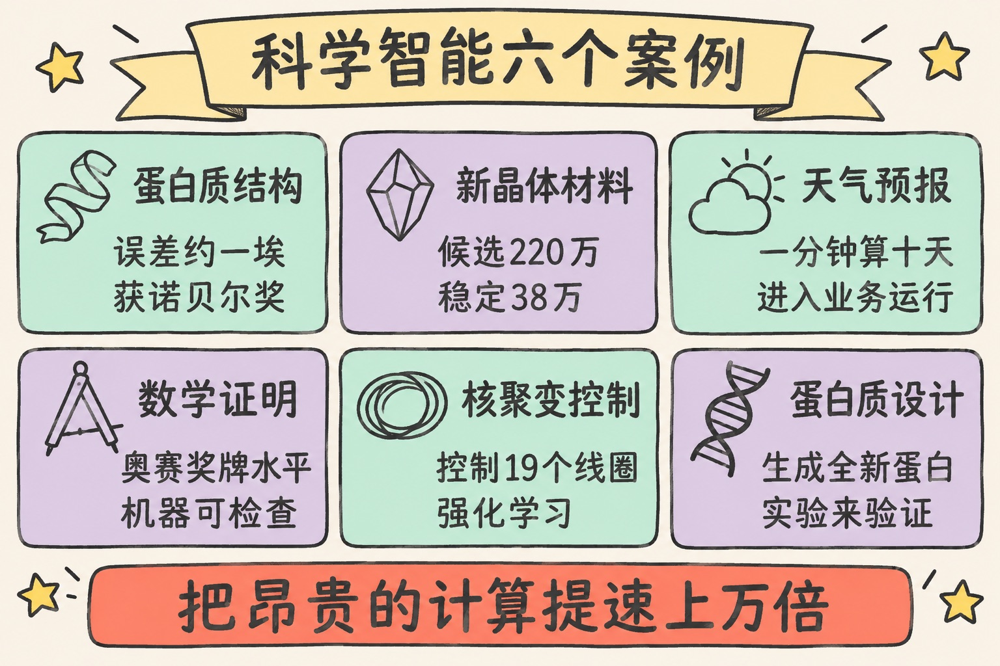
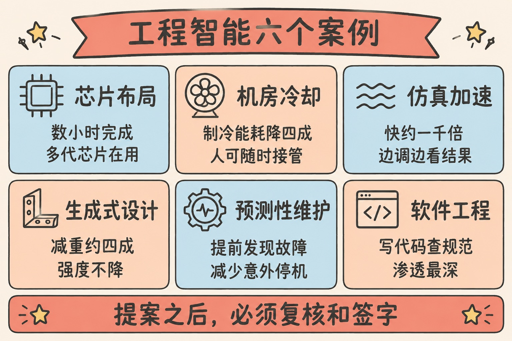
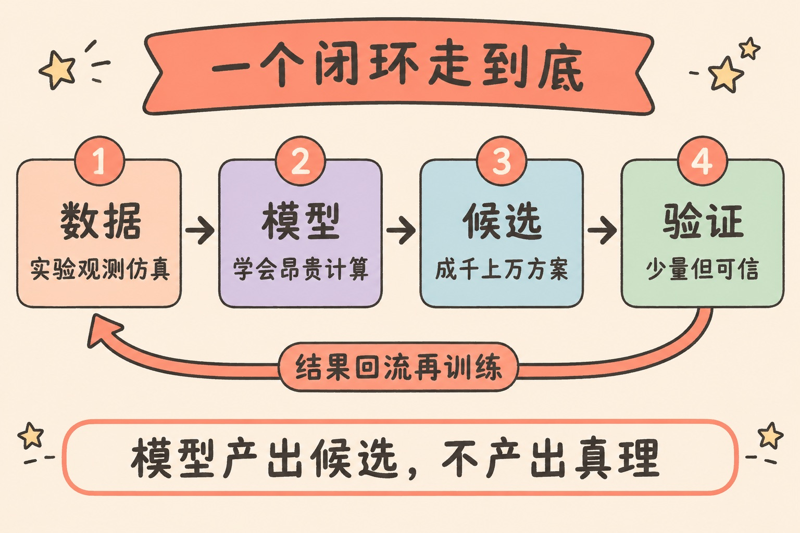
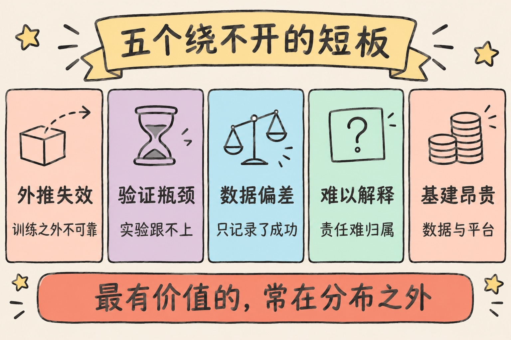

> AI for Science 回答“世界是什么样”，AI for Engineering 回答“东西怎么造出来”。两者用的是同一套工具箱，差别在于什么算对，以及错了要付出什么代价。

---

## 先讲结论

1. **AI for Science（AI4S）是让 AI 帮科学家发现规律。** 它的产出是一条新知识：一个结构、一种材料、一次预报、一个证明。对不对由实验和观测说了算。
2. **AI for Engineering（AI4E）是让 AI 帮工程师在约束下把东西造出来并跑得可靠。** 它的产出是一个可用的方案：一张版图、一个零件、一套控制策略。对不对由规格、成本和安全裕度说了算。
3. **两者共用一个闭环：数据 → 模型 → 候选 → 验证。** 模型不产生真理，只产生“值得去验证的候选”。真正的瓶颈常常是验证，不是算力。

这篇文章的起点很简单。我想给自己和同事讲清楚这两个词，于是先用一个单页 HTML 做了一份科普，再把它整理成这篇长文。页面怎么做的，放在倒数第二节。



---

## 一、先把两个词拆开看

这两个词经常被放在一起说，也经常被混着用。先各给一个定义。

### 一句话定义

- **AI for Science**：用机器学习加速“提出假设 → 做实验 → 验证”的科学循环。国内常译作“人工智能驱动的科学研究”，2023 年 3 月科技部会同自然科学基金委启动的专项部署用的就是这个名字。
- **AI for Engineering**：用机器学习在成本、安全、工期等约束下完成设计、优化、控制和运维。

### 人话解释

科学问的是“**是什么、为什么**”。这个蛋白质长什么样？有哪些还没被合成的稳定晶体？未来十天的大气怎么演化？

工程问的是“**怎么做、做得出来吗、可靠吗**”。这块芯片怎么布局最省功耗？这个零件怎么减重三成还不断裂？这台机器什么时候会坏？

### 类比理解

可以把 AI 在科学里的角色想成一位超快的“猜想生成器 + 模拟器”。它一天能提一百万个猜想，但哪个是真的，要等实验来裁决。

在工程里，它更像一位“在几百万种方案里挑最优解，并且盯着系统别出事”的助手。它挑出来的方案不能直接上线，要过规范校核，要有人签字。

### 六个维度的差别

| 维度 | AI for Science | AI for Engineering |
|------|----------------|--------------------|
| 目标 | 发现新知识：规律、结构、机制 | 交付可用的东西：产品、系统、决策 |
| 怎样算“对” | 与实验、观测一致，能被同行复现 | 满足规格：精度、成本、安全裕度、工期 |
| 数据从哪来 | 实验、观测、第一性原理模拟 | 传感器、CAD 模型、CFD/FEA 仿真、运行日志 |
| 典型方法 | 结构预测、代理模型、生成式假设搜索、自动定理证明 | 拓扑优化、强化学习控制、数字孪生、预测性维护 |
| 容错 | 错一次没关系，实验会纠正它 | 错一次可能是事故，要有保底方案和认证 |
| 节奏 | 以“发现”为里程碑，周期可以是几年 | 以“上线、交付”为里程碑，周期以周、月计 |

> 表里最重要的是倒数第二行。科学允许犯错，因为犯错是发现的一部分。工程不允许，因为错的那一次可能就是事故。这一条决定了两边对 AI 的用法完全不同。

顺带说一句“范式”。Jim Gray 把数据密集型科学称为第四范式，后来有人把 AI 驱动的科学研究叫作第五范式。这个词现在用得很滥，我在[范式：一个被用滥的词，和它原本的锋利](/posts/paradigm-kuhn-and-beyond/)里专门讨论过它的本义。这里只取它最朴素的意思：做科研的基本方式变了。



---

## 二、AI for Science：六个真实案例

下面这些都已经发表在期刊上，或者已经投入业务运行，不是概念演示。每个案例我只留一个最关键的数字。

| 年份 | 案例 | 关键数字 | 一句话说明 |
|------|------|----------|-----------|
| 2020–2021 | AlphaFold 2 预测蛋白质结构 | 骨架误差中位数约 1 Å | 从氨基酸序列直接算出三维结构。相关工作获 2024 年诺贝尔化学奖 |
| 2023 | GNoME 材料发现 | 220 万个新晶体候选，约 38 万个判定为稳定 | 图神经网络预测晶体稳定性，把已知稳定材料的数量扩大了近 10 倍 |
| 2023–2025 | GraphCast、盘古气象 | 0.25° 分辨率，10 天预报不到 1 分钟 | 传统数值预报要在超算上跑几小时。ECMWF 在 2025 年把自己的 AI 预报系统投入业务 |
| 2024–2025 | AlphaProof、AlphaGeometry 2、Gemini Deep Think | IMO 2024 银牌线，IMO 2025 金牌线 | 2024 年的系统把证明写成 Lean 代码，每一步都能被机器检查。2025 年的系统直接用自然语言作答，由竞赛协调员评分 |
| 2022 | 强化学习控制托卡马克 | 同时操控 19 个磁线圈 | 在瑞士 TCV 装置上，把比太阳核心还热的等离子体塑成指定形状 |
| 2023 | RFdiffusion 蛋白质设计 | 扩散模型 + 湿实验验证 | 反过来“画”出自然界没有的蛋白质，再送进实验室表达验证 |

1 Å 是 0.1 纳米，大约是一个原子的宽度。蛋白质结构预测做到这个精度，意味着它和实验测出来的结构基本重合。

### 这些案例的共同模式

科学问题里往往藏着一个“贵得要命的计算或实验”。量子化学计算、数值天气模式、湿实验，都属于这一类。

AI 学会了这个过程的近似版本，速度快上万倍。于是科学家可以把原来只能试几十次的事情，试上几百万次。

换句话说，AI4S 的本质不是“AI 比科学家聪明”，而是**搜索空间一下子变得搜得起了**。

### 两个需要说清楚的保留

- **“发现 220 万种新晶体”指的是预测，不是合成。** 伯克利的 A-Lab 报告用机器人在 17 天里合成了其中 41 种目标化合物。之后有学者发文质疑，认为其中相当一部分并不能算“新材料”。预测到验证之间还有很长的路。
- **RFdiffusion 已经站在科学和工程的交界上。** 生成一个能结合靶点的新蛋白，是科学问题。让它能表达、够稳定、能量产，就是工程问题了。



---

## 三、AI for Engineering：六个真实案例

工程的关键词是“约束”和“可靠”。AI 的价值通常落在三个环节：**设计**（找更好的方案）、**仿真**（算得更快）、**运行**（控制与维护）。

| 环节 | 案例 | 关键数字 | 一句话说明 |
|------|------|----------|-----------|
| 设计 | AlphaChip 芯片布局（2021） | 数小时完成原本数周的布局规划 | 把摆放宏单元看作一盘棋，用强化学习学摆放策略。成果已用于多代 TPU |
| 设计 | 生成式设计与拓扑优化 | 零件减重 40% 上下 | 给定载荷、材料和制造方式，算法“长”出像骨骼一样的结构。空客的仿生隔板、通用汽车的座椅支架是常被引用的例子 |
| 仿真 | 神经算子（FNO 等） | 比传统求解器快约三个数量级 | 学习“几何与边界条件 → 流场或应力场”的映射，设计师可以边调参数边看结果 |
| 运行 | Google 数据中心冷却调度（2016 起） | 制冷能耗降低 40% | 模型读取几千个传感器，定期给出控制设定。建议先过安全校验，人随时可以接管 |
| 运行 | 数字孪生与预测性维护 | 输入是振动、温度、电流时序 | 价值不在预测得多准，在于把计划外停机变成计划内检修 |
| 全流程 | 大语言模型辅助软件工程 | 目前 AI 渗透最深的工程分支 | 写代码、修 bug、把几百页行业标准变成可问答的知识库 |

### 工程里特有的一条规矩

模型给出的结果不能直接上线。桥梁要过规范校核，芯片要过时序签核，飞机要过适航认证。

所以 AI4E 的真实流程通常是三步：

```text
AI 提案  →  传统工具复核  →  人签字
（快，量大）   （慢，可信）      （担责）
```

这也是为什么工程界对“AI 替代工程师”的说法普遍冷静。AI 把“提案”这一步的成本打下来了，但“复核”和“担责”这两步的成本没变。

> AlphaChip 是个很好的提醒。它发表后，学界对它相对成熟商业工具到底有多大优势争论了好几年。工程成果的评价标准是“在同样约束下比现有工具好多少”，这比“能不能做”难回答得多。

工程数据的底子同样关键。传感器数据、仿真结果、运行日志如果没有治理好，后面的模型都是空中楼阁。这部分我在[从概念到落地：工业场景的数据治理与数据湖实战指南](/posts/industrial-data-lake-governance/)里写过。



---

## 四、它们共用的一个闭环和一套工具箱

不管是科学还是工程，AI 介入的方式几乎都可以画成同一个闭环。

| 环节 | 做什么 | 在科学里 | 在工程里 |
|------|--------|----------|----------|
| ① 数据 | 积累训练材料 | 实验、观测、模拟 | 传感器、仿真、日志 |
| ② 模型 | 学会“贵计算”的近似 | 结构预测、势函数 | 代理模型、控制策略 |
| ③ 候选 | 批量生成备选 | 假设、结构、分子 | 设计方案、控制动作 |
| ④ 验证 | 少量、昂贵、可信 | 做实验 | 仿真加规范校核 |

验证的结果再回流到数据，成为下一轮的训练材料。区别只在于“候选”是什么，“验证”有多贵。

### 工具箱里常见的六件东西

| 工具 | 英文 | 一句话说明 |
|------|------|-----------|
| 代理模型、神经算子 | surrogate、FNO、DeepONet | 用神经网络近似一个昂贵的物理求解器，换几个数量级的速度 |
| 物理信息神经网络 | PINN | 把守恒律、偏微分方程写进损失函数，数据少的时候也不违反物理 |
| 图神经网络 | GNN | 分子、晶体、电网、芯片网表都是“图”，天然适合它 |
| 生成模型 | diffusion、autoregressive | 在巨大的候选空间里“画”出新分子、新蛋白、新零件形状 |
| 强化学习 | RL | 把控制、布局、调度看作连续决策，用奖励信号学策略 |
| 大语言模型智能体 | LLM agent | 读文献、写代码、调用仿真器、规划实验，把前面的工具串起来 |

最后一项是这两年变化最快的。智能体到底由什么构成，可以看我之前写的[从入门到进阶：如何理解并打造属于你的 AI 智能体](/posts/ai-agent-guide/)。



---

## 五、八道边界题：这是科学问题还是工程问题

判断标准只有一条。如果答案是“一条新知识”，偏科学。如果答案是“一个在约束下能用的方案”，偏工程。先自己判断，再看右边两列。

| # | 题目 | 参考答案 | 理由 |
|---|------|----------|------|
| 1 | 给定一段氨基酸序列，预测它折叠后的三维结构 | 偏科学 | 输出是一条关于自然界的事实，用实验结构来检验 |
| 2 | 给无人机设计更轻的机臂，要求通过 1.5 倍载荷测试，且能用现有 3D 打印机生产 | 偏工程 | 目标是满足一组明确约束的可制造方案 |
| 3 | 根据过去 40 年的再分析数据，预测未来 10 天的全球大气状态 | 偏科学 | 对自然系统演化的预测，用后续观测打分。接进业务预报系统才进入工程范畴 |
| 4 | 数据中心有 2000 个传感器，决定每 5 分钟各台冷却泵的转速 | 偏工程 | 典型的受约束控制问题：省电是目标，温度上限是硬约束 |
| 5 | 设计一种能结合某病毒刺突蛋白的全新蛋白质，并在实验室表达出来 | 两者都算 | 能不能结合由自然决定，能表达、够稳定是工程约束 |
| 6 | 证明一道国际数学奥林匹克的几何题，并让 Lean 验证每一步 | 偏科学 | 答案是一条可被形式化检验的知识，不涉及制造或成本 |
| 7 | 给一块 5 nm 芯片摆放 3000 个宏单元，使布线最短且时序收敛 | 偏工程 | 组合优化加规范校核，输出是一张可以流片的版图 |
| 8 | 在 220 万个候选晶体里筛出稳定的，再用机器人合成其中几十种 | 两者都算 | 筛选稳定性是科学发现，自动合成平台的调度与配方是工程 |

第 5 题和第 8 题是故意设在边界上的。现实里越来越多的项目是这样：前半段是科学，后半段是工程，中间没有清晰的分界线。

---

## 六、它们做不到什么

科普不能只讲好消息。这两个方向的共同短板，基本都来自同一个事实：模型学的是数据里的分布，而科学与工程最有价值的地方，常常在分布之外。

| 短板 | 具体表现 |
|------|---------|
| 外推失效 | 训练数据覆盖不到的区域，模型会自信地给出错误答案。新材料、新工况、极端天气都在那里 |
| 验证瓶颈 | AI 一天能提 100 万个候选，实验室一年只能验证几百个。速度上限往往是实验，不是算力 |
| 数据偏差 | 已发表的结果偏向“成功”，失败的实验很少被记录，模型学不到“什么行不通” |
| 可解释性与责任 | 科学需要机制解释，工程需要责任归属。无法解释的预测很难写进论文，也很难通过安全认证 |
| 基础设施成本 | 高质量数据集、仿真器接口、自动化实验平台，这些不起眼的部分才是大头 |

数据偏差这一条值得多说一句。“什么行不通”这类知识，很多只存在于老工程师和老实验员的手感里，从来没被写下来。这正是 Polanyi 说的默会知识，我在 [Michael Polanyi：从化学家到「默会知识」的提出者](/posts/michael-polanyi/)里介绍过。模型能学到的，只是已经被写成数据的那一部分。

> 这里要特别警惕的是把“预测”当成“发现”。预测是候选，被实验确认之后才是发现。读到“AI 发现了多少种新材料”这类标题时，先问一句：验证了多少？



---

## 七、想入门，从哪里开始

两条路线需要同一个底子：把一门领域知识学扎实，再加上概率统计、线性代数和写代码的能力。然后分开走。

1. **偏科学的同学**：找一个有公开数据集和公开基准的问题。蛋白质结构有 PDB，材料有 Materials Project，气象有 ERA5 再分析资料。从复现一篇论文开始。
2. **偏工程的同学**：学会一个仿真工具，比如 OpenFOAM，或者 FreeCAD 加 CalculiX 这类开源组合。把它接到 Python 里，用 AI 做参数优化，完整体验一遍“提案 → 复核”。
3. **两边都适用**：先用传统方法把问题做一遍。知道“慢”在哪里，才知道 AI 该替换哪一步。

第三条最容易被跳过，也最重要。不知道传统求解器哪一步贵，就不知道代理模型该替谁。

---

## 八、复盘：我是怎么用一个 HTML 页面做这份科普的

这篇文章的前身是一个单页 HTML。我给 Claude 的原话只有一句：“什么 AI for science？AI for engineering？用 HTML 做个科普”。下面是这个页面的做法，也是这篇文章结构的来源。

### 输入与目标

输入是两个经常被混用的词。目标是让一个没接触过的人，十分钟内能分清它们，并且记住几个真实案例。

### 页面结构

页面一共七块，顺序就是读者的认知顺序：

1. **一句话定义**：两张并排的卡片，各放一个定义和四个典型问题。
2. **六维对比表**：把差别压成一张表。
3. **科学案例六个**、**工程案例六个**：每张卡片固定是“年份 + 机构 + 一个关键数字 + 两句话”。
4. **闭环图**：一张内联 SVG，四个节点加一条回流线。
5. **工具箱**：六种方法，各配一句话。
6. **互动测验八题**：三个按钮，答完显示理由。
7. **局限与入门建议**。

### 三个设计决定

**第一，用颜色做分类编码。** 科学线全程用蓝绿色，工程线全程用橙色。卡片顶边、表头、案例标题、图里的注释都遵守这一条。读者扫一眼就知道当前内容属于哪一边。

```css
:root {
  --sci: #0f7f88;   /* 科学：蓝绿，贯穿全页 */
  --eng: #cf5a14;   /* 工程：橙色，贯穿全页 */
}
/* 深色主题只重定义变量，组件样式一行都不用改 */
@media (prefers-color-scheme: dark) {
  :root { --sci: #3fc3c9; --eng: #f08a3c; }
}
```

**第二，每个案例只留一个数字。** “骨架误差约 1 Å”“制冷能耗 −40%”这样的数字，比三段背景介绍更容易被记住。数字还要带上领域自己的单位，埃、度、千赫，这些单位本身就是科普的一部分。

**第三，测验的数据和逻辑分开。** 八道题是一个数组，每题三个字段。整个测验的脚本不到五十行，没有用任何框架。

```js
// 每道题：题面、答案（sci / eng / both）、理由
var items = [
  { q: "给定一段氨基酸序列，预测它折叠后的三维结构。",
    a: "sci",
    why: "输出是一条关于自然界的事实，用实验结构来检验它。" },
  // ……其余七题同样的结构
];
```

想加题只需要往数组里加一行，这和工程里“配置与代码分离”是同一个道理。

### 反思：最容易出错的是事实，不是代码

页面本身一次就能跑。真正需要回头改的是事实表述。

初稿把 2024 和 2025 两届 IMO 的成绩写在同一张卡片里，并说“每一步证明都能被机器检查”。这句话对 2024 年的 AlphaProof 成立，它输出的是 Lean 证明。对 2025 年达到金牌线的 Gemini Deep Think 不成立，它是用自然语言作答、由人评分的。整理这篇文章时我把两者分开写了。

这件事和正文第六节讲的是同一个道理。**AI 生成的内容是候选，核对之后才能发布。** 写科普如此，做科研和做工程更是如此。

---

## 总结

1. **AI for Science 找规律，AI for Engineering 造东西。** 前者由实验裁决，后者由规格和安全裕度裁决。
2. **两者共用“数据 → 模型 → 候选 → 验证”这个闭环。** 模型把候选的成本打到接近零，验证的成本没变，所以瓶颈转移到了验证。
3. **读任何一条相关新闻，先问三个问题**：这是预测还是已验证？验证了多少？在同样约束下比现有方法好多少？

如果只记住一件事，那就是：AI 在这两个领域的角色都是“提案人”，不是“裁判”。裁判在科学里是实验，在工程里是规范和签字的人。

### 参考阅读

- Jumper et al., *Highly accurate protein structure prediction with AlphaFold*, Nature 2021. <https://doi.org/10.1038/s41586-021-03819-2>
- Merchant et al., *Scaling deep learning for materials discovery*（GNoME）, Nature 2023. <https://doi.org/10.1038/s41586-023-06735-9>
- Szymanski et al., *An autonomous laboratory for the accelerated synthesis of novel materials*（A-Lab）, Nature 2023. <https://doi.org/10.1038/s41586-023-06734-w>
- Lam et al., *Learning skillful medium-range global weather forecasting*（GraphCast）, Science 2023. <https://doi.org/10.1126/science.adi2336>
- Bi et al., *Accurate medium-range global weather forecasting with 3D neural networks*（盘古气象）, Nature 2023. <https://doi.org/10.1038/s41586-023-06185-3>
- Degrave et al., *Magnetic control of tokamak plasmas through deep reinforcement learning*, Nature 2022. <https://doi.org/10.1038/s41586-021-04301-9>
- Watson et al., *De novo design of protein structure and function with RFdiffusion*, Nature 2023. <https://doi.org/10.1038/s41586-023-06415-8>
- Mirhoseini et al., *A graph placement methodology for fast chip design*（AlphaChip）, Nature 2021. <https://doi.org/10.1038/s41586-021-03544-w>
- Li et al., *Fourier Neural Operator for Parametric Partial Differential Equations*, 2020. <https://arxiv.org/abs/2010.08895>
- Raissi, Perdikaris, Karniadakis, *Physics-informed neural networks*, Journal of Computational Physics 2019. <https://doi.org/10.1016/j.jcp.2018.10.045>

> 文中数字为量级说明，取自上述论文与各项目的官方介绍，具体以原文为准。
