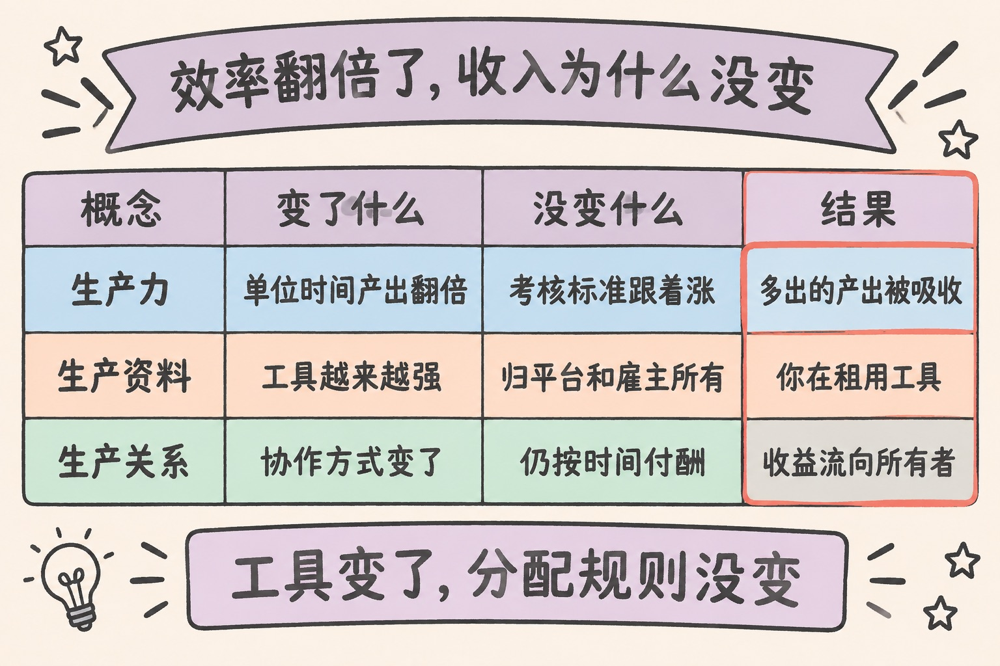
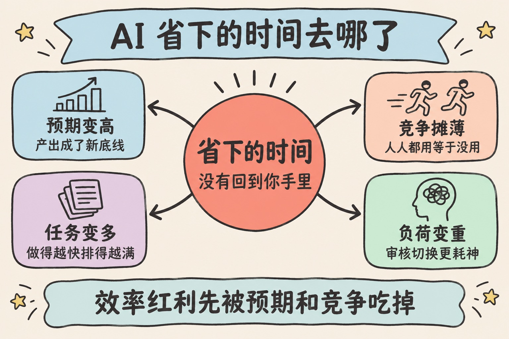
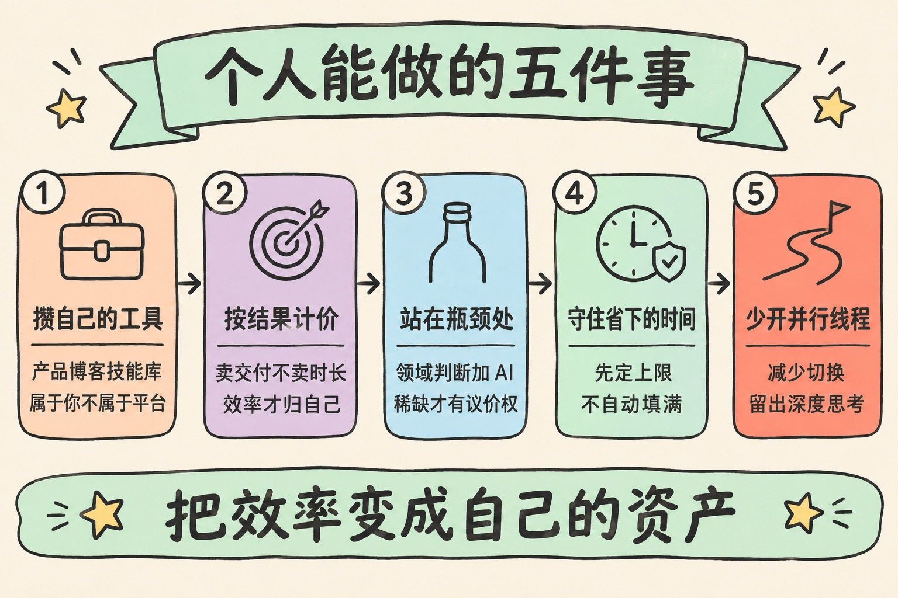

> 工具升级了，分配规则没升级。效率提升带来的好处会流向规则偏向的那一方。

## 先讲结论

1. **生产力确实提高了，但多出来的产出被吸收了**：先被更高的预期吸收，再被同行竞争摊薄，剩下的变成更重的认知负荷。
2. **新的核心生产资料不在你手里**：模型、算力、数据和平台属于 AI 公司和雇主，你是租用者。你的经验正被写成提示词和流程，这让你更容易被替代。
3. **生产关系基本没动**：大多数人仍然按时间和岗位拿工资。在这种关系下，单位时间产出提高，增加的价值首先归生产资料的所有者，这正是马克思说的「相对剩余价值」。历史上，这种错位持续过几十年。

所以「效率高了、收入没变、人更累」不是个人的错觉，而是这三个概念放在一起推出来的结果。

---

## 一、先把三个概念说清楚

| 概念 | 一句话解释 | 在 AI 时代对应什么 |
|------|-----------|------------------|
| 生产力 | 人利用工具改造世界、创造产出的能力 | 一个人一天能写多少代码、出多少方案、处理多少工单 |
| 生产资料 | 生产要用到的工具、设备、原材料、场地 | 大模型、算力、数据、软件平台、公司的业务系统 |
| 生产关系 | 生产过程中人与人的关系：谁拥有生产资料、怎么分工、成果怎么分配 | 雇佣合同、按月发薪、绩效考核、平台订阅、外包计价方式 |

马克思的基本判断是：生产力是最活跃的部分，变化快；生产关系相对稳定，变化慢。两者不匹配时，矛盾会积累，直到制度调整。

用这个框架看现在：**生产力在剧烈变化，生产资料的归属在集中，生产关系几乎没变。** 下面逐层拆开。

---

## 二、生产力：产出变多了，但被三样东西吸收

### 1. 被预期吸收

你用 AI 一天干完了原来三天的活，第一次是惊喜，第二次就成了标准。管理者和客户会很快把新的产出水平当成底线，考核标准随之上调。

这和 1865 年经济学家 Jevons 在《煤炭问题》（*The Coal Question*）里描述的现象同构：蒸汽机越省煤，煤的总消耗反而越多，因为用煤变便宜了，用的地方变多了。**工作也一样：单位任务的成本越低，被安排的任务越多。** 省下来的时间不会自动变成空闲，而是变成更多的任务。

### 2. 被竞争摊薄

如果只有你用 AI，你有优势；如果整个行业都用，这份优势就变成了入场门槛。竞争会把效率红利传导到价格上：报价变低、交付周期变短、客户期望更高。

这就是 [反内卷的同一套逻辑](/posts/anti-involution-same-logic/) 里讨论过的结构：大家都在同一个维度上加速，相对位置不变，绝对投入变大。

### 3. 被认知负荷抵消

AI 改变的不只是做多少，还有怎么做。以前的工作是「自己写」，现在变成「描述需求 → 等结果 → 判断对错 → 修改 → 再判断」。这个过程有几个隐性成本：

- **判断比执行累**：审核十段 AI 生成的代码，比自己写一段更消耗注意力，因为每一段都要假设它可能有错。
- **切换成本**：同时开几个 AI 会话、几条任务线，大脑一直在切换上下文。
- **边界消失**：AI 随时可用，手机上也能派活，工作和生活的边界被进一步打穿。

还有一个更反直觉的证据。METR 在 2025 年做过一个随机对照实验：16 名资深开源开发者在自己熟悉的大型仓库里完成 246 个任务，允许用 AI 的任务平均**多花了 19% 的时间**；而开发者事前预估 AI 能让自己快 24%，事后仍然觉得快了 20%。（这是 2025 年初工具水平下的结果，METR 自己也强调不能推广到所有场景。）它至少说明：**「感觉更高效」和「实际更高效」不是一回事，而「感觉很忙」是实打实的。**

调查数据也印证了这一点。Upwork 研究院 2024 年调查了 2500 名美、英、澳、加的从业者：96% 的高管预期 AI 会提升生产力，而 77% 使用 AI 的员工说 AI **增加了**他们的工作量。（这份调查由一家自由职业平台发起，方法论披露有限，适合作为信号而不是定论。）

---

## 三、生产资料：工具越来越强，但不归你

### 1. 新的核心生产资料高度集中

工业时代的核心生产资料是机器和厂房，归工厂主所有。AI 时代的核心生产资料是：

| 生产资料 | 谁拥有 |
|---------|-------|
| 基础模型 | 少数 AI 公司 |
| 算力 | 云厂商、芯片厂商 |
| 业务数据 | 雇主、平台 |
| 工作流和业务系统 | 雇主 |

个人能拥有的，通常只是一个订阅账号。**你在租用工具，而租来的工具产生的价值，分配规则由工具和岗位的所有者决定。**

### 2. 你的经验正在被「转写」成别人的生产资料

这一点最隐蔽。斯坦福和 MIT 的 Brynjolfsson 等人研究了 5000 多名客服人员使用 AI 助手的效果（NBER 工作论文 w31161，2023）：平均生产力提升约 14%，新手和低技能员工提升约 34%，而最资深员工几乎没有提升。

研究者的解释是：AI 把优秀员工的做法学了下来，再传给新手。从企业角度看这是好事；从老员工角度看，**自己多年积累的隐性经验，被转化成了企业拥有的、可以复制的资产。** 经验越容易复制，个人的议价能力越弱。

我们自己写提示词、整理工作流、沉淀 skill 也是同样的过程。区别只在于：这些东西最终归谁所有。

---

## 四、生产关系：按时间付酬，效率收益归所有者

### 1. 相对剩余价值

马克思在《资本论》第一卷里区分了两种增加剩余价值的方法：

- **绝对剩余价值**：延长工作时间。
- **相对剩余价值**：工作时间不变，提高生产效率，使劳动者「为自己干活」的那部分时间缩短，「为雇主干活」的那部分时间变长。

对一个拿月薪的人来说，工资对应的是时间和岗位，不是产出。AI 让每小时产出翻倍，如果工资和工时不变，多出来的价值就归了雇主。**这不需要任何人有恶意，规则本身就是这样设计的。**

马克思在讨论机器的章节里还提到「劳动强化」：机器缩短了工作日之后，资本会转而提高单位时间内的劳动密度。今天的对应物，就是上一节说的预期上调和认知负荷。

### 2. 议价能力在下降

收入能不能涨，最终取决于议价能力。而 AI 同时在三个方向上削弱它：

| 因素 | 机制 |
|------|------|
| 可替代性上升 | 新手借助 AI 就能达到中等水平，资深经验的稀缺性下降 |
| 产出难以归因 | 成果是「人 + AI」做的，个人贡献更难证明 |
| 威胁可信度上升 | 「这活 AI 也能干」成了压价的理由，哪怕实际上还干不了 |

### 3. 宏观数据：目前看不到收入变化

丹麦学者 Humlum 和 Vestergaard 把两轮大规模调查（覆盖 11 个高暴露职业、约 2.5 万名员工、7000 家单位）和丹麦的雇主-雇员行政数据对接，结论是：到 2024 年，AI 聊天机器人对收入和工时的影响在统计上接近零，置信区间排除了超过约 2% 的平均效应。平均节省的时间约 3%，而且节省的时间转化成工资的比例很低。（NBER 工作论文 w33777，2025；也有其他研究得出暴露职业收入上升的不同结论，这个问题还没有定论。）

这和我们的直观感受是一致的：**个人感觉效率提升很大，但落到收入上几乎看不到。**

---

## 五、历史上发生过同样的事

这不是 AI 独有的现象。

**恩格斯停顿（Engels' pause）**。经济史学家 Robert Allen 在 2009 年的论文里指出：英国工业革命期间，大约从 18 世纪 80 年代到 19 世纪 40 年代，人均产出持续增长，工人的实际工资却基本停滞，利润在国民收入中的占比上升。这段时期恰好是恩格斯写《英国工人阶级状况》的时代，所以被称为「恩格斯停顿」。工资真正开始跟上产出，要等到工会、工厂法、选举权扩大这些生产关系层面的调整之后。

**IT 生产率悖论**。1987 年，经济学家 Solow 说过一句很有名的话：「计算机时代随处可见，只是在生产率统计里看不到。」企业要花很多年重组流程、培训员工、调整组织，新技术的收益才会显现在数据里。

**凯恩斯的预言**。1930 年，凯恩斯在《我们后代的经济前景》里预测，一百年后人们每周工作 15 小时就够了。生产力的增长基本兑现了他的预期，工时却没有。多出来的生产力，变成了更多的消费、更多的工作和更激烈的竞争。

| 时期 | 生产力 | 劳动者感受 | 何时改变 |
|------|-------|----------|---------|
| 英国工业革命 | 人均产出持续上升 | 工资停滞、工时延长 | 几十年后的制度调整 |
| 计算机普及 | 设备和软件大量投入 | 统计上看不到提升 | 流程重组之后 |
| AI 普及（现在） | 个人产出明显上升 | 收入未变、更累 | 尚未发生 |

历史的经验是：**生产关系的调整一定会来，但很慢，而且不会自动发生。** 在这之前，个人能做的是调整自己在生产关系中的位置。

---

## 六、个人能做什么

既然问题出在生产资料归属和生产关系上，个人的对策也应该落在这两层，而不是单纯地更努力、更高效。

### 1. 攒属于自己的生产资料

把一部分 AI 带来的效率，投入到**你自己拥有**的东西上：一个产品、一个工具、一个博客、一个技能库、一份可复用的方法论。这些东西能持续产生价值，而且价值归你。

判断标准很简单：**如果明天离职，这份积累还在不在你手里？**

### 2. 从卖时间转向卖结果

按时间计酬时，效率收益归雇主；按结果计酬时，效率收益归自己。能接项目、能做咨询、能按交付物报价的场合，就不要按工时报价。在公司内部，也尽量争取以成果衡量的角色。

[生意赚钱的三个核心逻辑](/posts/business-money-logic/) 里讲过「卖什么」的问题，这里是同一个问题的另一面：卖时长还是卖结果，决定了效率提升归谁。

### 3. 站到瓶颈的位置

AI 把很多环节变得便宜了，稀缺的就变成了 AI 做不好的环节：领域判断、对结果负责、和真实世界打交道。比如在工业领域，懂工艺、懂设备、能判断模型结果靠不靠谱的人，配合 AI 的价值远大于单纯会用 AI 的人。

[AI 能力的锯齿状前沿](/posts/ai-capability-jagged-frontier/) 说明了一件事：AI 在某些任务上很强，在另一些任务上很弱。站在它弱的那一边，再用它强的那一边，议价能力就在你手里。

### 4. 守住省下来的时间

AI 省下来的时间，如果不主动守住，会被自动填满。可以给每天的任务量设上限，提前决定省下的时间用来做什么：学习、休息、做自己的项目，而不是默认接下一个任务。

### 5. 少开并行线程

同时开五个 AI 会话看起来很高效，代价是持续的切换和浅层注意力。把并行的任务线控制在少数几个，留出整块的时间做深度思考。深度思考恰好是 AI 最难替代、也最能拉开差距的部分。

---

## 总结

| 层面 | 发生了什么 | 个人对策 |
|------|----------|---------|
| 生产力 | 产出变多，但被预期、竞争和认知负荷吸收 | 守住省下的时间，少开并行线程 |
| 生产资料 | 新的核心工具集中在平台和雇主手里，经验被转写成别人的资产 | 攒属于自己的工具和作品 |
| 生产关系 | 仍按时间和岗位付酬，效率收益归所有者 | 尽量按结果计价，站到瓶颈位置 |

一句话：**AI 改变的是生产力，收入取决于生产关系。** 如果只提升效率而不改变自己在生产关系中的位置，效率越高，被吸收的就越多。

这也是一个可以用 [复杂问题分析五步法](/posts/complex-problem-analysis-five-steps/) 去拆的问题：效率提升 → 预期上调 → 任务增加 → 需要更高效率，是一个典型的强化回路；而真正的杠杆点不在「更快」，而在「谁拥有、怎么分配」。

## 参考阅读

- 马克思，《资本论》第一卷：第十章（相对剩余价值的概念）、第十三章（机器和大工业，劳动强化）。中文版章节编号按人民出版社版本。
- Robert C. Allen, "Engels' pause: Technical change, capital accumulation, and inequality in the British industrial revolution", *Explorations in Economic History*, 46(4), 2009.
- Robert Solow, "We'd better watch out", *New York Times Book Review*, 1987-07-12.
- William Stanley Jevons, *The Coal Question*, 1865.
- John Maynard Keynes, "Economic Possibilities for our Grandchildren", 1930.
- Erik Brynjolfsson, Danielle Li, Lindsey Raymond, "[Generative AI at Work](https://www.nber.org/papers/w31161)", NBER Working Paper 31161, 2023.
- Anders Humlum, Emilie Vestergaard, "[Large Language Models, Small Labor Market Effects](https://bfi.uchicago.edu/working-paper/large-language-models-small-labor-market-effects/)", 2025；NBER 版本见 [w33777](https://www.nber.org/papers/w33777)。
- METR, "[Measuring the Impact of Early-2025 AI on Experienced Open-Source Developer Productivity](https://metr.org/blog/2025-07-10-early-2025-ai-experienced-os-dev-study/)", 2025-07-10.
- Upwork Research Institute, "[From Burnout to Balance: AI-Enhanced Work Models](https://www.upwork.com/research/ai-enhanced-work-models)", 2024.
- 站内相关：[把赚钱当成工程问题](/posts/money-as-engineering-problem/)
