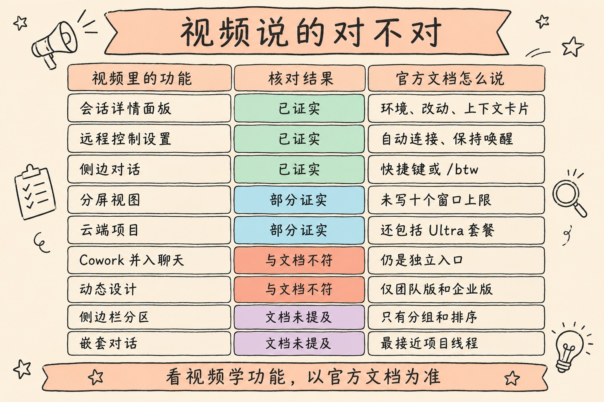
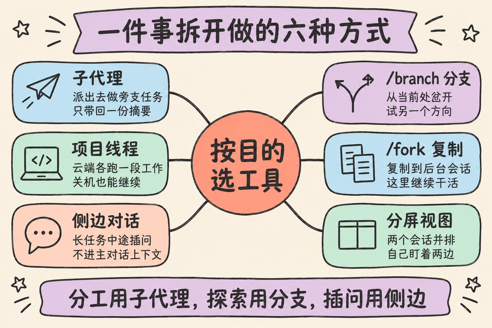
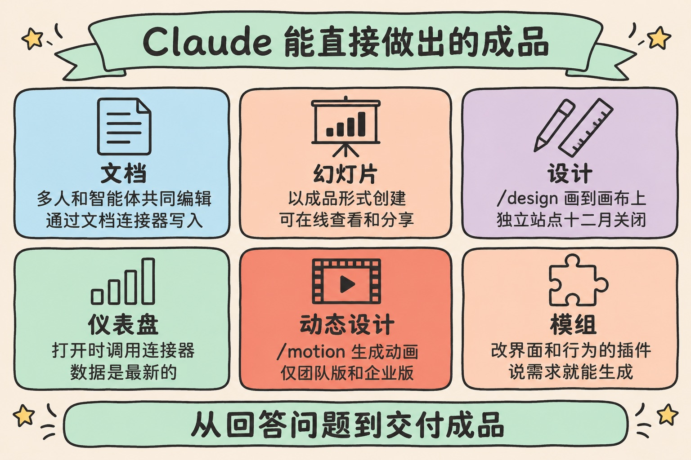

> 视频适合发现新功能，官方文档才适合确认新功能。

最近看到一个介绍 Claude 新版桌面应用的视频，讲了十个更新：会话面板、远程控制、侧边对话、分屏、嵌套对话、云端项目、各种成品（Artifacts）、`/doctor`、`/output-style`、模组（Mods）。视频讲得很生动，但其中有些说法我拿不准，于是逐条对照了 Anthropic 的官方文档。

核对时间是 2026 年 11 月 27 日，主要依据 Claude Code 文档里的 Desktop、Remote Control、Projects、Artifacts、Commands、Mods 几个页面，以及 Claude 帮助中心关于 Claude Design 迁移的文章。产品更新很快，以后读到这篇时，请以官方文档的最新版本为准。

## 先讲结论

1. **大部分功能属实**：会话详情面板、远程控制的几个设置项、侧边对话（`/btw`）、分屏、云端项目、`/doctor`、`/output-style`、模组都能在官方文档里找到。
2. **有三处和文档不符**：Cowork 并没有并入聊天，仍是独立入口；动态设计（Motion）只开放给团队版和企业版；云端项目的可用套餐除了 Pro 和 Max 还有 Ultra。
3. **有两处在文档里找不到**：「侧边栏分区」和「嵌套对话」。和嵌套对话最接近的官方概念是项目（Projects）里的线程，以及把旁支任务交给子代理的 `/subtask`。

---

## 一、逐条核对结果

| 视频里的说法 | 核对结果 | 官方文档怎么说 |
|------------|---------|--------------|
| 桌面应用只剩聊天和代码两个入口，Cowork 并入聊天 | 与文档不符 | Desktop 页面写的是：Claude Code 是 **Code** 标签页，应用里还有聊天和 Cowork。并入 Claude 的是 Claude Design，不是 Cowork |
| 右侧会话面板显示环境、远程控制、上下文占用 | 已证实 | 会话详情面板由几张卡片组成：Environment（含远程控制开关）、Changes（改动统计）、Context（上下文占用百分比，点开可按类别查看） |
| 面板里能看到记忆、skill、MCP 各占多少，还有连接器和输出文件 | 部分证实 | 文档只说上下文「按类别」显示，没有逐项列出；连接器和输出文件卡片没有找到 |
| 设置里可以让新会话自动连远程控制、保持电脑唤醒 | 已证实 | **Settings > Code** 里有 **Connect new sessions to Remote Control** 和 **Keep this computer awake for Remote Control** |
| 侧边栏可以建「分区」，把对话移进去 | 文档未提及 | 只找到会话列表的 **Group and sort**（分组和排序） |
| 嵌套对话：主对话派出子对话，做完汇报，还能进去接着聊 | 文档未提及 | 没有同名功能。最接近的是项目线程和 `/subtask` |
| 侧边对话不打扰主任务，相当于 `/btw` | 已证实 | 快捷键 **Cmd+;**（Windows 为 **Ctrl+;**），或输入 `/btw` |
| 分屏视图，最多 10 个窗口 | 部分证实 | 分屏存在；10 个窗口上限文档里没有写 |
| Claude Code 项目在云端跑，关机也能继续，Pro 和 Max 可用 | 部分证实 | 云端运行、共享记忆、公开测试都属实；套餐是 Pro、Max 和 Ultra，逐步开放 |
| 动态设计 Pro 和 Max 还用不了，「应该很快会加」 | 与文档不符 | 文档写明 `/motion` 需要团队版或企业版账号，以及 Claude Code v2.1.323 或更高版本。是否会开放给个人套餐，文档没有说 |
| `/doctor` 检查 skill 和 CLAUDE.md 是否过时 | 已证实（有细节差异） | 默认的 `/doctor` 检查安装、设置、扩展和 CLAUDE.md 问题；专门检查「过时或冲突指令」的是 `/doctor prompt-audit` |
| 模组：用大白话描述就能做出改变界面和行为的插件 | 已证实 | 模组是由 JavaScript 或 TypeScript 事件处理程序组成的插件；在会话里描述需求，Claude 会帮你写出来 |



---

## 二、能直接用的功能和入口

### 1. 会话详情面板

在 Code 标签页里，聊天旁边的一组卡片就是会话详情面板：

- **Environment**：会话在哪里运行（本地、SSH 或云端），远程控制开关也在这里。
- **Changes**：这次会话改了多少代码。
- **Context**：上下文用了多少，点开能按类别看是谁占用的。

Context 卡片的价值在于把「看不见的成本」摆出来。每次新开会话，记忆文件、skill 列表、MCP 工具定义都会先被加载。装得越多，还没开口就已经用掉一部分上下文和额度。命令行里对应的是 `/context` 命令。

### 2. 远程控制

远程控制让你在手机上的 Claude 应用或 claude.ai/code 里，接着操作电脑上正在运行的 Claude Code 会话，会话本身仍在你的电脑上跑。命令行、桌面应用、VS Code 扩展都能开启，要求 Claude Code v2.1.51 或以上；团队版和企业版需要管理员先打开开关。

桌面应用的 **Settings > Code** 里有两个值得打开的选项：

| 设置项 | 作用 |
|-------|------|
| Connect new sessions to Remote Control | 新会话自动连上远程控制，不用每次手动开 |
| Keep this computer awake for Remote Control | 防止电脑在任务中途睡眠 |

我之前写过 [用 Telegram 远程遥控 Claude Code](/posts/claude-code-telegram-remote/)，那是通过消息渠道插件实现的。两者的区别是：远程控制在手机上看到的是完整的会话界面；Telegram 方案只收发文字，但可以用任何能发消息的设备，也方便接入定时任务的推送。两者可以并用。

### 3. 侧边对话

长任务跑到一半，想问个问题又不想打断它，就用侧边对话：

```text
Cmd+;            # macOS 打开侧边对话
Ctrl+;           # Windows
/btw <问题>       # 在输入框里直接问一个旁支问题
```

文档里有两点值得注意：侧边对话**能读到主对话到此刻为止的全部内容**；侧边对话里 Claude 的回答**不会自动进入主对话**。所以它适合问「刚才那段代码为什么这样写」这类问题，不会污染主任务的上下文。侧边对话支持本地、SSH 和 WSL 会话。

### 4. 分屏视图

```text
按住 Option（Windows 为 Alt）点击侧边栏里的会话
或：右键会话 → Open in → Split view
退出分屏：Cmd+Ctrl+W（Windows 为 Ctrl+Alt+W）
```

视频说可以把一个聊天拖进当前聊天，还说最多放 10 个窗口，这两点文档里都没有找到。拖动只适用于会话内部的面板。

---

## 三、「嵌套对话」到底对应什么

视频里花了很大篇幅讲嵌套对话，并把它和分支对话、子代理做了区分。这个区分的思路是对的，但「嵌套对话」这个名字在官方文档里找不到。对照文档，一件事拆开做，现在有这几种官方方式：

| 方式 | 官方描述（意译） | 适合什么 |
|------|--------------|---------|
| 子代理 | 在一个会话里用独立的上下文做旁支任务，把摘要交回会话 | 查资料、读大量文件，只要结论 |
| `/subtask` | 把一个旁支任务交给子代理，结果回到当前对话 | 同上，显式触发 |
| 项目线程 | 独立的会话，有自己的上下文，做完一块工作向协调对话汇报 | 多块工作并行，需要能单独进去继续聊 |
| `/branch` | 从当前位置建一个对话分支，切过去，保留原对话 | 试另一种方案 |
| `/fork` | 把当前对话复制到一个新的后台会话，自己留在这里继续 | 让一个副本去跑，自己接着干 |
| 侧边对话 | 读主对话内容，但回答不进入主对话 | 中途插问 |

视频描述的「每个子对话都是一个完整的聊天，可以进去接着聊，做完会汇报」，和文档里的**项目线程**最吻合。有第三方文章提到桌面应用在 2026 年 10 月加入了嵌套会话，但我在官方文档里没有找到对应描述，这里不下结论。



---

## 四、Claude Code 项目（Projects）

项目适合「一个目标、多块工作、要持续推进」的场景。文档里的要点：

- **一个协调对话加多个线程**：每个线程是一个独立会话，有自己的上下文，做完一块工作向协调对话汇报。
- **线程通常在云端运行**：云端线程在你合上电脑后会继续跑；在你自己电脑上运行的线程，只在电脑醒着时运行。
- **共享记忆**：每个云端线程启动时会读取项目的 `MEMORY.md` 索引，也会带上项目说明。项目记忆和本机 Claude Code 的自动记忆是两套东西。
- **可用范围**：公开测试，Pro、Max、Ultra 套餐，逐步开放；团队版和企业版暂未提供。

视频里提到一个实用建议：项目在云端运行，看不到你电脑上的 skill 和文件，所以要趁电脑开着时，让 Claude 把项目需要的技能和资料整理好、加进项目里。这一点和文档对「云端线程」的描述一致，值得照做。

---

## 五、成品：文档、幻灯片、设计、仪表盘、动态设计

视频把这些统称为成品（Artifacts）。对照文档：

| 类型 | 入口 | 文档要点 |
|------|------|---------|
| Claude 文档 | 文档连接器 | 在 Claude Code 里以 `claude.ai Claude Docs` 连接器出现。视频说的「多标签页、和智能体实时协作」文档里没有找到原话 |
| 幻灯片 | 新建成品 | 新建设计、设计系统或幻灯片时，都以成品形式创建。导出 PPT 和直接演示，我没在核对的页面里找到 |
| 设计 | `/design <需求>` | 在画布上画出画板，发布为 Claude Design 成品，可导出 PNG 或 PDF。独立站点 claude.ai/design **2026 年 12 月 14 日关闭**，原有项目迁移为成品 |
| 仪表盘 | 连接器支持的成品 | 每次有人打开时调用 MCP 连接器取数据，所以显示的是最新数据。需要 Claude Code v2.1.209 或以上 |
| 动态设计 | `/motion <需求>` | 需要 v2.1.323 或以上，**仅团队版和企业版** |

Claude Code 里的成品功能面向 Pro、Max、Ultra、团队版和企业版；团队和企业的管理员可以在组织设置里按类型开关。

对 Claude Design 的老用户来说，12 月 14 日是个硬截止：独立站点的公开链接会失效，聊天记录和评论不会迁移，需要的内容要提前处理。



> 图里第六格的模组严格说不属于成品，它是改变 Claude Code 本身的插件，放在一起是为了一张图看全「Claude 能交付什么」。

---

## 六、三个命令和模组

### `/doctor`：给配置做体检

`/doctor` 检查安装、设置、扩展和 CLAUDE.md 的问题，提出修复建议，你确认后由 Claude 执行。它会权衡没用到的 skill 占用的上下文成本，也会指出 CLAUDE.md 里重复的、或者能从代码直接推出来的内容。

视频说它能检查「过时」的内容，这个功能对应的是另一个子命令：

```text
/doctor                # 常规体检：安装、设置、扩展、CLAUDE.md
/doctor prompt-audit   # 专查过时或互相冲突的指令
```

skill 和 CLAUDE.md 是会「腐烂」的：项目变了、模型变了，旧指令可能变成噪音甚至误导。我在 [Claude Code advisor 顾问工具](/posts/claude-code-advisor-tool/) 那篇里也提到过，配置是需要定期维护的资产。

### `/output-style`：改变回答风格

```text
/output-style            # 列出可用风格
/output-style concise    # 切换到简洁风格
```

需要 Claude Code v2.1.269 或以上。也可以在 `~/.claude/output-styles/` 下自己写风格文件。

### 模组（Mods）

文档的定义是：模组是改变 Claude Code 外观和行为的插件，由 JavaScript 或 TypeScript 事件处理程序组成。做法就是在会话里描述你想要什么，由 Claude 写出来。

几个限制：

- 命令行需要 v2.1.287 或以上，桌面应用需要 v2.1.286 或以上（用 `/status` 查版本）。
- 在桌面应用里，模组在 Code 标签页运行，WSL 和 SSH 会话除外。
- 模组不能改动权限确认弹窗。

视频里的例子是把一大段语音口述先整理成结构化指令，再交给 Claude 处理。对经常用语音转文字下指令的人，这是个很实用的思路。

---

## 七、我的使用建议

| 场景 | 推荐做法 |
|------|---------|
| 离开电脑还想跟进任务 | 打开远程控制的两个设置项；或继续用消息渠道方案 |
| 长任务中途有疑问 | 用侧边对话或 `/btw`，别在主对话里插话 |
| 只要结论的调研 | 交给子代理，主对话只收摘要 |
| 多块工作要持续推进，关机也要跑 | 用项目，提前把 skill 和资料放进项目 |
| 想对比两种方案 | 用 `/branch` |
| 配置越积越多 | 每隔一段时间跑一次 `/doctor` 和 `/doctor prompt-audit` |

最后提醒一点：分屏、项目、并行线程都在鼓励「同时做更多事」。工具允许开 10 个窗口，不代表人脑能同时盯住 10 件事。我在 [用了 AI 效率翻倍，为什么人更累了](/posts/ai-productivity-relations/) 里讨论过这个问题：并行开得越多，切换成本越高。建议从两个并排开始。

---

## 总结

- 这次更新的主线是：**Claude 从「回答问题」走向「并行干活」和「交付成品」**。会话面板、远程控制、侧边对话、分屏、项目解决的是并行和跟进；文档、设计、仪表盘、动态设计解决的是交付。
- 视频里大部分功能属实，但入口名称、套餐范围、上限数字有出入。「嵌套对话」「侧边栏分区」在官方文档里找不到对应描述。
- 学新功能的稳妥顺序：看视频知道有什么，查官方文档确认怎么用，在自己的版本里试一遍。

## 参考阅读

- [Claude Code Desktop 文档](https://code.claude.com/docs/en/desktop)：会话详情面板、侧边对话、分屏、会话管理。
- [Remote Control 文档](https://code.claude.com/docs/en/remote-control)：远程控制的开启方式和版本要求。
- [Projects 文档](https://code.claude.com/docs/en/projects)：协调对话、线程、共享记忆、可用套餐。
- [Artifacts 文档](https://code.claude.com/docs/en/artifacts)：成品类型、连接器支持、版本要求。
- [Commands 参考](https://code.claude.com/docs/en/commands)：`/btw`、`/branch`、`/fork`、`/subtask`、`/doctor`、`/output-style`、`/design`、`/motion`。
- [Mods 文档](https://code.claude.com/docs/en/mods)：模组的定义、版本要求和限制。
- [Move from standalone Claude Design to Claude](https://support.claude.com/en/articles/17440474-move-from-standalone-claude-design-to-claude)：Claude Design 独立站点关闭与迁移说明。
