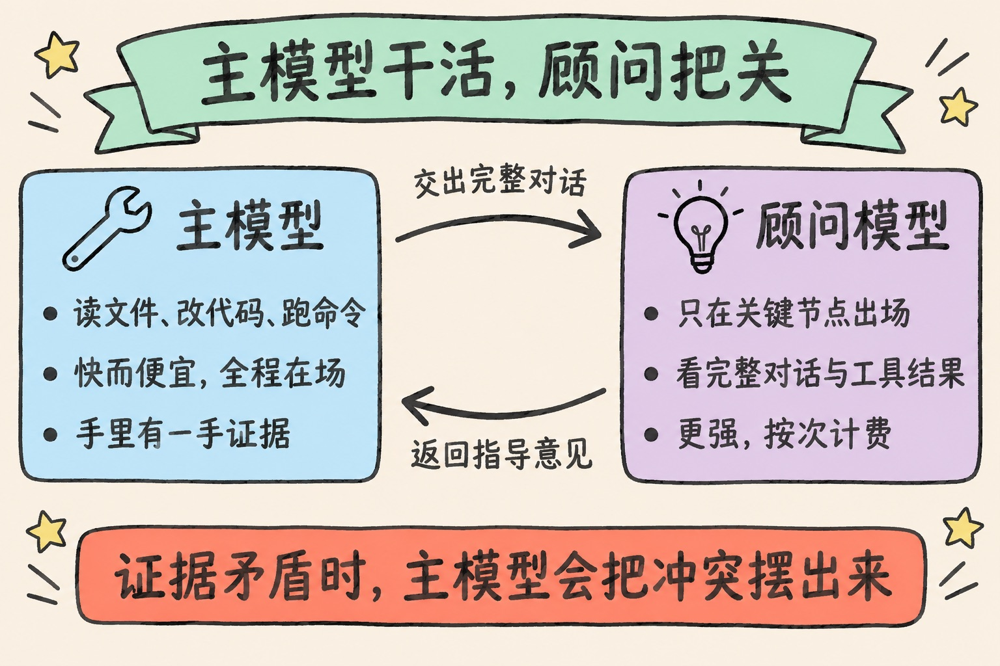
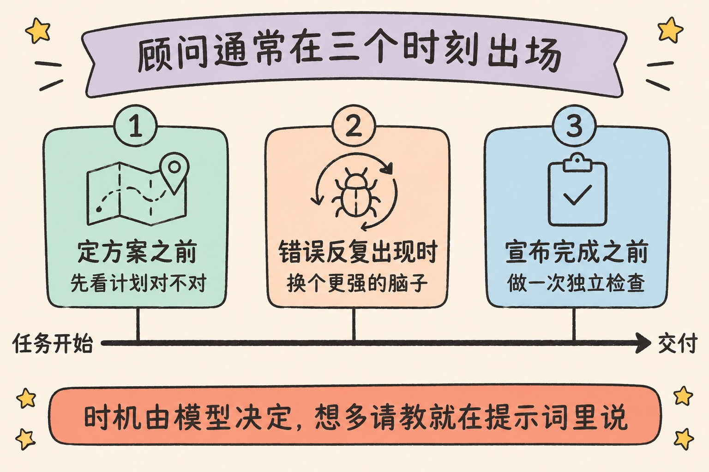
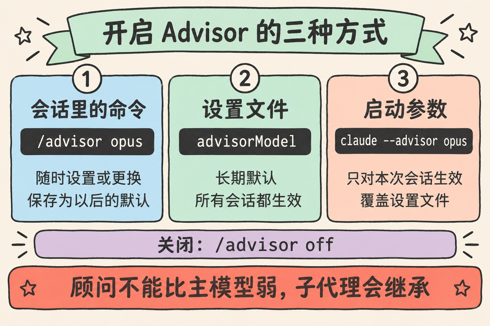
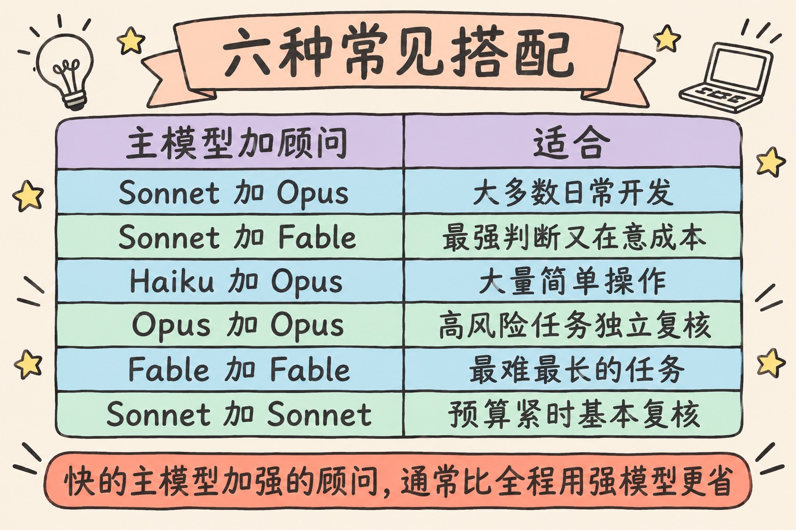
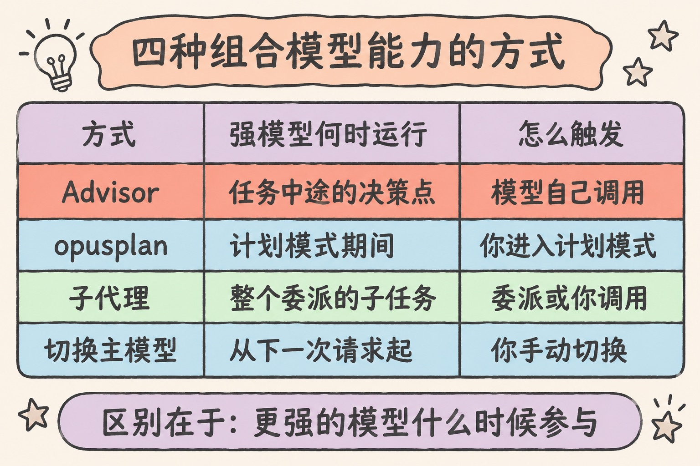
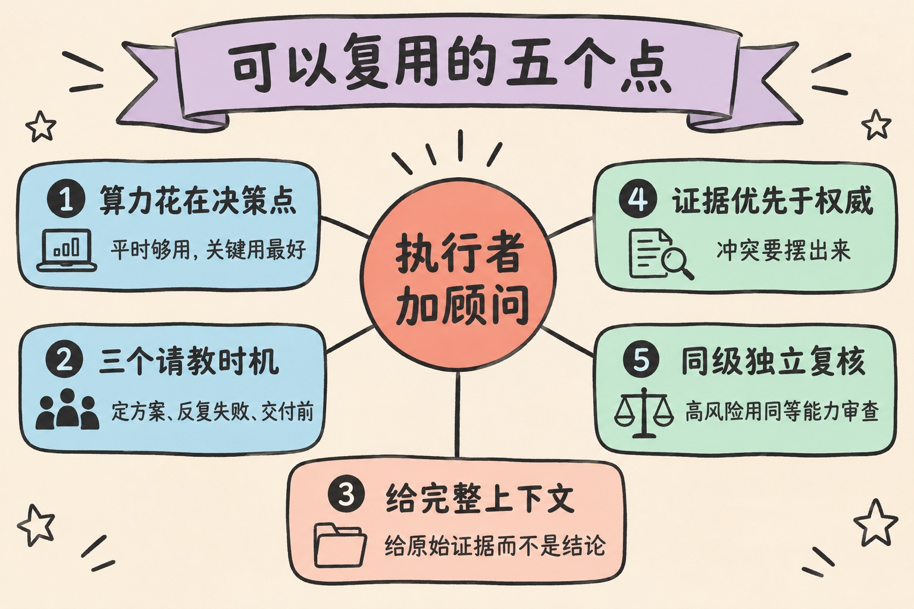

> 长任务里，大部分步骤是体力活，只有少数几个决策点决定成败。Advisor 的思路很简单：**平时让一个快而便宜的模型干活，到了关键节点，再请一个更强的模型来把关。**

---

## 先讲结论

1. **Advisor 是什么**：Claude Code 的一个实验性功能。主模型在任务中途的关键节点，把**完整对话**交给一个更强的「顾问模型」，拿回指导意见后再继续。
2. **为什么划算**：顾问只在决策点出场，不是每一轮都调用。官方的说法是，「快的主模型 + 强的顾问」通常比全程用强模型更便宜。
3. **怎么用**：一条命令 `/advisor opus` 就能开，也可以写进设置文件或用启动参数；想让它多请教，直接在提示词里说「继续之前先咨询 advisor」。

> 本文内容整理自 Claude Code 官方文档 [Escalate hard decisions with the advisor tool](https://code.claude.com/docs/en/advisor)（2026 年 11 月版本）。文档明确说明该功能仍是实验性的，行为、价格和可用范围都可能变化，使用前请以最新文档为准。

---

## 什么是 Advisor？

### 一句话定义

官方定义：advisor 工具让 Claude 在任务的关键时刻，去请教第二个、通常更强的模型。比如**在确定方案之前、在同一个错误反复出现时、在宣布任务完成之前**。顾问会收到完整对话，包括每一次工具调用和结果，然后返回指导意见，Claude 采纳后再继续。

### 人话解释

你雇了一个手脚麻利的工程师（主模型）干活，又请了一位资深专家（顾问模型）当顾问。工程师日常自己干，遇到「方案怎么定」「这个 bug 为什么老修不好」「这活算不算干完了」这类关键问题，就把来龙去脉原原本本讲给专家听，听完建议再动手。

### 类比：主刀医生和会诊专家

| 医院 | Claude Code |
|------|-------------|
| 主治医生，负责日常查房、开药、处理 | 主模型：读文件、改代码、跑命令 |
| 会诊专家，只在疑难节点被请来 | 顾问模型：只在决策点被调用 |
| 会诊时看完整病历 | 顾问看完整对话和全部工具调用结果 |
| 主治医生参考意见，但会根据新检查结果调整 | 主模型参考指导，但证据矛盾时会指出冲突 |



---

## 它是怎么工作的

### 什么时候请教顾问

**由 Claude 自己决定**。文档说，它倾向于在三个时刻请教：

1. **确定方案之前**：动手之前，先让顾问看看计划对不对；
2. **错误反复出现时**：同一个问题修了几次还在，换个更强的脑子看看；
3. **宣布完成之前**：交付前做一次独立检查。

但文档也强调，这个时机是「由模型驱动，而不是由规则驱动」的。**没有任何设置可以限制或强制调用次数**。如果你希望它多请教或少请教，就直接在提示词里说，比如「继续之前先咨询 advisor」。



### 顾问看到什么、返回什么

- **看到的**：始终是完整对话，包括每一次工具调用和结果；
- **返回的**：指导意见，主模型采纳后继续；
- **不是盲从**：文档特别说明，主模型一般会遵循顾问的建议，但如果自己的证据与之矛盾，比如建议的步骤一试就失败，或文件内容和建议对不上，它会**把冲突摆出来**，而不是无条件照做。

这一点很关键：顾问看的是对话记录，主模型手里有一手证据。两者冲突时以证据为准，这才是靠谱的协作。

### 你在界面上会看到什么

| 状态 | 界面显示 | 怎么查看详情 |
|------|---------|-------------|
| 请教中 | `Advising` 加上顾问模型的名字 | — |
| 已审阅 | 显示顾问已审阅对话 | 按 `Ctrl+O` 查看指导内容 |
| 拒绝 | `Advisor declined to advise on this request` | 有原因时按 `Ctrl+O` 查看 |
| 不可用 | `Advisor unavailable (<error_code>)` | 错误码就在提示里 |

---

## 怎么开启和关闭

文档给了三种方式，适用于不同场景：



### 方式一：会话里用 `/advisor` 命令

```text
/advisor            # 不带参数：打开选择器
/advisor opus       # 直接指定顾问模型
/advisor off        # 关闭
```

选择会保存到用户设置里的 `advisorModel`，之后的会话也会沿用。在非交互模式（`-p`）、Agent SDK、桌面应用、Remote Control 这些没有终端选择器的地方，`/advisor` 不带参数会打印当前顾问和可用的别名（需要 Claude Code v2.1.260 或更高版本）。

### 方式二：写进设置文件，作为长期默认

```json
{
  "advisorModel": "opus"
}
```

### 方式三：启动参数，只对本次会话生效

```bash
claude --advisor opus
```

这个参数会覆盖设置文件里的 `advisorModel`，而且**不会出现在 `claude --help` 里**。如果主模型不支持 advisor、指定的模型不能当顾问（比如 Haiku 4.5）、或被管理员的 `availableModels` 白名单排除，启动会直接报错退出。

开启后，会话里会提示：`Advisor Tool (experimental) is on and may use more tokens · /advisor`。

### 彻底禁用

```bash
export CLAUDE_CODE_DISABLE_ADVISOR_TOOL=1
```

设置这个环境变量后，`/advisor` 不可用，`advisorModel` 被忽略，`--advisor` 参数虽然能传但不起作用。

---

## 怎么选顾问模型

### 基本规则：顾问不能比主模型弱

顾问模型名可以写别名 `fable`、`opus`、`sonnet`（会解析到当前 Claude Code 版本内置的默认版本，随版本升级而前进），也可以写完整 ID，比如 `claude-opus-5-5`。

如果设置的顾问比主模型弱，Claude Code **不会挂载它**，并给出提示。还有一个容易忽略的点：**子代理会继承配置的顾问**，并按它们自己的模型重新检查搭配是否合格。

官方的搭配表（每一行是主模型，后面是它能接受的顾问）：

| 主模型 | 可接受的顾问 |
|--------|------------|
| Haiku 4.5 | Fable、Opus、Sonnet、Haiku 5.5 |
| Sonnet 4.6 | Fable、Opus、Sonnet、Haiku 5.5 |
| Opus 4.6 | Fable、Opus、Sonnet 5 及以上、Haiku 5.5 |
| Sonnet 5 或 Haiku 5.5 | Fable、Opus 4.7 及以上、Sonnet 5 及以上、Haiku 5.5 |
| Opus 4.7 或 Opus 4.8 | Fable、Opus 4.7 及以上、Sonnet 5.5 |
| Sonnet 5.5 | Fable、Opus 5 及以上、Sonnet 5.5 |
| Opus 5 或 Opus 5.5 | Fable、Opus 5 及以上 |
| Fable 5 | Fable 5.2、Fable 5.1 或 Fable 5 |
| Fable 5.1 | Fable 5.2 或 Fable 5.1 |
| Fable 5.2 | Fable 5.2 |

注意：Haiku 4.5 可以**调用**顾问，但不能**当**顾问。

### 六种常见搭配



| 主模型 + 顾问 | 官方描述 | 适合 |
|--------------|---------|------|
| Sonnet + Opus | Sonnet 处理日常工作，把规划、模糊的失败和完成检查交给 Opus | 大多数日常开发 |
| Sonnet + Fable | 在决策点获得 Fable 的指导，而不必全程运行 Fable；需要 Fable 权限 | 想要最强判断、又在意成本 |
| Haiku + Opus | 主模型成本最低，同时有强规划；比单用 Haiku 贵，但比把主模型换成 Sonnet 或 Opus 便宜 | 大量简单操作 + 少量关键决策 |
| Opus + Opus | 第二个 Opus 审查第一个；独立检查比成本更重要的高风险任务 | 涉及安全、生产、资金的改动 |
| Fable + Fable | 有 Fable 时能力最强的搭配；Fable 主模型不会挂载 Opus 或 Sonnet 顾问 | 最难、最长的任务 |
| Sonnet + Sonnet | 成本较低的第二意见，用来发现常规疏漏 | 预算紧时的基本复核 |

### Fable 顾问的计费提醒

在部分套餐上，Fable 的用量按 **usage credits（用量额度）** 计费，Fable 当顾问也一样。首次使用前需要一次性同意：先运行 `/model fable`，选择继续使用 Fable，Claude Code 记录同意后，再把 Fable 设为顾问。在同意之前，`/advisor fable` 不会保存，`claude --advisor fable` 会在启动时报错。

---

## 成本与缓存

**成本**：每次请教顾问，都按**顾问模型的费率**额外消耗 token。API 计费账户按顾问模型的输入输出单价付费；订阅套餐计入套餐用量（Fable 顾问在相应套餐上计入 usage credits）。顾问的用量会算进 `/usage` 显示的会话总量。

官方的核心论点是：Claude 只在决策点请教顾问，而不是每一轮都请教，所以「快的主模型 + 强的顾问」通常比全程运行强模型更便宜。

**缓存**：会话中途开关 advisor **不会**让主模型的提示缓存失效，顾问返回的指导也会作为对话的一部分被缓存。但顾问自己**每次都要重新读完整对话**，两次请教之间没有复用。所以对话越长，单次请教越贵。

---

## 和其他「多模型」方式有什么区别

文档把 advisor 和另外三种组合模型能力的方式做了对比，关键区别是：**你希望更强的模型在什么时候参与**。



| 方式 | 更强的模型何时运行 | 怎么触发 |
|------|-----------------|---------|
| Advisor | 任务中途的决策点 | Claude 需要指导时自己调用 |
| `opusplan` | 计划模式期间（受 `availableModels` 允许时），执行时切回 Sonnet | 你进入计划模式 |
| 设置了 `model` 的子代理 | 整个被委派的子任务 | Claude 委派，或你直接调用子代理 |
| `/model` | 从下一次请求开始一直用 | 你手动切换 |

怎么理解：

- **opusplan** 是「先由强模型做完规划，再交给快模型执行」，强模型只在开头出场；
- **子代理** 是「把一整块活交给另一个模型」，适合可以独立完成的子任务；
- **Advisor** 是「执行者全程在场，顾问随叫随到」，适合规划和执行交织、问题随时冒出来的长任务；
- **/model** 是直接换人，适合整段都需要最强模型的工作。

---

## 适用范围与限制

**适合**（官方原话的意思）：长的、多步骤的任务，其中大部分轮次是常规操作，但方案质量决定结果。例如大型重构、错误反复出现的调试、希望在 Claude 宣布完成前做独立检查的任务。

**不太适合**：没什么可规划的短任务，或者每一轮都需要最强模型的工作。这时应该直接换主模型。

**使用要求**：

| 项 | 要求 |
|----|------|
| 服务提供方 | Anthropic API、Claude Platform on AWS 或 Claude Models on Google Cloud（Anthropic 托管）；不支持 Amazon Bedrock、Google Cloud 的 Agent Platform、Microsoft Foundry |
| 版本 | 在 AWS / Google Cloud 托管版本上需要 v2.1.300 或更高 |
| 主模型 | Fable、Opus 4.6 及以上、Sonnet 4.6 及以上、Haiku 4.5 或 Haiku 5.5 |
| LLM 网关 | 取决于网关是否把请求原样转发给 Anthropic API |
| 功能开关 | 除 AWS / Google Cloud 托管版本外，需要从 Anthropic 拉取功能开关；设置了 `DISABLE_TELEMETRY` 这类关闭拉取的变量时，advisor 不可用 |

---

## 可以复用的五个点



Advisor 本身是一个功能，但它背后的思路，在用 AI、带团队、做工程时都能复用：

1. **把算力花在决策点上**：长任务里真正决定成败的只有少数节点。与其全程用最贵的资源，不如平时用够用的，关键时刻用最好的。这和 [Claude Code + Codex 协作](/posts/claude-code-codex-workflow/) 里「Opus 顶层设计、Codex 执行」是同一个思路，只是 advisor 把它做进了一个会话里。
2. **三个固定的请教时机**：定方案前、反复失败时、交付前。即使不用 advisor，人和 AI 协作时也值得在这三个点停下来做一次复核。
3. **给顾问完整上下文**：顾问之所以有用，是因为它看到了全部的工具调用和结果，而不是一段摘要。请人评审时同理：给原始证据，而不是结论。
4. **证据优先于权威**：主模型不会无条件服从顾问，证据矛盾时会把冲突摆出来。这是任何「专家 + 执行者」协作都该有的规则。
5. **独立复核用同级模型**：高风险任务用「Opus + Opus」，让第二个同等能力的模型独立审查，比换一个更强的模型更能发现盲点。

从 Harness 的角度看，advisor 是 Claude Code 在「模型之外的那层工程」里新加的一个调度能力：决定什么时候、把什么上下文、交给哪个模型。这正是 [Agent 与 Harness](/posts/agent-harness-guide/) 里说的，真正拉开差距的往往不是模型本身，而是调度模型的那一层。

---

## 总结

1. **Advisor = 执行者 + 随叫随到的顾问**：主模型日常干活，在定方案、反复失败、交付前这三个关键时刻，把完整对话交给更强的模型把关。
2. **开启很简单**：`/advisor opus`、设置文件里的 `advisorModel`、或启动参数 `--advisor`；顾问不能比主模型弱，子代理会继承。
3. **核心是成本结构**：强模型只在决策点出场，通常比全程用强模型更省；但每次请教都要重读完整对话，长会话里单次成本会上升。

如果你想马上试试：下一次做一个较长的重构或调试任务时，用 Sonnet 做主模型、`/advisor opus` 开启顾问，并在提示词里加一句「宣布完成之前先咨询 advisor」，然后用 `/usage` 看看成本和效果。

### 参考阅读

- Claude Code 文档：[Escalate hard decisions with the advisor tool](https://code.claude.com/docs/en/advisor)
- Claude Code 文档：[Model configuration](https://code.claude.com/docs/en/model-config)（模型别名、`opusplan`、Fable 与用量额度）
- Claude Code 文档：[Manage costs effectively](https://code.claude.com/docs/en/costs)
- Claude API 文档：[Advisor tool](https://platform.claude.com/docs/en/agents-and-tools/tool-use/advisor-tool)（底层的服务端工具，也可以直接在 Messages API 里使用）
- Anthropic 博客：[The advisor strategy](https://claude.com/blog/the-advisor-strategy)
- [Agent 与 Harness：模型是发动机，Harness 才是整台车](/posts/agent-harness-guide/)
- [Claude Code + Codex 协作开发心得](/posts/claude-code-codex-workflow/)
