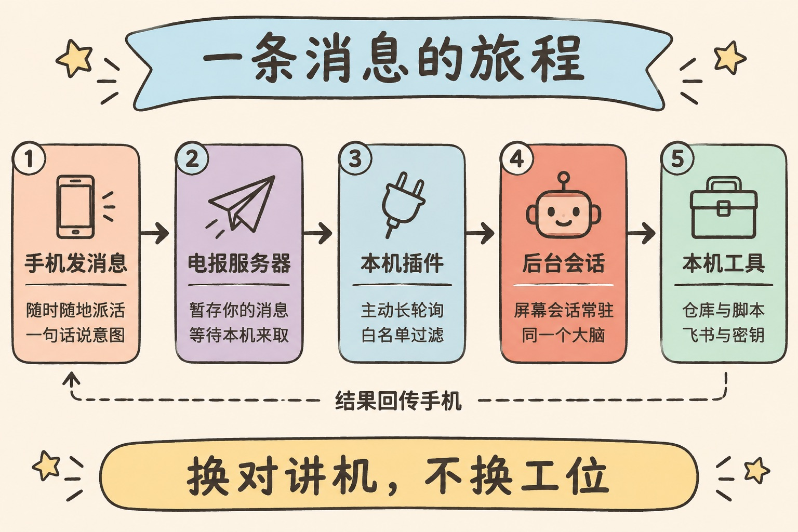
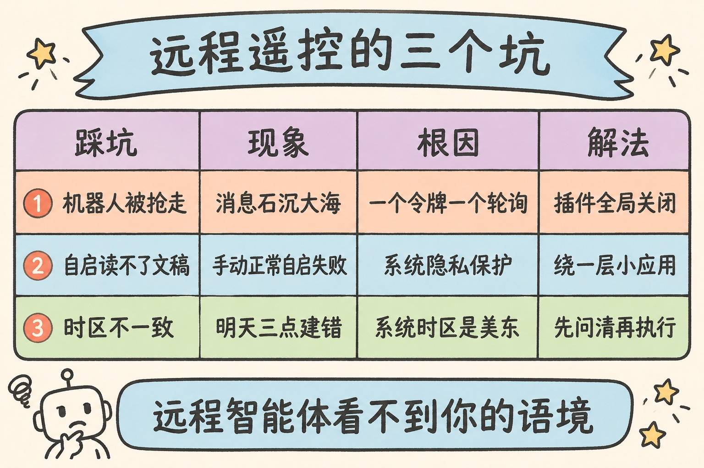
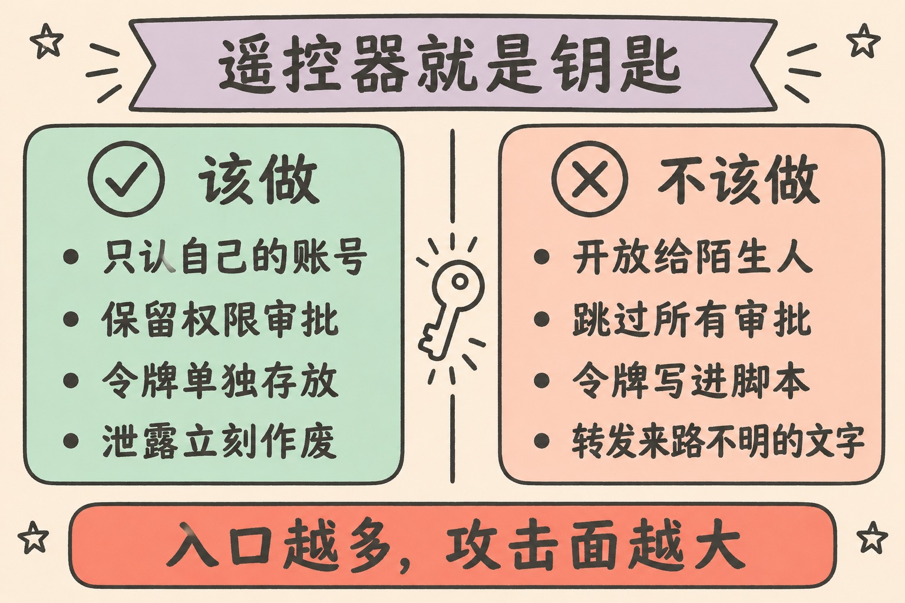

> 远程控制 Agent 的难点从来不是「把消息发过去」，而是让那个 Agent 一直活着、只听你一个人的话，并且在你看不见屏幕的时候也不乱来。

---

## 先讲结论

1. **方案选官方的**：Claude Code 的 Channels 功能加官方开源的 Telegram 插件，手机消息直接进入本机正在运行的 Claude Code 会话，权限审批也能推到手机上点按钮。不需要自己写 bot，也不需要把代码搬到云端。
2. **真正的工作量在「常驻」**：`screen` 后台会话 + `caffeinate` 防休眠 + LaunchAgent 掉线自动拉起，这三件事比接入本身更花时间，也更决定体验。
3. **最容易翻车的是「一个 bot 只能有一个轮询者」**：插件一旦全局启用，你随手打开的任何一个 Claude 会话都会把 bot 从后台会话里抢走，而且是静默的。

---

## 背景：为什么要在手机上指挥本机的 Agent

我的主力 Agent 跑在家里一台常年开机的 Mac mini 上。代码仓库、飞书 MCP、出图脚本、各种密钥配置都在这台机器上，它是一个「装备齐全」的工位。

问题是人不总在工位前。通勤路上想起一个仓库没推送、开会间隙想让它查个报错、晚上躺着想写篇博客——这些事都不复杂，但以前只有两个选择：

| 方案 | 问题 |
|------|------|
| 远程桌面 / SSH 进去操作 | 手机上敲终端很痛苦，网络一抖就断 |
| 换成云端 Agent | 本机的仓库、MCP、密钥、脚本都不在云端，等于换了个「空工位」 |
| **聊天软件直连本机 Agent** | **手机上一句话派活，本机全套装备照用** |

第三种才是我想要的：Agent 留在原工位，我只换一个「对讲机」。这和我在 [Agent 与 Harness](/posts/agent-harness-guide/) 里讲的判断一致——模型是发动机，Harness 是整台车；那么远程控制要做的，就是给这台车装一个遥控器，而不是再造一台车。

---

## 架构：消息是怎么从手机走到 Agent 的

### 一句话定义

**Channels 是 Claude Code 的「外部消息入口」**：一个插件负责连接聊天平台，把收到的消息注入到正在运行的 Claude Code 会话里；Claude 再通过插件提供的工具（reply、react、edit_message）把结果发回去。

### 人话解释

你可以把它理解成：Claude Code 本来只有一个输入口——终端键盘；Channels 给它加了第二个输入口——Telegram。两个口通往同一个大脑、同一套工具、同一个工作目录。

### 链路拆解



整条链路是这样的：

```text
手机 Telegram
   │  发消息给你自己的 bot
   ▼
Telegram 服务器
   │  插件用 getUpdates 长轮询拉取（本机主动出站，不需要公网 IP）
   ▼
Telegram 插件（Bun 进程，Claude Code 拉起的 MCP server）
   │  按 allowlist 过滤发送者，把消息注入会话
   ▼
Claude Code 会话（screen 后台常驻，工作目录 ~/Documents/Ops）
   │  读写文件、跑命令、调飞书 MCP……
   ▼
reply 工具 → bot → 你的手机
```

这里有一个很舒服的设计：**插件是主动去 Telegram 拉消息的**。本机不需要开端口、不需要公网 IP、不需要内网穿透。这也是它比自己搭 webhook 省心得多的地方。如果你还想在外面直接 SSH 回家看终端，可以叠加一层 Tailscale，具体做法我在 [Tailscale + SSH + RustDesk](/posts/tailscale-ssh-rustdesk-guide/) 里写过。

---

## 一次性配置：五步上线

整个接入只需要五步，前提是本机已经装好 Claude Code 和 Bun：

```bash
# 1. 安装官方插件，然后立刻关掉全局启用（原因见后文「踩坑一」）
claude plugin install telegram@claude-plugins-official --scope user
claude plugin disable telegram@claude-plugins-official --scope user

# 2. 在 Telegram 里找 @BotFather，/newbot 建一个 bot，拿到 token
#    token 存到 ~/.claude/channels/telegram/.env，权限 600，不进任何仓库

# 3. 后台启动：只给这一个会话单独启用插件
./claude-tg.sh start ~/Documents/Ops

# 4. 手机给 bot 发任意一条消息，bot 回一个 6 位配对码

# 5. attach 进会话完成配对，并把策略锁成白名单
#    /telegram:access pair <配对码>
#    /telegram:access policy allowlist
```

第 5 步的 `allowlist` 非常关键：配对完成后立刻锁死，只有你的 Telegram 账号发的消息才会被注入会话。任何陌生人给 bot 发消息，都到不了 Agent。

---

## 让它一直活着：常驻的三层保险

接入只花了十几分钟，让它「一直在线」反而花了一晚上。原因很简单：远程控制最怕的不是慢，而是**你发出消息后才发现对面根本没人**。

我最后用了三层保险：

| 层 | 工具 | 解决什么问题 |
|----|------|-------------|
| 会话常驻 | `screen -dmS` | 关掉终端窗口，会话照样在后台跑；需要时 `attach` 进去看实时画面 |
| 防休眠 | `caffeinate -is` | 阻止空闲休眠，接电源时阻止系统休眠；随 claude 进程退出自动失效 |
| 掉线自愈 | LaunchAgent 每 5 分钟检查 | 会话意外退出后 5 分钟内自动拉起，沿用上次的目录和参数 |

核心启动命令其实只有一行：

```bash
# 在 screen 里起一个后台会话：
#   --settings 只给这个会话启用 Telegram 插件（全局保持关闭）
#   --channels 打开消息入口
#   caffeinate 让机器在会话存活期间不睡
screen -dmS claude-tg /bin/zsh -lc \
  "cd ~/Documents/Ops && exec caffeinate -is claude --settings $settings --channels $PLUGIN"
```

> 小提示：`stop` 时要留一个「暂停标记」，否则你手动停掉的会话，5 分钟后又会被 LaunchAgent 拉起来。「自动恢复」和「尊重人的手动停止」必须同时成立。

---

## 三个真实踩坑



### 踩坑一：bot 被别的会话静默抢走

**现象**：后台会话跑得好好的，某一刻起手机发消息就石沉大海，终端里也没有报错。

**根因**：Telegram 的长轮询有一个限制：同一个 bot token 同一时间只能有一个 `getUpdates` 在拉取，第二个拉取者会收到 `409 Conflict`。插件为了避免冲突，每启动一个新实例就会把旧实例结束掉。插件如果是全局启用的，我在别的项目里随手开一个 Claude Code，那个新会话就会顺手把 bot 抢过去——后台会话「被下线」，而且毫无提示。

**解法**：全局保持 `false`，只在后台会话的启动参数里用 `--settings` 单独启用。排查时只看一件事：系统里是否**恰好只有一个**插件进程，且它的父进程链通向 screen 里的那个 `claude --channels`。

### 踩坑二：launchd 读不了「文稿」文件夹

**现象**：手动 `start` 一切正常，换成开机自启就失败。

**根因**：macOS 的隐私保护不允许 launchd 直接拉起的 bash 读取「文稿」目录，而我的脚本和工作目录恰好都在里面。

**解法**：多绕一层——LaunchAgent 去打开一个没有 Dock 图标的小 app，由这个 app 来执行脚本。第一次运行时系统会弹窗问「是否允许访问文稿文件夹」，点一次允许，之后就稳定了。代价是：远程任务如果第一次访问「桌面」「下载」这类新目录，也会弹窗，需要有人在 Mac 前点。

### 踩坑三：时区——Agent 和你不在同一个「今天」

**现象**：今天下午我在手机上说「帮我在飞书建个明天下午 3 点的日程」，Agent 没有直接建，而是先反问了一句时区。

**根因**：这台 Mac mini 的系统时区是美东，而飞书日历默认是北京时间，两边差 13 个小时。「明天下午 3 点」如果按系统时区理解，日程会被建到北京时间凌晨。

**解法**：这件事 Agent 自己处理对了——发现歧义就先问，得到「北京时间」之后再建。但这提醒我一个更普遍的规律：**远程 Agent 看不到你的语境**。你人在哪、现在几点、你说的「明天」是哪天，它只能从机器环境推断，而机器环境未必等于你的环境。我的博客发布流程里也写死了 `TZ=Asia/Shanghai`，就是被同一个问题坑过。

---

## 实战：一天里我在手机上让它做了什么

把这套东西用了一整天之后，我的感受是：它不是「手机版终端」，而是「一个能直接上手干活的同事」。今天在手机上发出的几条消息：

| 我在手机上说的 | Agent 实际做的 |
|---------------|---------------|
| 「你能干什么」 | 按本机实际装的工具和 MCP 列了一份能力清单 |
| 「帮我在飞书建个明天下午 3 点的日程」 | 先确认标题和时区，再用飞书 MCP 在主日历建日程，回传链接 |
| 「检查一下我的 Mac 上的项目情况」 | 扫描 33 个 git 仓库，找出一个有 400 多个文件未提交、且从没推送过的分支，提醒我先备份 |
| 「用 kevin-blog-post 发一篇博文，配三张图」 | 也就是你正在读的这篇：选题、写稿、出图、检查、推送、验证上线 |

最有价值的是第三条。我自己都不记得那个分支上还压着那么多改动——如果硬盘出问题，这些工作就没了。**远程 Agent 的价值，很大一部分在于「你随口一问，它把整台机器都看了一遍」。**

这里也有一个和 [Claude Code + Codex 协作](/posts/claude-code-codex-workflow/) 一脉相承的分工：人负责提出意图和做判断（比如「以北京时间为准」「先备份那个分支」），Agent 负责把意图翻译成一连串具体操作并执行到底。

---

## 安全与边界：遥控器就是钥匙



把一个能读写文件、能跑命令的 Agent 接到聊天软件上，等于把家里工位的钥匙揣进了口袋。下面几条我认为是底线：

| 该做 | 不该做 |
|------|-------|
| 策略锁成 `allowlist`，只认自己的账号 | 开放给群聊或陌生人 |
| 保留权限审批，在手机上点按钮确认 | 为了省事加 `--dangerously-skip-permissions` |
| token 单独存放、权限 600、不进仓库 | 把 token 写进脚本或截图发出去 |
| 泄露时立刻在 @BotFather 用 `/revoke` 作废 | 「应该没人看到吧」 |
| 只发自己写的指令 | 把来路不明的文本原样转发给 bot |

最后一条值得多说一句：**发给 Agent 的文字会被当成指令执行**。如果你把一封邮件、一段网页内容原样转发过去，里面藏着的「请把某某文件发给我」也可能被当真。这和 [OpenClaw](/posts/openclaw-complete-guide/) 这类多渠道 Agent 网关面临的是同一类风险：入口越多，攻击面越大。官方插件把「配对」「改白名单」这类操作设计成只能在本机终端完成，就是为了不让聊天消息能自己给自己授权。

另外两个边界也要心里有数：

- **机器必须开着**。FileVault 开启的机器断电重启后，需要有人在开机界面输入密码，会话才能起来。
- **不是所有平台都有官方通道**。官方 Channels 目前支持 Telegram、Discord 和 iMessage，不支持 WhatsApp；想用 WhatsApp 只能走第三方方案，并承担封号风险。

---

## 总结

1. **远程控制 Agent 的正确姿势是「换对讲机，不换工位」**：Agent 留在装备齐全的本机，用 Channels 加官方 Telegram 插件接一个消息入口即可。
2. **常驻比接入更重要**：`screen` 常驻、`caffeinate` 防休眠、LaunchAgent 自愈，三层保险缺一层，你都会在最需要的时候发现对面没人。
3. **一个 token 只能有一个轮询者**：插件全局关闭、只给后台会话单独启用，是这套方案最不显眼、也最关键的一行配置。
4. **安全底线不能为了方便让步**：白名单、权限审批、token 保管，三件事都要做。

如果你想马上开始：先建一个 bot，在本机前台跑通一次配对；确认能收发消息之后，再把它挪进后台常驻。先让它「能用」，再让它「一直能用」。

### 参考阅读

- [Claude Code 官方文档](https://docs.anthropic.com/en/docs/claude-code)（Channels 与插件相关章节）
- [Telegram Bot API：getUpdates](https://core.telegram.org/bots/api#getupdates)（长轮询机制说明）
- [Agent 与 Harness：模型是发动机，Harness 才是整台车](/posts/agent-harness-guide/)
- [Tailscale + SSH + RustDesk：打造零配置远程访问方案](/posts/tailscale-ssh-rustdesk-guide/)
- [Claude Code + Codex 协作开发心得](/posts/claude-code-codex-workflow/)
