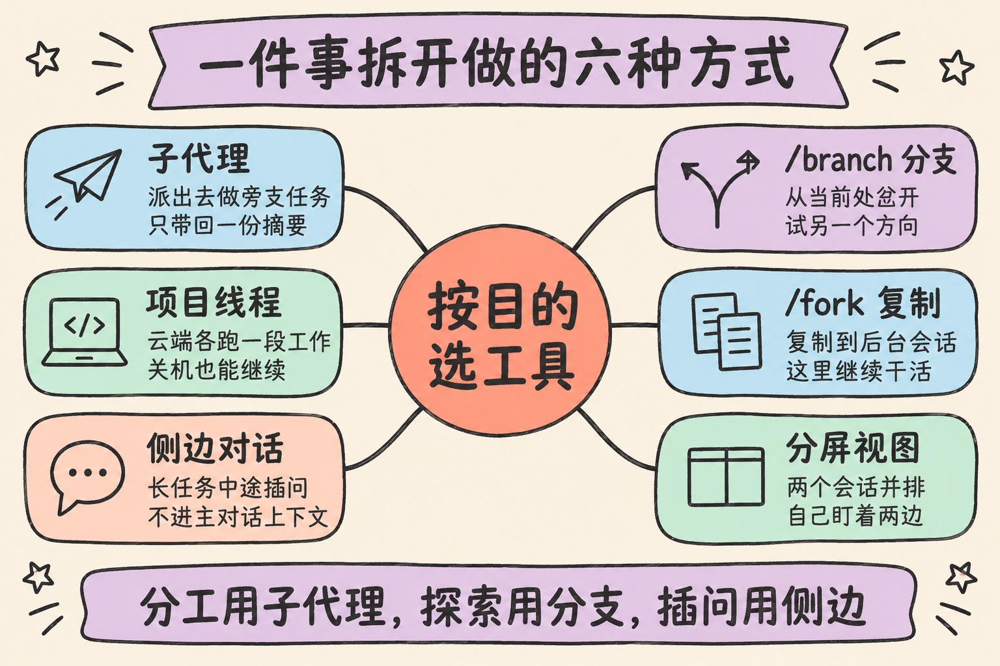

> Claude 正在从「一问一答的聊天框」变成「能并行干活、随时跟进、直接交付成品的工作台」。

这篇按 Anthropic 官方文档，把新版 Claude 桌面应用和 Claude Code 的主要能力系统梳理一遍：在哪里跑、怎么拆分工作、离开电脑怎么跟进、怎么让任务在云端持续推进、怎么交付成品、怎么维护配置和扩展它。

资料依据是 Claude Code 文档的 Desktop、Remote Control、Projects、Artifacts、Commands、Mods 几个页面，以及 Claude 帮助中心的 Claude Design 迁移说明，整理于 2026 年 11 月下旬。产品迭代很快，版本号和套餐范围请以官方文档的最新内容为准。

## 先讲结论

1. **工作方式变了**：一个任务可以在本地、SSH、WSL 或云端运行；可以拆给子代理、项目线程，或者分支出去试别的方向；长任务中途有疑问用侧边对话，不打断主任务。
2. **人可以离开电脑**：远程控制让手机接管电脑上正在跑的会话；云端项目里的线程在你合上电脑后继续工作。
3. **产出不只是对话**：文档、设计、幻灯片、仪表盘、动态设计都可以作为成品（Artifact）直接交付；配合 `/doctor` 维护配置，用模组（Mods）扩展 Claude Code 本身。


---

## 一、全景：桌面应用里的三个区域

Claude 桌面应用里有三块：

| 区域 | 定位 |
|------|------|
| 聊天 | 常规对话 |
| Cowork | 负责 Dispatch 和较长的智能体工作 |
| Code | 即 Claude Code，面向在项目文件夹里干活 |

其中 **Dispatch** 是一个常驻在 Cowork 里的对话：你把任务发给它，由它决定怎么处理。文档注明它需要 Pro、Max 或 Ultra 套餐，并且目前不向新用户开放。

本文重点是 **Code** 标签页。不要被「Code」这个名字劝退：它的本质是「让 Claude 在一个文件夹里操作文件、运行命令」，写博客、整理资料、做数据分析同样适用。我的博客就是这样写出来的，流程见 [用 Telegram 远程遥控 Claude Code](/posts/claude-code-telegram-remote/)。

---

## 二、Code 标签页：环境、权限、窗格

### 1. 运行环境

输入框下面那一排控件，第一个就是环境选择器：

| 环境 | 说明 |
|------|------|
| Local | 在你的电脑上运行，直接访问你的文件 |
| SSH | 在远程机器上运行 |
| WSL | 在本机的 WSL 2 发行版里运行（Windows） |
| Cloud | 默认在 Anthropic 托管的基础设施上运行，**关掉应用后会话仍会继续** |

选择的原则很简单：要动本机文件、连本机设备就用 Local；代码在服务器上就用 SSH；希望关机后继续跑就用 Cloud。

### 2. 权限模式

同一排控件里有权限模式选择器，快捷键 **Cmd+Shift+M** 打开菜单（桌面版里 Shift+Tab 不切换模式）：

| 模式 | 行为 |
|------|------|
| Manual（默认） | 编辑文件或运行命令前先问你 |
| Accept edits | 自动接受文件编辑 |
| Plan | 先出方案，不直接动手 |
| Auto | 自动判断，仅在可用时显示 |
| Bypass permissions | 跳过权限确认。Pro、Max、Ultra 需在 **Settings > Code** 打开 **Allow bypass permissions mode**；云端会话不可用 |

建议：日常用 Manual 或 Accept edits；方案没定之前用 Plan；Bypass 只在隔离环境里用。

### 3. 窗格与视图

Code 标签页由一组可拖动的窗格组成：聊天、diff、浏览器、终端、文件、计划、任务、子代理，macOS 上还有 iOS 模拟器。

| 操作 | 方法 |
|------|------|
| 打开 diff | Cmd+Shift+D |
| 打开浏览器 | Cmd+Shift+B |
| 打开终端 | Ctrl+` |
| 关闭当前窗格 | Cmd+\（Windows 为 Ctrl+\） |
| 移动窗格 | 拖动标签或顶部把手；拖边缘调整大小 |
| 弹出为独立窗口 | 支持，也可以再停靠回来 |

视图模式有 Normal、Thinking、Verbose 三种，按 **Ctrl+O** 循环切换。想看 Claude 的思考过程就切到 Thinking，排查问题时用 Verbose。

### 4. 会话详情面板

聊天旁边的一组卡片，告诉你这个会话「在哪里跑、改了什么、在跑什么、上下文用了多少」：

- **Environment**：运行位置，远程控制开关也在这里。
- **Changes**：改动统计。
- **Context**：上下文占用百分比，点开可以按类别查看占用来源。

Context 卡片值得常看。每次新开会话，记忆文件、skill 列表、MCP 工具定义都会先加载，装得越多，还没开口就用掉越多上下文和额度。命令行里对应的是 `/context`（加 `all` 展开明细）。

---

## 三、并行与拆分：一件事怎么拆开做

Claude Code 提供了好几种「拆开做」的方式，目的不同，选法也不同：

| 方式 | 入口 | 文档描述（意译） | 适合 |
|------|------|--------------|------|
| 子代理 | 让 Claude 派出，或 `/subtask` | 在会话内用独立上下文做旁支任务，只把摘要交回 | 调研、读大量文件，只要结论 |
| 项目线程 | Projects | 独立会话，有自己的上下文，做完一块向协调对话汇报 | 多块工作并行，需要能单独进去继续 |
| `/branch` | 命令 | 在当前位置建对话分支并切过去，原对话保留，可用 `/resume` 回去 | 试另一种方案 |
| `/fork` | 命令 | 把当前对话复制到新的后台会话，自己留在这里继续 | 让副本去跑，自己接着干 |
| 侧边对话 | Cmd+; 或 `/btw` | 能读主对话到此刻的全部内容，回答不会自动进入主对话 | 长任务中途插问 |
| 分屏视图 | 按住 Option 点击会话，或右键 → Open in → Split view | 两个会话并排 | 同时盯两件事 |

几点补充：

- **侧边对话**的价值在于不污染主任务的上下文。问「刚才那段为什么这么写」「这个报错是什么意思」，都适合放在侧边。它支持本地、SSH 和 WSL 会话。
- **子代理和项目线程的区别**：子代理是一次性的派活，你拿到的是摘要；项目线程是一个完整会话，你可以点进去看它做过的全部工作，并和它继续对话。
- **后台任务**窗格会列出正在运行的子代理、后台 shell 命令和动态工作流，点开能看输出。
- 退出分屏：Cmd+Ctrl+W（Windows 为 Ctrl+Alt+W）。



---

## 四、远程控制：离开电脑也能跟进

远程控制把 claude.ai/code 或 Claude 手机应用连到你电脑上正在运行的 Claude Code 会话。**代码执行和文件访问始终在你的电脑上**，手机只是另一个操作界面。

### 怎么开

| 场景 | 方法 |
|------|------|
| 命令行，服务模式 | `claude remote-control`（别名 `claude rc`） |
| 命令行，交互会话 | `claude --remote-control`（别名 `--rc`） |
| 已经在跑的会话 | 输入 `/remote-control`（别名 `/rc`） |
| 桌面应用、VS Code | 在输入框里输入 `/remote-control` |

手机端连接：打开 Claude Code 显示的链接，或者扫二维码（`claude remote-control` 模式下按空格切换二维码显示）；也可以直接打开 claude.ai/code 或 Claude 应用，按名字找到会话，远程控制中的会话带一个绿色状态点的电脑图标。

### 两个值得打开的设置

在桌面应用的 **Settings > Code** 里：

| 设置项 | 作用 |
|-------|------|
| Connect new sessions to Remote Control | 新会话自动连上远程控制 |
| Keep this computer awake for Remote Control | 防止电脑在任务中途睡眠 |

### 限制

- 每个交互进程只能有一个远程会话。
- 本地进程必须一直运行：关掉终端或退出桌面应用，会话就下线。
- 需要 claude.ai 订阅（Pro、Max、Ultra、Team、Enterprise），API key 方式不支持；Claude Code v2.1.51 或以上。团队版和企业版要管理员先打开开关。
- 连接期间，会话记录会存放在 Anthropic 的服务器上。

和我之前搭的 [Telegram 遥控方案](/posts/claude-code-telegram-remote/) 相比：远程控制在手机上看到的是完整的会话界面，体验更好；Telegram 方案只收发文字，但能接入定时任务的推送，也不依赖 Claude 应用。两者可以并用。

---

## 五、Claude Code 项目：让工作在云端持续推进

项目（Projects）适合「一个目标、多块工作、需要持续几天推进」的场景。

### 结构：一个协调对话加多个线程

- **协调对话**：一个长期运行的会话，Claude 在里面担任协调者。它看到的是各线程汇报的结果，而不是每一步细节。
- **线程**：独立会话，有自己的上下文窗口，做完一块工作向协调对话汇报。线程通常在云端运行，**合上电脑后继续工作**；也可以通过远程控制在自己电脑上运行线程（需要 v2.1.280 或以上），但只在电脑醒着时运行。

### 怎么建

在侧边栏选 **Projects**（或在 **More** 里找），点 **New project**，填三项：

1. 名称；
2. 想做什么（可选的目标描述）；
3. 上下文：仓库、文件、文件夹。

也可以从一个云端会话的菜单里选 **Continue in project**，把它接进项目。

### 给项目长期上下文

| 内容 | 说明 |
|------|------|
| 项目说明 | 最多 16,000 字符，每个新线程启动时都会带上 |
| 项目记忆 | 每个云端线程启动时读取 `MEMORY.md` 索引；与本机 Claude Code 的自动记忆是两套 |
| 文件 | 一次最多上传 1,000 个文件、2 GB，单个文件最大 480 MB；最多 10 个文件夹（另可加 Google Drive 文件夹），隐藏文件和 `node_modules` 不会加入 |

一个实用建议：云端线程看不到你电脑上的 skill 和资料，所以要趁电脑开着时，让 Claude 把项目需要的技能说明、背景资料整理好放进项目。

### 用量与套餐

- 所有项目合计每天最多新建 500 个线程。
- 没有运行中的线程、没有在盯的 PR、没有新消息的项目，闲置时不消耗套餐额度。
- 公开测试，面向 Pro、Max、Ultra，逐步开放；团队版和企业版暂未提供。命令行和 VS Code 里不可用。

---

## 六、成品（Artifacts）：直接交付，而不只是回答

成品是 Claude 发布到 claude.ai 上的页面，可以是一份讲解、一个仪表盘、一份设计或文档。

### 怎么做、给谁看

- 在 Claude Code 里直接说要什么，比如「做一个成品，带注释地讲解这个 PR 的改动」。首次发布后会在浏览器打开。
- **新成品默认只有自己可见**。团队版和企业版可以分享给指定的人、整个组织或某个文件夹；公开分享在团队版和企业版默认关闭。
- Ctrl+] 重新打开最近的成品，`/artifacts` 列出自己的和别人分享给你的成品。

### 类型

| 类型 | 入口 | 要点 |
|------|------|------|
| 讲解页、报告 | 直接描述需求 | 最通用的形式 |
| 仪表盘 | 连接器支持的成品 | 每次有人打开时调用 MCP 连接器取数，所以显示的是最新数据；需要 v2.1.209 或以上 |
| 文档 | Claude Docs 连接器 | 在 Claude Code 里以 `claude.ai Claude Docs` 连接器出现 |
| 设计 | `/design <需求>` | 在一张画布上画出多个画板，发布为 Claude Design 成品，可导出 PNG 或 PDF；需要 v2.1.265 或以上 |
| 幻灯片 | 在 Claude 里新建 | 新建设计、设计系统或幻灯片时，都以成品形式创建 |
| 动态设计 | `/motion <需求>` | 生成 Claude Motion 成品；需要 v2.1.323 或以上，仅团队版和企业版，只在桌面应用的本地和云端会话里可用 |

### 套餐和注意事项

- 成品功能面向 Pro、Max、Ultra、Team、Enterprise，需要用 `/login` 登录的账号。
- 通过 Bedrock、Vertex、Foundry 使用时不可用；启用了 CMEK、HIPAA 或零数据保留时也不可用。
- 不想用可以关掉：设置 `"enableArtifact": false`，或环境变量 `CLAUDE_CODE_DISABLE_ARTIFACT=1`。
- **独立的 Claude Design 站点（claude.ai/design）将于 2026 年 12 月 14 日关闭**。原有项目迁移为成品；独立站点上的聊天和评论不会迁移，公开链接会失效。`/design-sync` 上传的目标就是这个独立站点，需要留意。


> 图里第六格的模组不属于成品，它是改变 Claude Code 本身的插件，下文单独讲。

---

## 七、维护配置：给 Claude 做体检

skill、CLAUDE.md、MCP 会越积越多。项目变了、模型变了，旧指令可能变成噪音甚至误导。几个命令专门用来维护它们：

```text
/context              # 用彩色网格显示上下文占用；/context all 展开明细
/doctor               # 诊断安装、设置、扩展和 CLAUDE.md 问题，提出修复，确认后执行（别名 /checkup）
/doctor prompt-audit  # 专查过时或互相冲突的指令（v2.1.283 或以上）
/output-style concise # 切换回答风格；不带参数则列出可用风格（v2.1.269 或以上）
```

`/doctor` 会权衡没用到的 skill 的上下文成本，也会指出 CLAUDE.md 里重复的、或者能从代码直接推出来的内容。建议每隔几周跑一次 `/doctor` 和 `/doctor prompt-audit`。

我在 [Claude Code advisor 顾问工具](/posts/claude-code-advisor-tool/) 里也提到过：配置是一种需要定期维护的资产，和代码一样会过时。

---

## 八、模组（Mods）：改造 Claude Code 本身

### 是什么

文档的定义：**模组是改变 Claude Code 外观和行为的插件，由 JavaScript 或 TypeScript 事件处理程序组成。** 做法很简单：在会话里描述你想要什么，Claude 帮你写出来（对应 `/plugin-authoring`）。

模组的处理程序挂在事件上，可以观察、改写或直接回应这些事件，覆盖工具调用、提示和对话轮次。例如：

- `tool.call`：Claude 每次准备调用工具时触发；
- `ui.render`：渲染界面组件时触发，例如加载动画。

模组还能注册命令和工具、调用模型、定时执行、给其他会话发消息、读写文件和访问网络。

### 文档里的例子

| 模组 | 作用 |
|------|------|
| token-weather | 在输入框上方显示上下文用量「天气预报」 |
| blast-radius | 拦住 `rm -rf` 或强制推送，先展示它会影响什么 |
| replay-theater | 增加一个 `/replay` 命令 |

### 安装和管理

```bash
claude plugin validate ./some-mod          # 安装前先校验
claude plugin install token-chart@your-org # 在 shell 里安装，然后在会话里 /reload-plugins
/plugin                                    # 在会话里管理，Installed 标签页可以单独关掉某个模组
claude --safe-mode                         # 本次会话不加载模组
```

版本要求：命令行 v2.1.287 或以上，桌面应用 v2.1.286 或以上（用 `/status` 查看）。模组在命令行、桌面应用的 Code 标签页（WSL 和 SSH 会话除外）和 VS Code 里运行。

### 安全提醒

文档写得很直白：**模组是以你的权限运行的代码，没有沙箱。** 它不能改变权限确认弹窗显示的内容，但如果没有加载内置的防护，它可以放行原本会被 `deny` 规则拦下的工具调用。所以只装自己写的或可信来源的模组，装之前先 `validate`、读一遍代码。

一个值得做的模组思路：把一大段语音口述先整理成结构化指令，再交给 Claude 处理。对经常用语音下指令的人很实用。

---

## 九、按场景怎么选

| 场景 | 推荐做法 |
|------|---------|
| 要动本机文件或连本机设备 | Local 环境 |
| 希望关机后继续跑 | Cloud 环境，或放进项目 |
| 方案还没定 | Plan 模式 |
| 只要结论的调研 | 交给子代理 |
| 多块工作要持续推进 | 建项目，提前放好说明和资料 |
| 想对比两种方案 | `/branch` |
| 长任务中途有疑问 | 侧边对话或 `/btw` |
| 离开电脑还想跟进 | 远程控制，打开自动连接和保持唤醒 |
| 结果要给别人看 | 做成成品，确认分享范围 |
| 配置越积越多 | 定期 `/context`、`/doctor`、`/doctor prompt-audit` |
| 想改 Claude Code 的行为 | 写一个模组，先 `validate` |

最后提醒一点：分屏、项目、并行线程都在鼓励「同时做更多事」。工具能并行，人脑的注意力却很难同时照看很多件事。我在 [用了 AI 效率翻倍，为什么人更累了](/posts/ai-productivity-relations/) 里讨论过：并行开得越多，切换成本越高。从两条线并行开始，比一下子开很多条更稳。

---

## 总结

- **在哪里跑**：Local、SSH、WSL、Cloud 四种环境，配合五种权限模式和可拖动的窗格。
- **怎么拆**：子代理要结论，项目线程要持续推进，`/branch` 试方向，`/fork` 放副本去跑，侧边对话插问。
- **怎么跟**：远程控制让手机接管本机会话，云端项目让工作在关机后继续。
- **怎么交付**：成品覆盖讲解页、仪表盘、文档、设计、幻灯片和动态设计，默认仅自己可见。
- **怎么维护和扩展**：`/context`、`/doctor`、`/output-style` 维护配置，模组改造 Claude Code 本身，但要记住模组没有沙箱。

## 参考阅读

- [Claude Code Desktop 文档](https://code.claude.com/docs/en/desktop)：环境、权限模式、窗格、会话详情面板、侧边对话、分屏。
- [Remote Control 文档](https://code.claude.com/docs/en/remote-control)：开启方式、手机连接、限制。
- [Projects 文档](https://code.claude.com/docs/en/projects)：协调对话与线程、项目说明和记忆、限额与套餐。
- [Artifacts 文档](https://code.claude.com/docs/en/artifacts)：发布、分享、类型、版本与套餐。
- [Commands 参考](https://code.claude.com/docs/en/commands)：`/btw`、`/branch`、`/fork`、`/context`、`/doctor`、`/output-style`、`/remote-control`、`/design`、`/motion` 等。
- [Mods 文档](https://code.claude.com/docs/en/mods)：模组的事件、示例、安装管理与安全说明。
- [Move from standalone Claude Design to Claude](https://support.claude.com/en/articles/17440474-move-from-standalone-claude-design-to-claude)：Claude Design 独立站点关闭与迁移。
