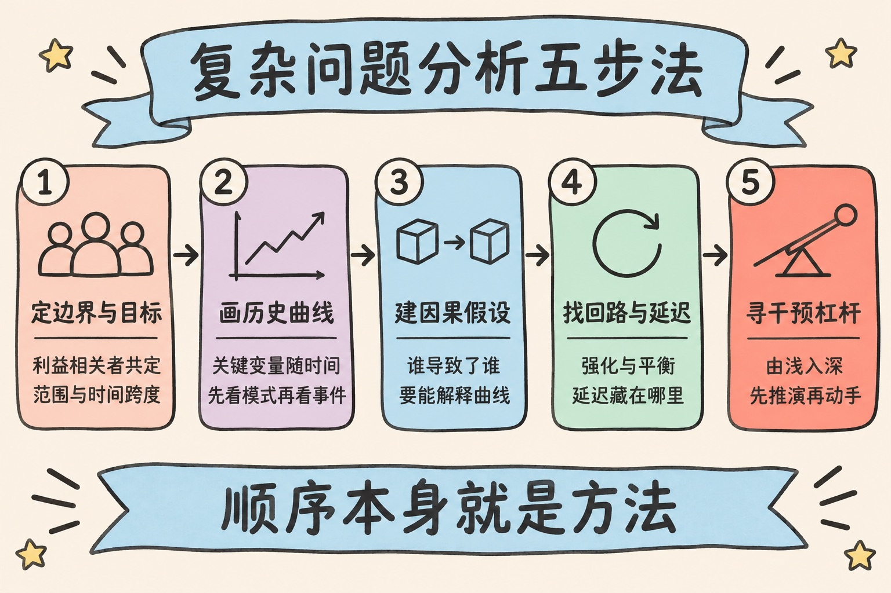
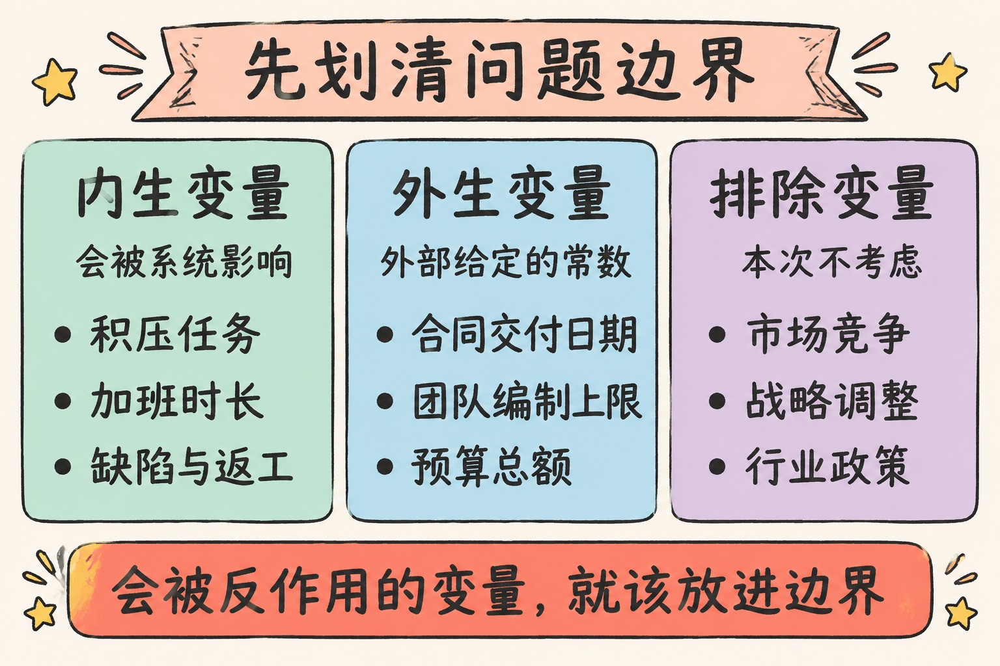
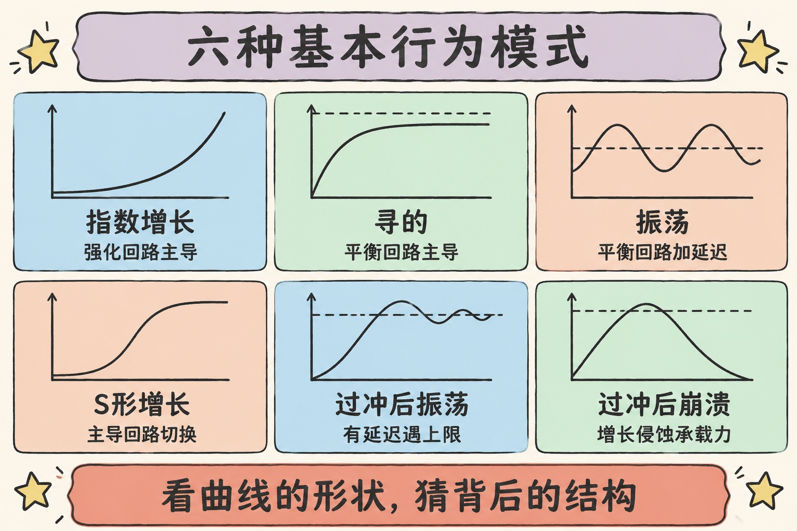
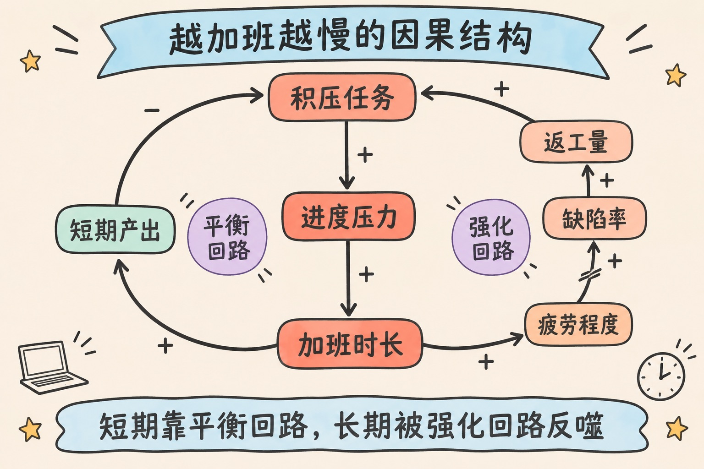
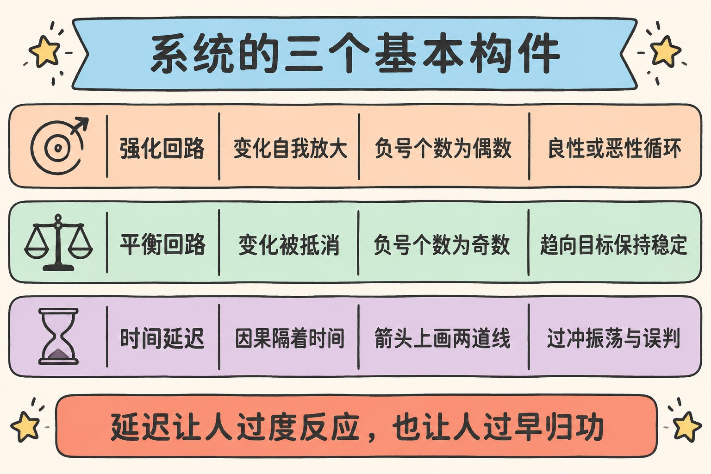
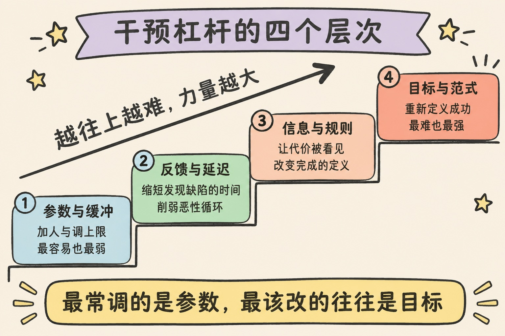

> 面对复杂问题，大多数人的第一反应是「该怎么办」；而真正有效的第一步，是先搞清楚「这到底是一个什么问题」。

---

## 先讲结论

1. **复杂问题的分析有一条可复用的顺序**：先由利益相关者定义边界和目标，再画关键变量的历史变化，然后建立因果假设，识别强化回路、平衡回路和时间延迟，最后才去找干预杠杆。
2. **顺序本身就是方法**：跳过前面几步直接找对策，最常见的结果是「按下葫芦浮起瓢」——对策在短期生效，又在一段延迟之后被系统反弹回来。
3. **杠杆往往不在你最先想到的地方**：调参数最容易，但效果最弱；改变信息流、规则和目标更难，但力量大得多。

---

## 背景：为什么复杂问题总是越治越乱

先看一个几乎每个工程团队都经历过的场景：

> 项目延期了。管理者要求加班，头两周进度确实追上来一些；一个月后，缺陷数开始上涨，返工越来越多，进度反而比加班前还慢。于是继续加班……

这里没有人偷懒，也没有人决策「明显错误」。问题在于，大家都在用**线性、单向、即时**的思路处理一个**环形、互相影响、有延迟**的系统。

MIT 的 John Sterman 用过一个经典实验说明这件事：在「啤酒游戏」（Beer Game）里，参与者扮演供应链上的零售商、批发商、分销商和工厂，只需要根据订单决定进货量。只要终端需求出现一次小幅变化，整条链路的库存和订单就会剧烈振荡；而参与者事后大多把原因归结为外部需求的波动或其他角色的决策，而不是系统里的延迟和自己的决策规则 [1]。

**复杂问题难，不是因为信息不够，而是因为我们看不见结构。** 下面这五步，就是一套把结构「画出来」的流程。它和 Sterman 在《Business Dynamics》里总结的系统动力学建模流程基本对应：问题界定、动态假设、建模、测试、政策设计 [2]。



| 步骤 | 回答的问题 | 产出物 |
|------|-----------|-------|
| 1. 定义边界和目标 | 谁关心？要解决什么？范围多大、时间多长？ | 问题陈述 + 边界表 |
| 2. 画变量的历史变化 | 问题是怎么随时间演变的？ | 行为随时间变化图（参考模式） |
| 3. 建立因果假设 | 什么导致了这条曲线？ | 因果回路图 |
| 4. 识别回路与延迟 | 哪些回路在主导？延迟在哪里？ | 标注了 R / B / 延迟的回路图 |
| 5. 寻找干预杠杆 | 改哪里，效果最大、副作用最小？ | 干预方案 + 预期行为 |

---

## 第一步：由利益相关者定义问题边界和目标

### 一句话定义

**边界决定了你把哪些东西当作「系统内部会互相影响的」，哪些当作「外部给定的」。**

### 为什么要利益相关者一起定

同一个「项目延期」，在不同人眼里是不同的问题：

| 利益相关者 | 他眼中的问题 | 他关心的目标 |
|-----------|-------------|-------------|
| 管理层 | 交付日期守不住 | 按期上线 |
| 开发团队 | 需求一直在变、人累 | 可持续的节奏 |
| 测试团队 | 缺陷越修越多 | 质量 |
| 客户 | 功能迟迟不到 | 尽快可用 |

如果只由一方定义问题，分析从一开始就带着偏见：管理层定义的问题，答案多半是「加人加班」；开发团队定义的问题，答案多半是「砍需求」。英国学者 Peter Checkland 的软系统方法论（SSM）专门强调这一点：复杂的「问题情境」里，不同的人有不同的世界观，分析的第一步是把这些视角都摆上桌面 [3]。

### 怎么划边界

Sterman 推荐用一张**边界表**把变量分成三类 [2]：

| 类别 | 含义 | 本例 |
|------|------|------|
| 内生变量 | 系统内部、会被其他变量影响 | 积压任务、加班时长、疲劳、缺陷率、返工量、进度 |
| 外生变量 | 外部给定、不被系统影响 | 合同交付日期、团队编制上限 |
| 排除变量 | 有关系但本次不考虑 | 市场竞争、公司战略调整 |

划边界有一个简单的原则：**如果一个变量会受到系统内其他变量的反作用，就应该放进来。** 把它当成外部常数，等于主动看不见一条反馈回路。

另外别忘了**时间范围**。只看两周，加班是有效的；看半年，结论可能完全相反。时间范围至少要长到能覆盖系统里最长的那个延迟。



---

## 第二步：绘制关键变量的历史变化

### 一句话定义

**参考模式（reference mode）就是关键变量随时间变化的曲线：问题过去是什么样，如果什么都不做，将来可能是什么样。**

### 为什么一定要画曲线

人们描述问题时习惯用「事件」：「上周又延期了」「这个月缺陷特别多」。但事件是结果，**模式才是线索**。把关键变量按时间画出来，你会看到事件看不到的东西：

- 积压任务是**持续上升**，还是**周期性振荡**？
- 缺陷率是突然跳升，还是在加班开始**一段时间之后**才上升？
- 进度是先快后慢，还是一直在慢？

系统动力学总结过几种基本行为模式，每一种背后都有典型的结构 [2]：

| 行为模式 | 曲线形状 | 背后通常的结构 |
|---------|---------|---------------|
| 指数增长 | 越来越快地上升 | 强化回路主导 |
| 寻的 | 逐步趋近一个目标值 | 平衡回路主导 |
| 振荡 | 围绕目标上下波动 | 平衡回路 + 时间延迟 |
| S 形增长 | 先加速、后放缓、最后饱和 | 强化回路与平衡回路的主导权切换 |
| 过冲后振荡 | 冲过上限再来回摆动 | 有延迟的增长遇到上限 |
| 过冲后崩溃 | 冲过上限后一路下滑 | 增长侵蚀了承载能力 |



这张表非常好用：**看到曲线的形状，就能缩小结构的搜索范围。** 本例中，进度曲线「先改善、后恶化、比原来更差」，这是一个强烈的信号：有一个起作用很快的平衡回路，和一个起作用较慢、方向相反的强化回路。

> 小提示：数据不全也要画。凭访谈画出的「大致曲线」也比没有好，关键是把**形状**和**时间顺序**说清楚，并让不同利益相关者确认。

---

## 第三步：建立变量之间的因果假设

### 一句话定义

**因果假设是一组「A 变化会导致 B 怎样变化」的判断，用箭头连成图，用来解释第二步画出的曲线。**

### 画因果图的基本规则

- 箭头表示因果方向：`加班时长 → 短期产出`；
- 箭头上标极性：`+` 表示同向变化（A 增加，B 也增加），`-` 表示反向变化；
- 变量用**名词**，而且要能「增加或减少」（写「疲劳程度」，不写「累了」）；
- 有明显延迟的箭头上画两道短线 `||`。

本例的因果假设可以写成这样：

```text
积压任务 ──(+)──▶ 进度压力 ──(+)──▶ 加班时长 ──(+)──▶ 短期产出 ──(-)──▶ 积压任务
                                         │
                                        (+)
                                         ▼
                                      疲劳程度 ──(+)── || ──▶ 缺陷率 ──(+)──▶ 返工量 ──(+)──▶ 积压任务
```

### 关键是「假设」两个字

因果图不是事实，是**可以被检验的假设**。好的因果假设必须能**解释第二步的曲线**：如果你画的结构推演出来的是持续改善，而实际曲线是先好后坏，那这张图就漏掉了什么。

这也是为什么第二步要在第三步之前：**先有要解释的现象，再有解释。** 反过来做，很容易画出一张「什么都连上了、什么都解释不了」的意大利面图。



---

## 第四步：识别强化回路、平衡回路和时间延迟

把因果图里的环找出来，系统的「性格」就清楚了。

### 三个基本构件

| 构件 | 定义 | 判断方法 | 带来的行为 |
|------|------|---------|-----------|
| 强化回路（R） | 变化会沿着回路自我放大 | 回路上 `-` 号的个数为偶数 | 指数增长或指数崩溃（良性或恶性循环） |
| 平衡回路（B） | 变化会被回路抵消，趋向目标 | 回路上 `-` 号的个数为奇数 | 寻的、稳定 |
| 时间延迟 | 原因和结果之间隔着一段时间 | 箭头上的 `||` | 过冲、振荡，以及「明明有效却放弃了」 |

### 回到案例

- **B1 加班回路**：积压 → 压力 → 加班 → 短期产出 → 积压减少。这是一个平衡回路，**起效快**，所以头两周看起来很有用。
- **R1 返工回路**：加班 → 疲劳 → 缺陷 → 返工 → 积压增加 → 更多加班。这是一个强化回路，而且中间隔着**疲劳积累的延迟**，所以要过几周才显现。

两条回路叠在一起，正好解释了第二步的曲线：**先由快速的 B1 主导，进度改善；延迟过后，R1 接管主导权，进度一路恶化。** Peter Senge 在《第五项修炼》里把这种结构归纳为「饮鸩止渴」（Fixes that Fail）：一个对症状有效的短期对策，在延迟之后引发了让问题更严重的副作用 [4]。



### 延迟为什么最危险

延迟让人做出两类错误决策：

1. **过度反应**：对策还没起效，就以为没用，于是加码，等效果一起到来时已经过头了。啤酒游戏里的订单振荡，就是这样来的 [1]。
2. **过早归功**：短期改善出现了，就以为问题解决了，而真正的代价还在路上。

还有一个软件工程里的经典例子：Fred Brooks 在《人月神话》里提出「向一个已经延期的软件项目增加人手，只会让它更晚」 [5]。新人需要培训、沟通成本上升，这些都是带延迟的负面回路，短期内会先吃掉产能。

---

## 第五步：寻找可能的干预杠杆

### 一句话定义

**杠杆点是系统里「一个小的改变，能带来行为大幅变化」的位置。**

### Meadows 的十二个杠杆点

系统科学家 Donella Meadows 在 1999 年的文章《Leverage Points: Places to Intervene in a System》里，把干预系统的位置按效力从弱到强排成了十二级 [6]。可以归成四个层次来记：

| 层次 | 包含的杠杆点（由弱到强） | 本例中的干预 |
|------|----------------------|-------------|
| 参数与缓冲 | 常数和参数；缓冲库存的大小；存量与流量的物理结构 | 加人、调整加班上限 |
| 反馈与延迟 | 延迟的长度；平衡回路的强度；强化回路的增益 | 缩短缺陷发现的延迟（自动化测试、每日集成） |
| 信息与规则 | 信息流的结构；系统的规则 | 把疲劳和缺陷率放进进度看板；规定「质量不达标不计入完成」 |
| 目标与范式 | 自组织的能力；系统的目标；范式；超越范式的能力 | 把目标从「按期交付」改为「按期交付可用的功能」 |

Meadows 自己的提醒很重要：人们最常调整的是参数，因为它最容易；但它通常是**最弱**的杠杆。越往下，干预越难推动，力量也越大 [6]。



### 用回路结构找杠杆

有了第四步的回路图，找杠杆就不再是拍脑袋，而是有章可循：

1. **削弱恶性的强化回路**：减少疲劳对缺陷的影响（限制连续加班、强制休息）；
2. **缩短关键延迟**：让缺陷更早被发现，R1 回路就来不及积累成灾；
3. **改变信息流**：让决策者能看到「加班的滞后代价」，而不只看到「本周完成了多少」；
4. **改变目标**：当「完成」的定义包含质量，系统自然会抑制返工回路。

### 先推演，再动手

每一个干预都应该回答一个问题：**它会让第二步的曲线变成什么形状？** 如果说不出预期的曲线，说明你还没有真正理解这个干预。条件允许的话，把因果图变成一个简单的仿真模型，跑一跑不同方案，这正是系统动力学建模的最后一步 [2]。

---

## 风险与边界

- **模型永远是简化**。统计学家 George Box 的名言是「所有模型都是错的，但有些是有用的」。因果图的价值在于让大家的假设显性化、可讨论，而不是给出唯一正确答案。
- **因果假设需要数据检验**。参考模式画错了，后面的推理全错。重要决策前，尽量用真实数据核对关键曲线。
- **不是所有问题都需要这套流程**。原因简单、反馈很快的问题（比如一个明确的 bug），直接解决就好。这套方法适合**反复出现、越治越乱、牵涉多方**的问题。
- **边界外的变量会反咬一口**。被你划成「外生」或「排除」的变量，可能恰恰是下一轮问题的来源。每隔一段时间要重新审视边界。

---

## 总结

1. **顺序就是方法**：边界与目标 → 历史曲线 → 因果假设 → 回路与延迟 → 干预杠杆，前一步是后一步的输入，跳步就容易「越治越乱」。
2. **结构决定行为**：看到曲线的形状就能缩小结构的范围，看清回路和延迟就能解释「为什么短期有效、长期无效」。
3. **找杠杆要往深处找**：参数最容易调但最弱；信息流、规则和目标更难改，但力量大得多。

如果你想马上用起来：挑一个最近「反复出现、越治越乱」的问题，拿一张纸，先写下各方眼中的问题和目标，再画出两三个关键变量过去半年的曲线。很多时候，画完曲线，答案已经露出一半了。

关于回路本身的更多讨论，可以参考 [增强回路、长期价值与做正确的事](/posts/reinforcing-loops-long-term-value-right-things/) 和 [系统思维与反脆弱](/posts/systems-thinking-antifragile/)；关于如何从现象走向结构，可以参考 [透过现象看本质](/posts/phenomenon-and-essence/)。

### 参考阅读

1. John D. Sterman, "Modeling Managerial Behavior: Misperceptions of Feedback in a Dynamic Decision Making Experiment", *Management Science*, 1989.
2. John D. Sterman, *Business Dynamics: Systems Thinking and Modeling for a Complex World*, McGraw-Hill, 2000.
3. Peter Checkland, *Systems Thinking, Systems Practice*, Wiley, 1981.
4. Peter M. Senge, *The Fifth Discipline: The Art and Practice of the Learning Organization*, Doubleday, 1990.
5. Frederick P. Brooks Jr., *The Mythical Man-Month*, Addison-Wesley, 1975.
6. Donella Meadows, [Leverage Points: Places to Intervene in a System](https://donellameadows.org/archives/leverage-points-places-to-intervene-in-a-system/), The Sustainability Institute, 1999.
7. Donella Meadows, *Thinking in Systems: A Primer*, Chelsea Green, 2008.
