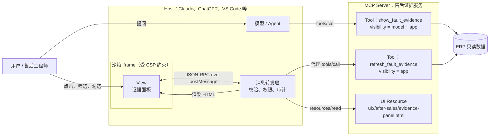
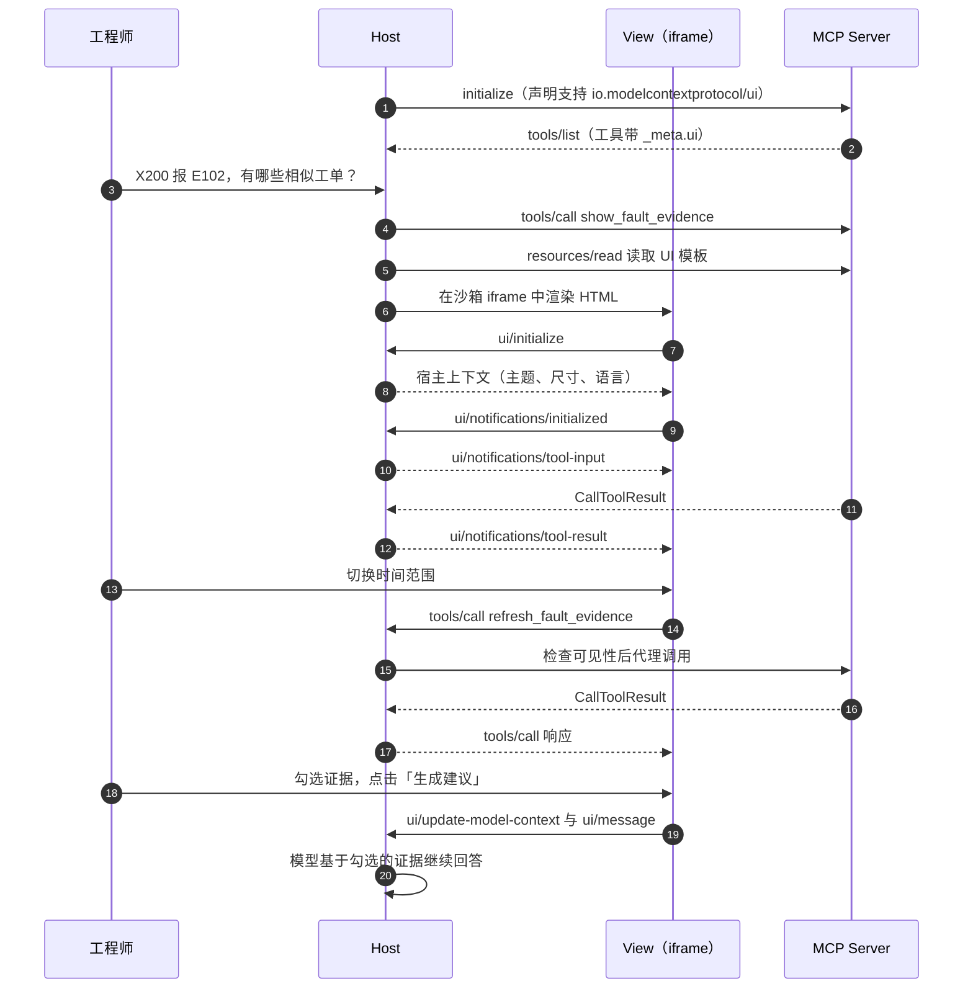
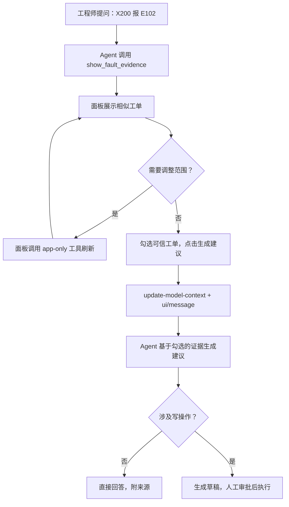

> MCP 解决了“Agent 怎么连接外部能力”，MCP App 解决的是下一个问题：Agent 拿到结果之后，怎么把它交到人手里，让人能看、能比、能选、能改。

---

## 先说结论

如果只记住四件事，可以记住下面这四句：

1. **MCP App 是 MCP 的官方扩展，不是一个新协议。** 它让 Tool 在返回数据的同时，附带一个可交互的 HTML 界面，直接渲染在对话里。
2. **核心公式只有一句：MCP App = Tool + UI Resource。** Tool 通过 `_meta.ui.resourceUri` 指向一个 `ui://` 资源，宿主负责取回模板、放进沙箱、转发双向消息。
3. **它不是“在聊天框里嵌个网页”，而是一套有边界的协议。** 预声明模板、沙箱 iframe、CSP 白名单、工具可见性和可审计的 JSON-RPC，缺一不可。
4. **企业落地不要从“炫酷看板”开始。** 先给一个已经稳定的只读 Tool 加一块“证据面板”，让人能核对 Agent 的依据；UI 是渐进增强，不支持的宿主照样拿到文字。

如果你还不熟悉 MCP 在 Agent 系统中的位置，可以先读[《从 Tool、Skill 到 Loop、Runtime：企业级 Agent 系统的完整概念地图》](/posts/enterprise-agent-system-concepts/)。本文沿用那篇文章里的售后知识 Agent 作为主线案例。

---

## 一、为什么需要 MCP App：文字成了 Agent 的瓶颈

MCP 让 Agent 有了统一的“手”：查 ERP、搜工单、读知识库，都可以封装成 Tool。但 Tool 的返回值只有两种形态：文本和结构化数据。最终交到用户面前的，仍然是模型转述后的一段文字。

很多场景下，文字恰恰是最差的载体：

- 18 条相似工单要横向比较，文字只能一条条念；
- 故障率随固件版本的变化，一张趋势图胜过三段描述；
- 配置一组参数，表单比来回问答高效得多；
- 设计稿、PDF、地图、3D 模型，根本无法用文字“转述”。

换句话说，**Agent 已经能“查到”，但人还“用不上”**。最后一公里卡在了呈现层。

社区很早就意识到这个问题，并出现了两条路线：

- **MCP-UI**：社区项目，跑通了“工具返回 UI 资源、宿主负责渲染”的模式，Postman、Shopify、Goose、Hugging Face 等先行采用；
- **OpenAI Apps SDK**：以 MCP 为底座，让开发者在 ChatGPT 里构建交互式应用。

两条路线思路相近，但互不兼容。服务器开发者要么二选一，要么维护两套实现。**MCP App 的意义，就是把这两条路线统一成一个开放标准。**

| 时间 | 事件 |
|---|---|
| 2025 年 | MCP-UI 与 OpenAI Apps SDK 分别验证了“对话内交互界面”的需求 |
| 2025-11-21 | SEP-1865 提出，由 MCP-UI 维护者与 Anthropic、OpenAI 的工程师共同推动 |
| 2026-01-26 | 规范发布第一个稳定版，Claude、ChatGPT、VS Code 等客户端陆续支持 |
| 2026-09 | 官方 SDK `@modelcontextprotocol/ext-apps` 发布 2.0，通信协议保持兼容 |

---

## 二、什么是 MCP App

### 一句话定义

**MCP App 是 MCP 的一个可选扩展（标识为 `io.modelcontextprotocol/ui`），允许 MCP Server 为 Tool 声明一个可交互的 HTML 界面，由宿主在沙箱中渲染，并通过 MCP 的 JSON-RPC 协议与界面双向通信。**

### 人话解释

普通 MCP Tool 只能“说”，MCP App 让 Tool 还能“递过来一块屏幕”。

模型调用工具后，用户看到的不再只是一段总结，而是一个可以点击、筛选、勾选的界面。更关键的是，这块界面不是孤立的网页：它能拿到工具的输入和结果，能再次调用服务器上的工具，还能把用户的操作告诉模型。

### 类比理解

可以把它理解成**对话里的小程序**：

- 宿主（Claude、ChatGPT）相当于微信，提供容器和安全边界；
- MCP Server 相当于小程序后台，提供数据和能力；
- UI Resource 相当于提前提交审核的小程序页面；
- 界面的一切能力都要经过宿主转发，不能直接碰宿主的数据。

区别在于，小程序由用户主动打开，MCP App 通常由**模型调用工具时自动唤起**，并且始终和对话上下文联动。

### 几个角色先认清

| 角色 | 它回答的问题 | 售后示例 |
|---|---|---|
| MCP Server | 能力和界面由谁提供 | 售后证据服务 |
| Tool | 能做什么动作 | `show_fault_evidence` 查询相似工单 |
| UI Resource | 结果用什么界面呈现 | `ui://after-sales/evidence-panel.html` |
| View | 界面运行起来是什么 | 工程师看到的证据面板 |
| Host | 谁来渲染、转发和把关 | Claude、ChatGPT、VS Code |
| Sandbox | 界面被关在什么边界里 | 受 CSP 约束的 iframe |

规范和 SDK 把渲染后的界面统称为 **View**，下文沿用这个叫法。

---

## 三、先看全景：一次 MCP App 调用是怎么跑起来的

下面这张图把主要角色放到同一个位置上：



这张图里最重要的是三条边界：

- **模型只和 Tool 打交道**，它不直接操作界面；
- **View 只和 Host 打交道**，所有请求都经 Host 校验和转发；
- **Host 是唯一的把关者**：渲染什么、放行什么、要不要问用户，都由它决定。

把时间线展开，一次完整的交互是这样的：



整个过程可以分成四个阶段：

1. **连接与发现**：宿主在初始化时声明支持 MCP Apps，服务器在 `tools/list` 里返回带 `_meta.ui` 的工具；
2. **初始化**：模型调用工具，宿主读取 UI 资源并在沙箱中渲染，View 通过 `ui/initialize` 握手，拿到主题、尺寸、语言等宿主上下文；
3. **交互**：宿主把工具输入和结果推给 View；用户操作界面时，View 可以调用工具、更新模型上下文、发送消息；
4. **清理**：宿主在销毁 View 之前发送 `ui/resource-teardown`，给界面留出保存状态的机会。

---

## 四、拆解一：UI Resource——提前声明的界面模板

### 一句话定义

**UI Resource 是一个使用 `ui://` 协议、MIME 类型为 `text/html;profile=mcp-app` 的 MCP 资源，内容是一份完整的 HTML5 文档。**

它就是普通的 MCP Resource，只是多了几条约定：

- URI 必须以 `ui://` 开头；
- MIME 类型必须是 `text/html;profile=mcp-app`；
- 内容通过 `text`（字符串）或 `blob`（Base64）返回；
- 可以在 `_meta.ui` 里声明安全和渲染配置。

一个 `resources/read` 的返回示例：

```json
{
  "contents": [{
    "uri": "ui://after-sales/evidence-panel.html",
    "mimeType": "text/html;profile=mcp-app",
    "text": "<!DOCTYPE html><html>...</html>",
    "_meta": {
      "ui": {
        "csp": {
          "connectDomains": ["https://erp-gateway.example.com"],
          "resourceDomains": ["https://unpkg.com"]
        },
        "prefersBorder": true
      }
    }
  }]
}
```

`_meta.ui` 里能声明的东西不多，但几乎每一项都和安全有关：

| 字段 | 作用 | 不声明时 |
|---|---|---|
| `csp.connectDomains` | 允许 fetch / XHR / WebSocket 访问的源 | 禁止一切外部连接 |
| `csp.resourceDomains` | 允许加载脚本、样式、图片、字体的源 | 禁止一切外部资源 |
| `csp.frameDomains` | 允许嵌套的 iframe 来源 | 禁止嵌套 iframe |
| `csp.baseUriDomains` | 允许的 base URI | 仅同源 |
| `permissions` | 申请摄像头、麦克风、定位、剪贴板写入 | 不授予；即使申请，宿主也可以拒绝 |
| `domain` | 申请固定的沙箱域名，用于 OAuth 回调、CORS 白名单 | 由宿主分配，格式因宿主而异 |
| `prefersBorder` | 是否希望宿主加边框和背景 | 由宿主决定 |

如果完全不声明 CSP，宿主必须使用最严格的默认策略：只允许同源和内联的脚本、样式，图片只能来自同源或 `data:`，禁止一切外部连接。宿主**可以收得更紧，但不能放得更松**。

### 为什么要“提前声明”，而不是在工具结果里直接返回 HTML

这是规范里一个关键的设计取舍。MCP-UI 早期的做法是把 HTML 直接嵌在工具结果里，开发方便，但有三个问题：

- 宿主无法提前缓存，每次调用都要重新传一遍页面；
- 模板和数据混在一起，没法单独审查；
- 每次返回的 HTML 都可能不同，安全审计无从下手。

预声明之后，宿主可以在连接阶段就拿到模板，提前加载、计算哈希、做黑白名单，工具结果里只需要传数据。

> 模板是静态的，数据是动态的。把两者分开，宿主才能缓存、审查和复用。

---

## 五、拆解二：Tool 与界面的绑定——`resourceUri` 与 `visibility`

### 绑定方式

Tool 通过 `_meta.ui.resourceUri` 指向 UI Resource：

```json
{
  "name": "show_fault_evidence",
  "description": "展示指定型号、指定故障码的历史工单证据面板（只读）",
  "inputSchema": {
    "type": "object",
    "properties": {
      "error_code": { "type": "string" },
      "device_model": { "type": "string" },
      "months": { "type": "integer", "default": 12 }
    },
    "required": ["error_code", "device_model"]
  },
  "_meta": {
    "ui": { "resourceUri": "ui://after-sales/evidence-panel.html" }
  }
}
```

早期版本用的是扁平的 `_meta["ui/resourceUri"]`，现已废弃，新代码统一写嵌套的 `_meta.ui.resourceUri`。

### 可见性：哪些工具给模型，哪些只给界面

`_meta.ui.visibility` 决定一个工具能被谁调用：

| 取值 | 模型能否看到并调用 | View 能否调用 | 典型用途 |
|---|---|---|---|
| `["model", "app"]`（默认） | 能 | 能 | 主工具，例如“展示证据面板” |
| `["app"]` | 不能 | 能 | 刷新、翻页、筛选等纯界面操作 |
| `["model"]` | 能 | 不能 | 不希望界面直接触发的操作 |

`["app"]` 是一个很实用的设计：翻页、切换时间范围这类操作，没必要塞进模型的工具列表，既浪费 Token，又可能被模型误调用。宿主必须把这类工具从模型的工具列表中过滤掉；同时，View 只能调用**同一个服务器**上的工具，跨服务器调用一律拒绝。

这里要特别警惕的是默认值：**不写 `visibility` 时，View 也能调用这个工具。** 如果服务器上有写操作工具，又不希望界面绕过模型直接触发，一定要显式写成 `["model"]`。

### 渐进增强：不支持 UI 的宿主怎么办

MCP App 是可选扩展，需要在连接时协商。宿主在 `initialize` 请求里声明：

```json
{
  "capabilities": {
    "extensions": {
      "io.modelcontextprotocol/ui": {
        "mimeTypes": ["text/html;profile=mcp-app"]
      }
    }
  }
}
```

服务器可以据此决定注册带界面的工具，还是纯文本版本。更重要的一条要求是：**即使有界面，工具也必须返回有意义的 `content` 文本。** 不支持 MCP Apps 的宿主会忽略 `_meta.ui`，把它当成普通工具使用。

> UI 是渐进增强，不是前提条件。服务器在任何宿主里都能工作，支持 UI 的宿主只是体验更好。

---

## 六、拆解三：View 与 Host 的双向通信

### 通信方式

View 和 Host 之间使用 **JSON-RPC 2.0 over `postMessage`**。概念上，View 就像一个 MCP Client，Host 则扮演“代理服务器”：View 发来的标准 MCP 请求（如 `tools/call`），由 Host 检查后转发给真正的 MCP Server。

规范选择复用 MCP 的 JSON-RPC，而不是另起一套消息格式，理由很实在：类型定义、错误处理、超时机制都能直接复用，每条消息都是结构化的，天然便于审计。

### 消息一览

| 方向 | 方法 | 作用 |
|---|---|---|
| View → Host | `ui/initialize` | 握手，声明 View 的能力，拿到宿主上下文 |
| View → Host | `tools/call` | 调用服务器上的工具（经 Host 代理） |
| View → Host | `resources/read` | 读取服务器资源（经 Host 代理） |
| View → Host | `ui/update-model-context` | 更新模型在后续轮次能看到的上下文 |
| View → Host | `ui/message` | 以用户身份向对话发一条消息 |
| View → Host | `ui/open-link` | 请求宿主打开外部链接 |
| View → Host | `ui/request-display-mode` | 请求切换为内联、全屏或画中画 |
| View → Host | `ui/notifications/size-changed` | 内容尺寸变化，请宿主调整容器 |
| Host → View | `ui/notifications/tool-input` | 推送完整的工具调用参数 |
| Host → View | `ui/notifications/tool-input-partial` | 模型流式生成参数时推送部分参数（可选） |
| Host → View | `ui/notifications/tool-result` | 推送工具执行结果 |
| Host → View | `ui/notifications/tool-cancelled` | 工具调用被取消 |
| Host → View | `ui/notifications/host-context-changed` | 主题、尺寸、显示模式等发生变化 |
| Host → View | `ui/resource-teardown` | 即将销毁 View，等待其收尾 |

### content 写给模型，structuredContent 写给界面

工具结果里有三个字段，各有各的读者：

| 字段 | 给谁看 | 建议放什么 |
|---|---|---|
| `content` | 模型，以及不支持 UI 的宿主 | 简短的文字摘要，保证降级可用 |
| `structuredContent` | View | 渲染界面所需的完整结构化数据 |
| `_meta` | View 和宿主 | 时间戳、版本号等元信息 |

规范给出的最佳实践是：`structuredContent` 和 `_meta` 专供界面使用，不加入模型上下文。这意味着你可以把几百条工单明细交给界面渲染，只给模型一句“共 18 条相似工单，明细已在面板中展示”。

但要注意，这是“建议”而不是“保证”，各宿主的实际处理可能不同。**不要把不该让模型看到的敏感数据放进 `structuredContent`**，它同样会经过宿主。

> content 写给模型看，structuredContent 写给界面看。分清读者，Token 和体验才能兼顾。

### 把用户的操作告诉模型：三条通道

View 里发生的事，模型默认是不知道的。规范提供了三种方式，用途完全不同：

| 方法 | 作用 | 是否触发模型回复 | 典型场景 |
|---|---|---|---|
| `ui/update-model-context` | 更新 View 提供的上下文，每次覆盖上一次 | 不触发，后续轮次生效 | 用户当前勾选、筛选、查看的内容 |
| `ui/message` | 以用户身份往对话里发一条消息 | 触发 | “请基于我勾选的工单给出建议” |
| `notifications/message` | 写日志 | 不触发，也不给模型 | 调试、遥测 |

一个实用的组合是：**先用 `update-model-context` 放入大段上下文，再用 `ui/message` 发一句简短的指令。** 这样对话记录保持干净，模型又拿到了完整信息。

---

## 七、拆解四：安全模型——为什么它不是“在聊天里嵌个网页”

把第三方 HTML 放进对话界面，本质上是在宿主里运行不受信任的代码。规范把威胁列得很清楚：

- 恶意服务器下发有害 HTML；
- View 试图逃出沙箱；
- View 未经授权调用工具；
- View 窃取宿主中的敏感数据；
- View 伪装成宿主界面进行钓鱼。

对应的防线有四层：

| 防线 | 机制 | 防的是什么 |
|---|---|---|
| iframe 沙箱 | 所有 View 必须运行在受限的沙箱 iframe 中 | 直接访问或操纵宿主页面 |
| 可审计通信 | 所有交互都是结构化 JSON-RPC，宿主校验并记录 | 偷偷调用、事后无法追溯 |
| 模板预审 | 模板在连接阶段交给宿主，可审查、计算哈希、拉黑 | 动态下发恶意页面 |
| CSP 强制 | 按声明的域名构造 CSP，未声明的一律拦截 | 数据外泄、加载恶意脚本 |

对于网页版宿主，规范还要求使用**双层 iframe**：外层是与宿主不同源的 Sandbox Proxy，内层才是 View。外层负责按 CSP 加载 HTML 并转发消息，即使 View 被攻破，也碰不到宿主页面所在的源。

此外，宿主可以对 View 发起的请求追加用户确认，比如工具调用、发消息、打开链接。

但这套机制也有边界：

- **防不了社交工程**：界面依然可以展示误导性内容，宿主需要清楚标出“这是第三方界面”；
- **防不了资源滥用**：恶意 View 可以占满 CPU 和内存，宿主需要自己做资源限制；
- **防不了服务器本身的越权**：沙箱只管界面，工具该做的鉴权一项都不能省。

> 沙箱管住的是界面，管不住业务。真正的权限边界，仍然在 Tool 和服务器端。

---

## 八、宿主上下文：让 View 看起来像宿主的一部分

一个体验好的 View，应该让用户感觉不到“这是嵌进来的网页”。握手时，宿主会通过 `hostContext` 告诉 View 当前环境：

| 字段 | 内容 | 用途 |
|---|---|---|
| `theme` | `light` / `dark` | 切换配色 |
| `styles.variables` | 标准化的 CSS 变量（颜色、字体、边框等） | 与宿主视觉保持一致 |
| `styles.css.fonts` | 字体加载规则 | 使用宿主字体 |
| `displayMode` | `inline` / `fullscreen` / `pip` | 适配不同显示模式 |
| `containerDimensions` | 固定宽高或最大宽高 | 控制布局 |
| `locale` / `timeZone` | 语言与时区 | 本地化 |
| `platform` | `web` / `desktop` / `mobile` | 响应式设计 |
| `safeAreaInsets` | 安全区边距 | 移动端避开刘海和圆角 |

两个细节值得一提：

- 规范**刻意没有标准化间距变量**，因为间距一变，布局就容易崩，这部分留给 View 自己；
- 这些字段都可能在运行中变化，宿主会发送 `host-context-changed` 通知，View 要能增量合并。

写样式时，用 `var(--变量名, 默认值)` 的形式引用宿主变量，取不到时有兜底，在任何宿主里都不会太难看。

---

## 九、动手：用 Python 写一个最小 MCP App

下面延续售后场景，做一个“故障证据面板”：

- 模型调用 `show_fault_evidence`，面板展示相似工单；
- 工程师切换时间范围，面板调用 app-only 工具刷新数据；
- 工程师勾选可信的工单，点击按钮，把判断交还给 Agent。

示例基于 MCP Python SDK 1.x（`mcp>=1.26,<2`，FastMCP 写法，与官方 qr-server 示例一致）和 `@modelcontextprotocol/ext-apps` 2.0.4 编写并验证。Python SDK 2.x 的入口类已改名为 `MCPServer`，升级时以官方文档为准。

### 1. 目录结构

```text
after-sales-evidence/
├── server.py              # MCP Server：两个 Tool + 一个 UI Resource
└── evidence-panel.html    # View：证据面板
```

### 2. 服务器：两个 Tool + 一个 UI Resource

```python
# /// script
# requires-python = ">=3.10"
# dependencies = ["mcp>=1.26,<2"]
# ///
"""售后故障证据面板：一个最小可运行的 MCP App 服务器。"""

from datetime import date, timedelta
from pathlib import Path
from typing import Any

from mcp.server.fastmcp import FastMCP
from mcp.types import CallToolResult, TextContent

VIEW_URI = "ui://after-sales/evidence-panel.html"
MCP_APP_MIME = "text/html;profile=mcp-app"

mcp = FastMCP("after-sales-evidence")

# 示例数据；实际项目中应替换为只读 ERP Adapter 的查询结果。
SAMPLE_WORK_ORDERS: list[dict[str, Any]] = [
    {"id": "WO-2026-0918", "date": "2026-09-18", "cause": "编码器接口松动", "fix": "断电后重新插拔并紧固接口"},
    {"id": "WO-2026-0702", "date": "2026-07-02", "cause": "编码器接口松动", "fix": "更换接口线缆"},
    {"id": "WO-2026-0315", "date": "2026-03-15", "cause": "固件 v2.3 已知缺陷", "fix": "升级固件至 v2.4"},
    {"id": "WO-2025-1120", "date": "2025-11-20", "cause": "编码器损坏", "fix": "更换编码器"},
    {"id": "WO-2024-0608", "date": "2024-06-08", "cause": "电源模块老化", "fix": "更换电源模块"},
]


def query_work_orders(error_code: str, device_model: str, months: int) -> list[dict[str, Any]]:
    """按时间范围筛选相似工单（示例实现忽略型号和故障码过滤）。"""
    cutoff = date.today() - timedelta(days=30 * months)
    return [wo for wo in SAMPLE_WORK_ORDERS if date.fromisoformat(wo["date"]) >= cutoff]


def build_evidence(error_code: str, device_model: str, months: int) -> CallToolResult:
    """同一份数据拆成两部分：content 给模型看，structuredContent 给界面渲染。"""
    items = query_work_orders(error_code, device_model, months)
    summary = (
        f"{device_model} 近 {months} 个月共有 {len(items)} 条 {error_code} 相似工单，"
        "明细已在证据面板中展示。"
    )
    return CallToolResult(
        content=[TextContent(type="text", text=summary)],
        structuredContent={
            "error_code": error_code,
            "device_model": device_model,
            "months": months,
            "items": items,
        },
    )


@mcp.tool(meta={"ui": {"resourceUri": VIEW_URI}})
def show_fault_evidence(error_code: str, device_model: str, months: int = 12) -> CallToolResult:
    """展示指定型号、指定故障码的历史工单证据面板（只读）。"""
    return build_evidence(error_code, device_model, months)


@mcp.tool(meta={"ui": {"resourceUri": VIEW_URI, "visibility": ["app"]}})
def refresh_fault_evidence(error_code: str, device_model: str, months: int) -> CallToolResult:
    """供面板切换时间范围时调用；visibility 为 app，模型的工具列表里看不到它。"""
    return build_evidence(error_code, device_model, months)


@mcp.resource(
    VIEW_URI,
    mime_type=MCP_APP_MIME,
    # View 从 unpkg 加载 SDK，必须在 CSP 中声明，否则会被宿主拦截。
    meta={"ui": {"csp": {"resourceDomains": ["https://unpkg.com"]}, "prefersBorder": True}},
)
def evidence_panel() -> str:
    """返回证据面板的 HTML 模板。"""
    return Path(__file__).with_name("evidence-panel.html").read_text(encoding="utf-8")


if __name__ == "__main__":
    mcp.run()  # 默认使用 stdio，适合 Claude Desktop 等本地宿主
```

这段代码有三个要点：

- **同一份数据拆成两半**：`content` 只有一句摘要给模型，`structuredContent` 放完整明细给界面；
- **`refresh_fault_evidence` 设为 `visibility: ["app"]`**：模型看不到它，只有面板能调用；
- **CSP 里声明了 `https://unpkg.com`**：View 要从这里加载 SDK，不声明就会被宿主拦截。

### 3. View：接收结果、刷新数据、交还判断

```html
<!DOCTYPE html>
<html lang="zh-CN">
<head>
  <meta charset="UTF-8" />
  <meta name="color-scheme" content="light dark" />
  <style>
    /* 优先使用宿主下发的 CSS 变量，取不到时回退到默认值 */
    body {
      margin: 0;
      padding: 12px;
      font-family: var(--font-sans, system-ui, sans-serif);
      color: var(--color-text-primary, CanvasText);
      background: transparent;
    }
    header { display: flex; justify-content: space-between; align-items: center; gap: 8px; }
    table { width: 100%; border-collapse: collapse; margin: 12px 0; font-size: 14px; }
    th, td { padding: 6px 8px; border-bottom: 1px solid var(--color-border-primary, #ddd); text-align: left; }
  </style>
</head>
<body>
  <header>
    <strong id="title">正在加载证据…</strong>
    <select id="months">
      <option value="3">近 3 个月</option>
      <option value="12" selected>近 12 个月</option>
      <option value="36">近 36 个月</option>
    </select>
  </header>
  <table>
    <thead><tr><th></th><th>工单</th><th>日期</th><th>根因</th><th>处理方式</th></tr></thead>
    <tbody id="rows"></tbody>
  </table>
  <button id="ask" disabled>基于勾选的工单生成处理建议</button>

  <script type="module">
    import { App } from "https://unpkg.com/@modelcontextprotocol/ext-apps@2.0.4/app-with-deps";

    const app = new App({ name: "售后证据面板", version: "1.0.0" });
    const picked = new Set();
    let state = null;

    function render(result) {
      if (!result.structuredContent) return;
      state = result.structuredContent;
      picked.clear();
      document.getElementById("title").textContent =
        `${state.device_model} · ${state.error_code} · ${state.items.length} 条相似工单`;

      // 工具数据一律当作不可信输入：用 textContent 写入，不拼 innerHTML。
      const rows = document.getElementById("rows");
      rows.replaceChildren();
      for (const item of state.items) {
        const tr = document.createElement("tr");
        const box = document.createElement("input");
        box.type = "checkbox";
        box.addEventListener("change", () => {
          box.checked ? picked.add(item.id) : picked.delete(item.id);
          document.getElementById("ask").disabled = picked.size === 0;
        });
        const cells = [box, item.id, item.date, item.cause, item.fix].map((value) => {
          const td = document.createElement("td");
          typeof value === "string" ? (td.textContent = value) : td.append(value);
          return td;
        });
        tr.append(...cells);
        rows.append(tr);
      }
      document.getElementById("ask").disabled = true;
    }

    // 必须在 connect() 之前注册，否则可能错过第一次工具结果。
    app.ontoolresult = render;

    // 切换时间范围：调用对模型不可见的 app-only 工具，直接刷新界面。
    document.getElementById("months").addEventListener("change", async (event) => {
      if (!state) return;
      const result = await app.callServerTool({
        name: "refresh_fault_evidence",
        arguments: {
          error_code: state.error_code,
          device_model: state.device_model,
          months: Number(event.target.value),
        },
      });
      render(result);
    });

    // 把工程师的判断交还给 Agent：先更新上下文，再发一条简短的消息触发回复。
    document.getElementById("ask").addEventListener("click", async () => {
      const lines = state.items
        .filter((item) => picked.has(item.id))
        .map((item) => `- ${item.id}（${item.date}）：${item.cause}，${item.fix}`);
      await app.updateModelContext({
        content: [{ type: "text", text: `工程师勾选的参考工单：\n${lines.join("\n")}` }],
      });
      await app.sendMessage({
        role: "user",
        content: [{ type: "text", text: "请基于我勾选的工单，给出处理建议和不确定项。" }],
      });
    });

    await app.connect();
  </script>
</body>
</html>
```

View 里同样有几个容易踩坑的地方：

- **`ontoolresult` 必须在 `connect()` 之前注册**，否则可能错过第一次推送的结果；
- **工具数据一律当作不可信输入**，用 `textContent` 写入 DOM，不要拼接 `innerHTML`；
- **SDK 会自动上报尺寸变化**，宿主据此调整 iframe 高度，View 不需要自己处理；
- **按钮不直接产生副作用**：它只是更新上下文、发一条消息，后续动作仍由 Agent 在原有的审批链路中完成。

### 4. 接入宿主

服务器默认使用 stdio 传输，可以直接接入支持 MCP Apps 的本地宿主。以 Claude Desktop 为例：

```json
{
  "mcpServers": {
    "after-sales-evidence": {
      "command": "uv",
      "args": ["run", "/你的路径/after-sales-evidence/server.py"]
    }
  }
}
```

`uv run` 会读取脚本头部的依赖声明并自动安装。调试时也可以用 ext-apps 仓库自带的 `basic-host` 参考宿主，或 MCPJam、Postman 等已支持 MCP Apps 的工具；它们通常走 HTTP 传输，需要改用 `streamable-http` 并配置 CORS，可以参考官方 qr-server 示例。

生产环境建议不要依赖公共 CDN：用 Vite 加 `vite-plugin-singlefile` 把 View 打包成单个 HTML 文件，这也是官方 Quickstart 的做法，这样 CSP 可以保持最严格的默认值。

---

## 十、企业售后案例：给售后知识 Agent 加一块证据面板

### 背景

在[上一篇文章](/posts/enterprise-agent-system-concepts/)里，售后知识 Agent 已经能做到：查询设备台账、检索历史工单、检索知识库，最后输出“结论—证据—建议—不确定项—来源”。

问题出在最后一步。工程师拿到的是一段文字：“同型号近 12 个月共有 18 条相似工单，其中 15 条最终定位为接口松动。”他真正想知道的是：**这 18 条是哪 18 条？跟我手上这台设备的固件版本一致吗？那 3 条例外是什么情况？**

文字回答不了这些追问，只能一轮轮地再问 Agent。

### 输入

- 已有 4 个只读 Tool，接口稳定；
- 用户是一线售后工程师，在 Claude 或企业内部的 Agent 客户端里提问；
- 工单数据涉及客户信息，有字段级权限要求。

### 目标

让工程师**能核对 Agent 的依据**，而不只是被动接受结论。

### 方案选择

| 方案 | 优点 | 缺点 |
|---|---|---|
| 纯文本回答，附工单号 | 零开发成本 | 核对时要逐条复制工单号去 ERP 查 |
| 回答里附内部系统链接 | 复用现有系统 | 跳出对话，上下文断开，Agent 不知道用户看了什么 |
| 单独开发一个 Web 看板 | 功能完整 | 与对话割裂，重复建设 |
| **MCP App 证据面板** | 在对话内核对，操作能回传给 Agent | 需要处理宿主兼容和安全配置 |

### 我做的决策

我的判断是选 MCP App，但严格限定边界：

1. **只读**：面板只展示和筛选，不提供任何写 ERP 的按钮；
2. **主工具给模型，辅助工具给界面**：`show_fault_evidence` 由模型调用，筛选和翻页用 app-only 工具；
3. **判断交还给 Agent**：工程师勾选的证据通过 `update-model-context` 回传，再由 Agent 生成建议；建草稿工单仍走原有的人工审批；
4. **权限在服务器端做**：app-only 工具和普通工具一样过 RBAC 和字段脱敏，不因为“只有界面能调”就放松；
5. **文本兜底**：`content` 里始终保留可读摘要，不支持 MCP Apps 的客户端照常可用。

### 交互流程



### 反思

这个案例里最容易做错的，不是界面，而是边界：

- **把面板做成“迷你 ERP”**：加上改状态、派工单的按钮，等于绕开了 Agent 的审批链路；
- **把明细塞进 content**：几百条工单直接进入模型上下文，Token 暴涨，回答反而变差；
- **以为 app-only 就安全**：界面能调用的工具，一个被篡改的界面同样能调用，服务器端鉴权一样不能少。

> MCP App 的价值不是把对话变成一个系统，而是让人能在对话里核对 Agent 的依据。

---

## 十一、什么时候该用 MCP App，什么时候不该用

一个简单的判断标准：**如果用户需要“看、比、选、调”，就值得做界面；如果用户只需要一个答案，文字就够了。**

| 适合 | 不适合 |
|---|---|
| 多条数据的横向比较、排序、筛选 | 一句话就能说清的结论 |
| 图表、地图、PDF、设计稿等视觉内容 | 纯问答、纯摘要 |
| 多步骤表单、参数配置 | 需要完整业务流程的重型系统 |
| 需要用户确认或勾选的中间结果 | 高风险写操作的最终执行 |
| 实时数据监控、轮询刷新 | 目标用户的客户端普遍不支持 MCP Apps |

还有一个常被混淆的问题：MCP App 和模型即时生成的界面（比如一些客户端里的 Artifact、可视化组件）有什么区别？

| 维度 | MCP App | 模型即时生成的界面 | 跳转到内部 Web 系统 |
|---|---|---|---|
| 界面由谁写 | 服务器开发者，提前声明 | 模型在对话中现写 | 业务系统团队 |
| 能否审查 | 能，模板可枚举、可哈希 | 较难，每次都可能不同 | 能 |
| 数据来源 | 经宿主代理调用 MCP 工具 | 主要是对话里已有的数据 | 系统自身 |
| 与对话联动 | 双向：读结果、回写上下文、发消息 | 取决于宿主 | 基本没有 |
| 适合 | 稳定、可复用的业务界面 | 一次性的可视化和草图 | 完整、复杂的业务流程 |

换句话说，**MCP App 是“产品化”的界面，模型生成的界面是“即兴”的界面。** 企业场景里需要稳定、可审计的那部分，应该交给 MCP App。

---

## 十二、生产环境最容易踩的坑

| 风险 | 常见表现 | 对策 |
|---|---|---|
| 首个结果丢失 | 界面一直显示“加载中” | 在 `connect()` 之前注册 `ontoolresult` |
| CSP 拦截 | 本地正常，进宿主后脚本或接口加载失败 | 在 `_meta.ui.csp` 中声明域名，或打包成单文件 |
| Token 暴涨 | 明细数据全部进入模型上下文 | 明细放 `structuredContent`，`content` 只放摘要 |
| 模型“看不见”用户操作 | 用户筛选了半天，Agent 还按旧条件回答 | 用 `update-model-context` 同步界面状态 |
| 界面绕过审批 | 面板按钮直接调用写操作工具 | 写操作工具设为 `["model"]`，副作用走 Agent 和人工审批 |
| XSS | 工单内容里的脚本在面板中执行 | 用 `textContent` 渲染，不拼接 `innerHTML` |
| 不支持的宿主 | 用户只看到空白或一段 JSON | `content` 必须是可读文本，服务器按能力协商降级 |
| 视觉割裂 | 深色模式下面板一片刺眼的白 | 使用宿主 CSS 变量并提供兜底值 |
| 依赖不完整参数 | 参数还没流式生成完就发起查询 | `tool-input-partial` 只用于预览，不做关键操作 |
| 状态丢失 | 面板被销毁时用户的输入没了 | 处理 `onteardown`，必要时持久化状态 |

---

## 十三、从 0 到 1 的落地路线

### 阶段 0：先有稳定的只读 Tool

界面只是呈现层。如果 Tool 的输入输出还不稳定，界面会跟着反复返工。先把 Tool 的 Schema、错误码和权限定下来。

### 阶段 1：一个只读证据面板

一个模型工具加一个 View，只做展示。验收标准很简单：工程师核对依据的时间是否明显缩短，追问轮次是否减少。

### 阶段 2：加入界面交互

增加 app-only 工具支持筛选、翻页、刷新；用 `update-model-context` 让 Agent 知道用户在看什么。

### 阶段 3：引入有副作用的动作

建草稿工单、生成升级报告这类动作，通过 `ui/message` 交还给 Agent，由 Agent 走原有的人工审批。所有写操作都要有预览、幂等键和审计记录。

### 阶段 4：多宿主兼容与治理

- 按宿主能力协商注册工具，保留纯文本版本；
- 审计每个模板声明的 CSP 域名，纳入安全评审；
- 模板版本化，配合截图回归测试（官方仓库就用 Playwright 对示例服务器做了截图回归）。

---

## 十四、把所有概念压缩成一套记忆模型

继续用售后服务中心来类比：

- **MCP Server**：后台业务部门，提供数据和能力；
- **Tool**：业务窗口，能办哪些事写得清清楚楚；
- **UI Resource**：提前备案的标准看板模板；
- **View**：摆在工程师面前的那块交互屏；
- **Host**：服务大厅，负责安保、转达和登记；
- **Sandbox 与 CSP**：门禁和访客白名单；
- **visibility**：员工通道和客户通道；
- **update-model-context**：给 Agent 递一张便条；
- **ui/message**：替用户开口说一句话。

它们的关系可以浓缩成一句话：

> **Tool 决定能做什么，UI Resource 决定怎么呈现，Host 决定允许什么，View 让人和 Agent 在同一块界面上协作。**

---

## 三点总结

1. **MCP App = Tool + UI Resource。** 它是 MCP 的官方扩展，让工具结果从“一段文字”变成“一块可交互的界面”，并且和对话双向联动。
2. **真正的难点不是界面，而是边界。** 预声明模板、沙箱、CSP、工具可见性、服务器端鉴权和人工审批，决定了它能不能进入企业环境。
3. **起点是给一个稳定的只读 Tool 加证据面板。** 先让人能核对 Agent 的依据，再逐步加入交互和动作。

> Agent 从“能说”到“能用”，差的往往不是更强的模型，而是一块让人能核对、能纠正、能接手的界面。

---

## 参考资料

- [MCP Apps 规范（2026-01-26 稳定版）](https://github.com/modelcontextprotocol/ext-apps/blob/main/specification/2026-01-26/apps.mdx)
- [MCP Apps GitHub 仓库（ext-apps）](https://github.com/modelcontextprotocol/ext-apps)
- [MCP Apps Quickstart](https://apps.extensions.modelcontextprotocol.io/api/documents/quickstart.html)
- [MCP Apps API 文档](https://apps.extensions.modelcontextprotocol.io/api/)
- [SEP-1865 讨论](https://github.com/modelcontextprotocol/modelcontextprotocol/pull/1865)
- [MCP 客户端支持情况](https://modelcontextprotocol.io/extensions/client-matrix)
- [Claude：MCP Apps 入门](https://claude.com/docs/connectors/building/mcp-apps/getting-started)
- [ChatGPT：MCP Apps in ChatGPT](https://developers.openai.com/apps-sdk/mcp-apps-in-chatgpt/)
- [VS Code：MCP Apps 支持](https://code.visualstudio.com/blogs/2026/01/26/mcp-apps-support)
- [MCP-UI](https://mcpui.dev/)
- [MCP Python SDK](https://github.com/modelcontextprotocol/python-sdk)
