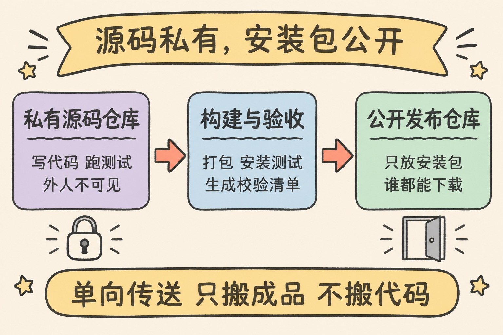
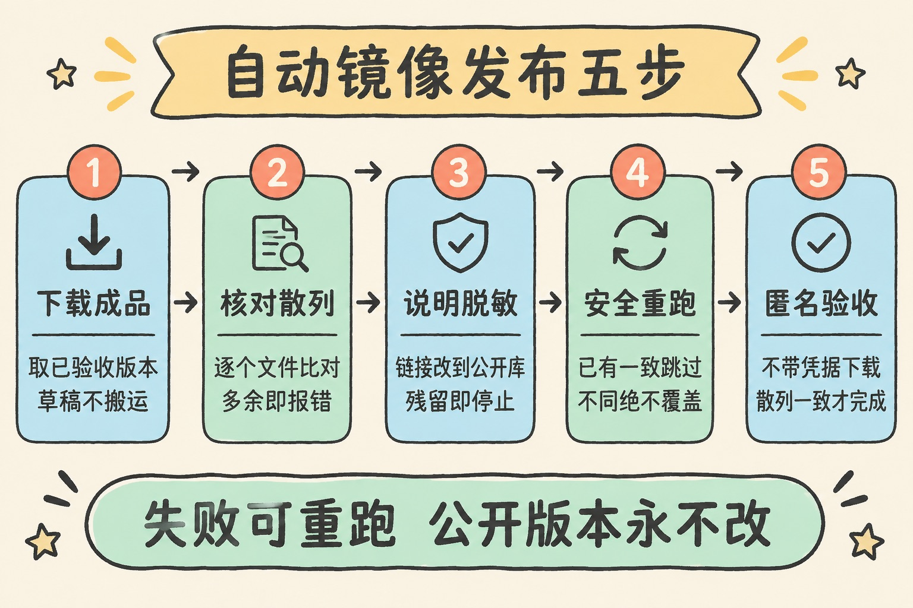
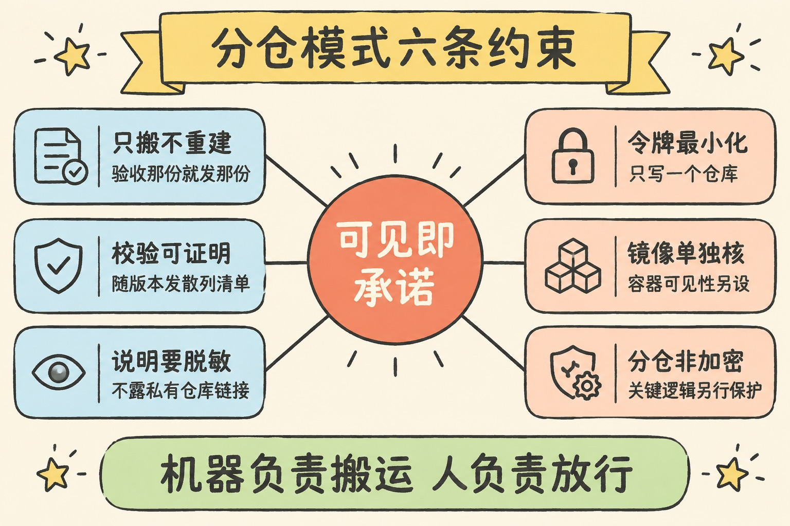

> 代码要关起门来写，安装包要敞开门来发——把这两件事放进同一个仓库，就等于每次发版都要在“保密”和“方便”之间二选一。

---

## 先说结论

1. **把“写代码的地方”和“发安装包的地方”拆成两个仓库**：源码仓库保持私有，另建一个只放二进制、不含任何源码的公开发布仓库。
2. **发布仓库只搬运、不构建**：它里面的每个文件，都必须是源码仓库流水线里已经验收过的同一份构建，逐字节复制，用校验和证明没变。
3. **搬运要自动、可重跑、可验证**：发版后自动镜像；重复执行不出乱子；最后用“陌生人”的身份把每个文件下载一遍，散列对得上才算发布完成。

如果只记住一件事：**可见性是仓库级的，而“谁该看到什么”是文件级的。** 分仓就是用仓库边界去表达文件级的访问意图。

---

## 背景：为什么会有这种需求

很多面向客户交付的软件都有同一个矛盾：

- **源码不能公开**：里面有核心算法、客户定制配置、内部接口地址，提交历史里还可能藏着早年不规范的东西。
- **安装包必须好拿**：客户要能直接下载，运维要能写进部署脚本，应用内的自动更新要能匿名访问一个稳定地址。

在 GitHub 这类平台上，矛盾会变得很具体：**Release 附件的下载权限继承仓库的可见性**。仓库一旦私有，附件下载就需要登录且有权限的账号——客户和自动更新客户端都没有。

于是常见的几种“凑合”做法就出现了：

| 凑合做法 | 看起来的好处 | 实际问题 |
|---------|------------|---------|
| 为了发版把源码仓库临时改成公开 | 一步到位 | 源码和全部历史在公开期间可被任何人克隆，事后改回私有也收不回 |
| 安装包走网盘、聊天工具转发 | 不用折腾 | 版本混乱，无法校验完整性，自动更新无从谈起 |
| 给每个客户开账号、加仓库权限 | 权限精细 | 客户能看到源码；账号随人员流动越来越难管 |
| 自建下载服务器 | 完全可控 | 多了一台要运维、要备份、要上 HTTPS 的机器 |

这些做法的共同问题，是**把“访问控制”这件事交给了人的临时操作**。分仓模式要做的，是把它固化成结构。

---

## 什么是“源码与发布资产分仓”？

### 一句话定义

**分仓模式是：源码仓库私有，负责开发、构建和验收；另建一个公开的发布仓库，只承载已验收的二进制资产和发布说明，二者通过一条自动化流水线单向连接。**

### 人话解释

换句话说，你有两个仓库，各管一件事：

- **源码仓库**是工厂车间：写代码、跑测试、打包、做安装验收，全部在这里，外人进不来。
- **发布仓库**是门店货架：只摆成品，标好版本和校验码，谁都能来拿，但看不到车间里任何东西。

车间到货架之间只有一条单向传送带：成品验收合格后，原样送上货架。货架不会反过来影响车间，也不会自己“加工”任何东西。

### 类比理解

可以把它理解成餐厅的**后厨与出餐口**。后厨不对外开放，但出餐口是公开的；端出去的菜必须是后厨做好、尝过的那一盘，出餐口的人不能自己再炒一遍。



很多团队已经在用这种模式：桌面软件的自动更新经常指向一个专门的 `xxx-releases` 仓库，仓库简介写着“仅二进制，不含源码”。它不是什么新技术，而是**把已有的平台能力，按访问意图重新排列**。

---

## 核心拆解：设计时要守住的五条约束

分仓本身很简单，建一个仓库就行。真正决定它可靠不可靠的，是下面五条约束。

### 一、只搬运，不重建

**发布仓库里绝不能出现“重新构建”的步骤。**

这件事真正关键的地方在于：你在源码仓库里做的所有验收——单元测试、安装测试、升级测试——验证的是**那一份**构建产物。如果发布仓库自己再编译一次，哪怕源码完全相同，产物也可能因为依赖版本、构建时间、编译器差异而不同，之前的验收就全部作废了。

所以镜像步骤只做一件事：从源码仓库的 Release 下载文件，原样上传。

### 二、用校验和证明“没变”

“原样”要能被证明。最朴素也最可靠的方式，是随每个版本发布一份 `SHA256SUMS.txt`：

```text
3f9a…c21e  app-2.1.0-windows-x64-setup.exe
8b47…0d9a  app-2.1.0-windows-x64.zip
e1c0…77f3  app-2.1.0-docker-image.tar.gz
```

镜像时要检查三件事，缺一不可：

- 清单里列出的每个文件都存在，且散列一致；
- 目录里**没有清单之外**的多余文件（防止夹带）；
- 清单本身格式合法（不允许 `../` 之类的路径）。

客户拿到文件后，也能用同一份清单自行核对。校验和不能防止“发布者本人作恶”，但能防止传输损坏、误传版本和中途篡改。

### 三、发布说明要“脱敏”

这是最容易漏掉的一条。源码仓库里的发布说明，常常带着这类链接：

- 指向构建提交的 commit 链接；
- 指向源码仓库 Release 附件的下载链接；
- 指向仓库内文档的 `blob/main/docs/...` 链接。

原样复制到公开仓库后，这些链接对外人全是 404，而且**暴露了私有仓库的名字和目录结构**。镜像时要做三种处理：

| 原内容 | 处理方式 |
|-------|---------|
| 下载链接 | 改写为发布仓库的同名地址 |
| 提交链接 | 去掉链接，只保留完整 SHA 文本，方便内部追溯 |
| 其他指向源码仓库的链接 | **直接报错停止**，交给人判断 |

最后一条是“失败即关闭（fail closed）”：宁可这次不发，也不要把一个没想到的内部链接发出去。

### 四、可重跑，但绝不覆盖

自动化一定会失败：网络抖动、令牌过期、平台限流。失败后要能放心地重跑，所以镜像必须是**幂等**的：

- 目标版本**不存在** → 创建并上传；
- 目标版本**已存在且文件完全一致** → 什么也不做，直接进入验证；
- 目标版本**已存在但文件不同** → 报错，绝不覆盖。

第三种情况看似严格，其实是在保护客户：一个已经公开的版本号，对应的文件就永远不该变。真要修复，发一个新的补丁版本。

### 五、最后用陌生人的身份验收

流水线里的每一步都带着令牌，所以“我能下载”不代表“客户能下载”。最后一步应该**不带任何凭据**，像一个陌生人那样把每个公开地址下载一遍，再对一次散列。

这一步能抓到的问题包括：仓库可见性设错了、附件还在草稿状态、CDN 还没生效、文件名大小写不一致。它是整条流水线里唯一真正站在客户视角的检查。

---

## 实操：用 GitHub Actions 实现自动镜像

下面以 GitHub 为例，给出一套可以直接改用的实现。假设源码仓库叫 `acme/app`（私有），发布仓库叫 `acme/app-releases`（公开）。

### 第一步：建发布仓库

```bash
# 公开、只放二进制；关掉 issue 和 wiki，避免它变成第二个讨论区
gh repo create acme/app-releases --public \
  --description "app 安装包发布通道（仅二进制，不含源码）" \
  --disable-issues --disable-wiki
```

README 写清楚三件事：这里没有源码、文件从哪来、怎么校验。客户第一次打开就知道该怎么用。

### 第二步：准备跨仓库令牌

工作流自带的 `GITHUB_TOKEN` **只对运行它的那个仓库有权限**，不能写别的仓库。所以需要一个单独的令牌：

- 类型选 **fine-grained personal access token**；
- 仓库范围**只选** `acme/app-releases` 一个；
- 权限只给 **Contents: Read and write**；
- 设置有效期，到期前轮换。

把它存成源码仓库的 Actions secret，例如 `RELEASES_REPO_TOKEN`。权限给得越窄，令牌泄露时的损失越小。

### 第三步：写一个可复用的镜像工作流

把镜像做成独立工作流，既能在发版后自动调用，也能手动触发补发旧版本：

```yaml
# .github/workflows/mirror-release.yml
name: Mirror release
on:
  workflow_dispatch:          # 手动重试 / 补发旧版本
    inputs:
      version: { required: true, type: string }
  workflow_call:              # 被发版工作流调用
    inputs:
      version: { required: true, type: string }
    secrets:
      RELEASES_REPO_TOKEN: { required: false }

permissions:
  contents: read              # 本仓库只需要读

jobs:
  mirror:
    runs-on: ubuntu-latest
    steps:
      - uses: actions/checkout@v4
      - uses: actions/setup-python@v5
        with: { python-version: '3.11' }
      - name: Mirror and verify
        env:
          SOURCE_TOKEN: ${{ github.token }}                 # 读源码仓库 Release
          TARGET_TOKEN: ${{ secrets.RELEASES_REPO_TOKEN }}  # 写发布仓库
          VERSION: ${{ inputs.version }}
        run: python scripts/mirror_release.py --version "$VERSION"
```

在原有发版工作流末尾加一个 job，**依赖发布成功**后才运行：

```yaml
  mirror:
    needs: [publish]                 # 源码仓库 Release 发布成功后才镜像
    uses: ./.github/workflows/mirror-release.yml
    with:
      version: ${{ needs.preflight.outputs.version }}
    secrets:
      RELEASES_REPO_TOKEN: ${{ secrets.RELEASES_REPO_TOKEN }}
```

这样镜像失败不会影响源码仓库已经完成的发布，修好令牌后手动重跑即可。

### 第四步：镜像脚本的骨架

脚本把前面五条约束逐条落地。核心逻辑不长，下面是精简后的骨架：

```python
def mirror(version, source_token, target_token, workdir):
    tag = f"v{version}"
    if not target_token:                       # 先检查令牌，避免白下载一遍
        raise ValueError("缺少 RELEASES_REPO_TOKEN")

    # 1. 只搬运：下载源码仓库已发布的 Release，草稿不镜像
    download_release(SOURCE, tag, workdir / "assets", token=source_token)

    # 2. 校验和：清单与文件一一对应，散列全部一致
    expected = verify_directory(workdir / "assets")

    # 4. 幂等：已有且一致则跳过；已有但不同则报错，绝不覆盖
    if target_state(tag, expected, token=target_token) == "absent":
        notes = rewrite_notes(source_body)     # 3. 脱敏：改链接，残留源码链接即报错
        create_release(TARGET, tag, notes, workdir / "assets", token=target_token)

    # 5. 陌生人验收：不带凭据逐个下载，散列必须一致
    verify_public_downloads(TARGET, tag, expected)
```

其中“脱敏”函数的关键是最后那个兜底检查：

```python
def rewrite_notes(body):
    body = rewrite_commit_links(body)          # 提交链接 → 纯 SHA 文本
    body = body.replace(SOURCE_URL + "/releases/download/",
                        TARGET_URL + "/releases/download/")
    leftover = find_links_into(body, SOURCE_URL)
    if leftover:                               # 没想到的内部链接：停下来，交给人
        raise ValueError(f"发布说明仍指向私有仓库：{leftover}")
    return body
```

写完先拿一个**已经手动发布过**的版本试跑：脚本应该识别出“文件完全一致”，不做改动，只跑最后的匿名验证。这是零风险验证整条链路的好办法。

### 第五步：给客户和自动更新一个稳定地址

GitHub 支持用固定路径指向最新版本的附件：

```text
https://github.com/acme/app-releases/releases/latest/download/<文件名>
```

注意文件名里如果带版本号，这个地址每个版本都会变。自动更新更稳妥的做法，是每个版本额外发布一个固定文件名的清单（例如 `latest.json`），里面写版本号、下载地址和散列，客户端只认这一个地址。

关于 GitHub Actions 的更多自动化用法，可以参考我之前写的[用 GitHub Actions 自动生成并发布 GitHub 热点项目日报](/posts/github-hot-digest-automation/)。



---

## 风险与边界

这套方法解决的是“访问控制”和“分发稳定”，不是所有问题。

### 它不是加密

二进制公开，就意味着**任何人都能拿去逆向**。分仓保护的是源码、提交历史和内部结构，不是算法本身。如果核心逻辑真的不能外泄，要配合授权校验、服务端计算或代码混淆，而不是指望一个私有仓库。

### 适合与不适合

| 场景 | 是否适合 |
|------|---------|
| 面向客户交付的桌面软件、工具、离线部署包 | 很适合 |
| 需要应用内自动更新的客户端 | 很适合，配合固定清单地址 |
| 本来就开源的项目 | 不需要，直接在源码仓库发布 |
| 只在公司内网使用的工具 | 不需要，内部制品库更合适 |
| 单个文件特别大的资产 | 要先确认平台限制（GitHub Release 单个附件需小于 2 GiB） |

### 容易踩的坑

- **容器镜像的可见性要单独核对**。在很多平台上，镜像仓库的公开/私有设置与代码仓库并不同步。把代码仓库改回私有后，记得确认镜像是否还按你的意图对外可见。
- **令牌会过期**。fine-grained 令牌到期后镜像会失败，最好在日历里设提醒，或在失败信息里写清楚该去哪儿更新。
- **公开仓库的计费和私有仓库不同**。私有仓库的 Actions 分钟数有额度限制，构建和验收放在源码仓库时，要把这部分成本算进去。
- **签名比校验和更进一步**。校验和证明“文件和清单一致”，代码签名才能证明“文件确实来自你”。客户端自动更新尤其应该校验签名。

### 真正需要人把关的地方

自动化能保证“搬得对”，但保证不了“该不该搬”。**发哪个版本、发布说明写什么、出现脱敏报错时那个链接能不能公开**，这些判断仍然应该留给人。这和[分阶段验收的 AI 协作开发框架](/posts/codex-claude-github-collaboration-framework/)里的思路一致：机器负责执行和检查，人负责关键节点的放行。



---

## 三点总结

1. **用结构表达访问意图**：源码私有、资产公开，用两个仓库把“谁该看到什么”固定下来，而不是每次发版临时改权限。
2. **镜像只搬运、可证明、可重跑**：逐字节复制已验收构建，用校验和证明没变，重复执行不覆盖已公开版本。
3. **以客户视角收尾**：发布说明脱敏、失败即关闭，最后不带凭据把每个文件下载一遍，对上散列才算完成。

## 如果你想马上开始，可以这样做

1. 新建一个公开的 `<项目名>-releases` 仓库，写好 README，手动发布一个现有版本，验证下载和校验流程。
2. 创建只对该仓库有写权限的 fine-grained 令牌，存进源码仓库的 secret。
3. 把镜像脚本和可复用工作流加进源码仓库，先对已手动发布的版本试跑一次（应当“无改动、验证通过”），再接到发版流程末尾。

---

## 参考阅读

- [GitHub Docs：About releases](https://docs.github.com/en/repositories/releasing-projects-on-github/about-releases)
- [GitHub Docs：Linking to releases（`releases/latest/download`）](https://docs.github.com/en/repositories/releasing-projects-on-github/linking-to-releases)
- [GitHub Docs：Reusing workflows](https://docs.github.com/en/actions/using-workflows/reusing-workflows)
- [GitHub Docs：Automatic token authentication（`GITHUB_TOKEN` 的权限范围）](https://docs.github.com/en/actions/security-guides/automatic-token-authentication)
- [GitHub Docs：Managing your personal access tokens](https://docs.github.com/en/authentication/keeping-your-account-and-data-secure/managing-your-personal-access-tokens)
- 站内：[代码里的脚手架：写了就要拆，但不能不写](/posts/scaffolding-in-code/)
