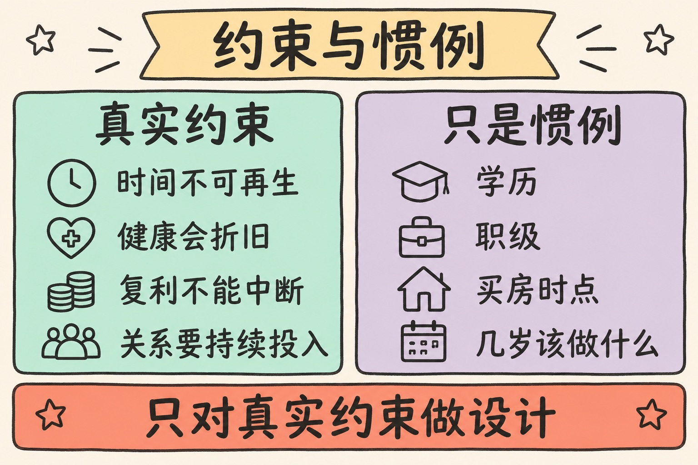
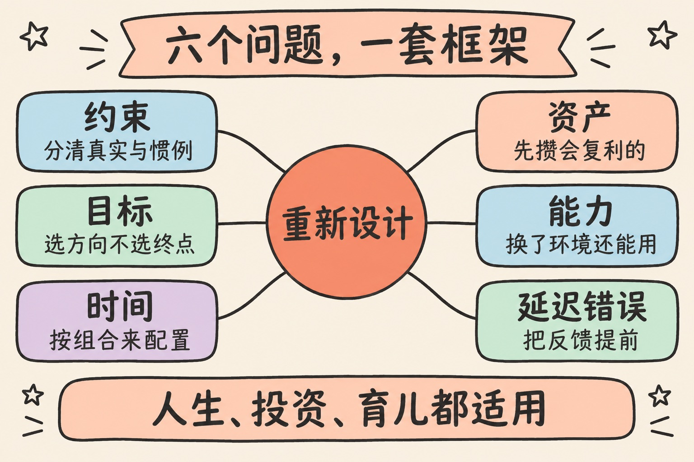
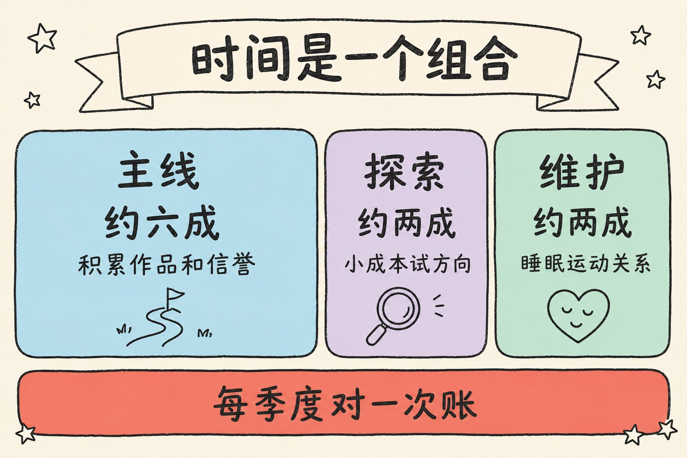
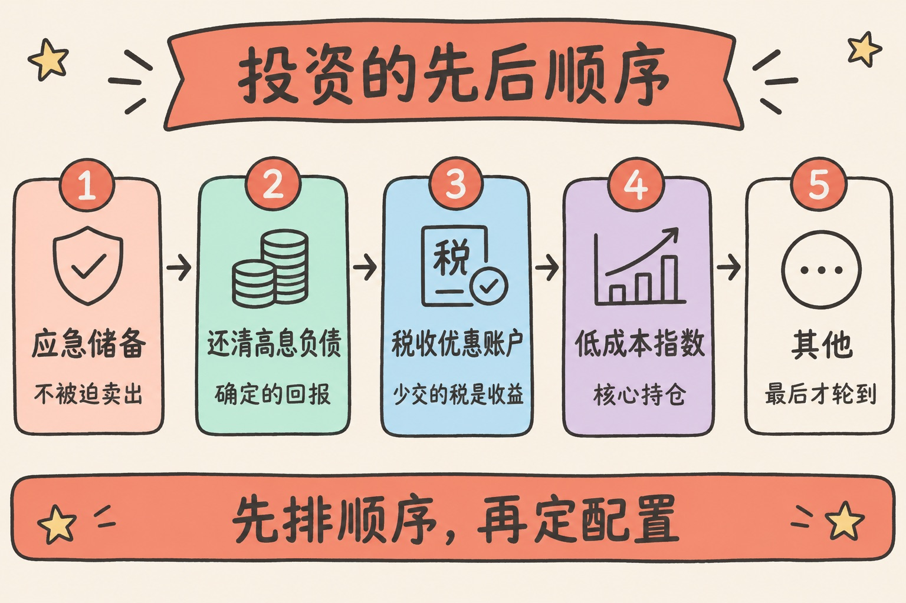
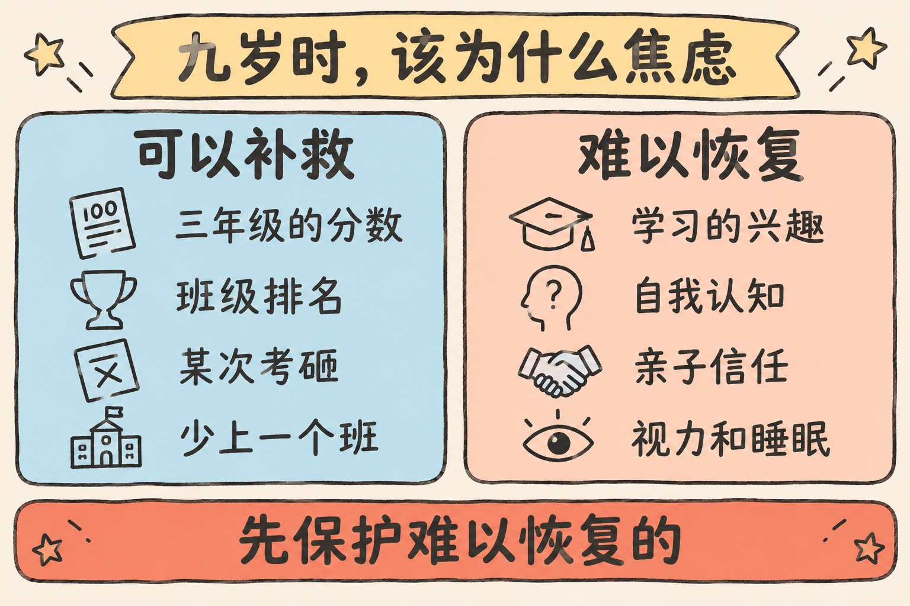
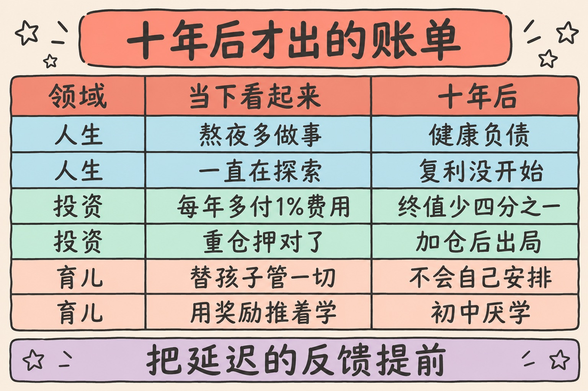

> 默认路径不蠢，它是一份保险。离开它可以，但保险要自己重新买。

这篇文章整理自我和 Claude 的一次连续追问。我先问了一个大问题：如果不再按社会默认的成功路径生活，而是从第一性原理重新设计人生，该怎么选目标、配时间、攒资产、建能力，并避开那些十年后才显现的错误？然后把同一个问题换了两次角度：个人投资，以及一个小学三年级、九岁孩子的教育。

三次回答放在一起看，我发现它们是同一个结构。下面是我消化之后的版本。

---

## 先讲结论

1. **先分清真实约束和惯例，只对真实约束做设计。** 时间、健康、复利、关系是约束；学历、职级、几岁该做什么是惯例。
2. **人生、投资、育儿可以用同一组六个问题来设计**：约束是什么、目标怎么选、时间怎么配、什么在复利、练什么能力、哪些错误十年后才显现。
3. **最危险的错误都有同一个特征：反馈延迟。** 犯错的当下毫无感觉，甚至看起来像是做对了。

---

## 一、默认路径是一份保险

说到“从第一性原理设计人生”，很容易滑向另一个极端：既然上学、升职、买房都是别人定的规矩，那就全部推翻。

这个推论漏了一步。第一性原理不是“什么都不信”，而是把一件事拆到不能再拆，看哪些部分是真的绕不过去的。拆完之后，真实约束其实只有几条：

| 真实约束 | 为什么绕不过去 |
|---------|--------------|
| 时间不可再生 | 花掉就没有了，不能借也不能存 |
| 健康会折旧 | 透支有利息，而且很晚才出账单 |
| 复利需要长期不中断 | 中途出局一次，前面的积累大打折扣 |
| 深度关系需要持续投入 | 不能突击，也不能购买 |
| 你不了解十年后的自己 | 偏好会变，今天笃定的目标未必还成立 |

学历、职级、买房时点、“几岁该做什么”，这些是惯例。惯例可以不遵守，约束不行。

但默认路径并不蠢。它是给“还不了解自己的普通人”设计的一份保险，替你防住了三种下行风险：收入中断、缺乏反馈、社会孤立。按部就班上班的人，工资每月到账，绩效考核告诉你做得怎么样，同事和同学自动构成社交圈。

离开默认路径，等于退掉了这份保险。可以退，但这三样风险得自己重新防住。很多人离开之后过得不好，不是因为方向选错了，而是只退了保，没有补保。



---

## 二、六个问题，一套框架

把三次回答叠在一起，骨架是同一组问题：

| 问题 | 它在问什么 |
|------|-----------|
| 约束 | 哪些是真的绕不过去，哪些只是惯例 |
| 目标 | 往哪个方向走，而不是到达哪个终点 |
| 时间 | 一天、一年的时间按什么比例分配 |
| 资产 | 哪些东西会自己复利，值得先攒 |
| 能力 | 哪些能力换了环境还能用 |
| 延迟错误 | 哪些错现在没感觉，十年后才出账单 |

其中两个领域还可以直接写成等式，一眼看出力气该花在哪：

```text
投资：长期财富 ≈ 储蓄额 × 时间 ×（市场回报 − 费用 − 税 − 行为损失）
教育：长期结果 ≈ 内在动机 × 基础能力 × 时间 − 损耗
```

等式的用处是把“我能控制的”和“我控制不了的”分开。投资里只有市场回报不归你管，大多数人却把精力全花在预测它上面。教育里成绩是可以补的，动机和损耗很难补，而抢跑、刷题、排满课外班，恰恰是拿后两项去换短期成绩。



---

## 三、人生版：选方向，买自由

**目标：选方向，不选终点。** 先过滤借来的欲望。有一个很好用的问题：如果永远没人知道我做成了这件事，我还想要吗？大部分目标过不了这一关。剩下的目标也别定成终点，因为偏好会变；定成方向，并且让每一步都留下可迁移的东西。

谨慎要按可逆性分配。可逆的决定快速试错；不可逆的——伴侣、是否生育、健康、信誉——值得用十倍的思考。这和我在[《价值观：清单没有用，排序才有用》](/posts/personal-value-system/)里写的是一回事：重要的不是列出在乎什么，而是冲突时谁让谁。

**时间：按组合来配置。**

| 份额 | 给什么 | 作用 |
|------|--------|------|
| 约六成 | 一条主线 | 能力、作品、信誉的积累来源 |
| 约两成 | 探索 | 小成本试新方向，否则主线选错了也不会知道 |
| 约两成 | 维护 | 睡眠、运动、重要关系，不产生增长，但缺了一切归零 |

每季度对一次账：时间实际花在哪，和自己声称的优先级是否一致。

**资产：先买自由，再谈增值。** 资产至少有五类：金融资本、能力、健康、关系、信誉。后四类不能突击购买，只能慢慢攒。钱这一项，最大的自由来自低固定支出，它决定你敢不敢拒绝、敢不敢试错；其次是一到两年的生活储备，买的是“不被迫做决定”的权利。

**能力：做组合，不做单项冠军。** 两三项各做到前 20% 的能力叠起来，比单项做到前 1% 更现实，也更难被替代。优先练可迁移的底层能力：清晰写作、说服、独立把事情做完、不确定条件下的判断。积累要靠公开作品而不是靠准备，作品能带来反馈和信誉，学习笔记不能。



---

## 四、投资版：为生活筹资，而不是跑赢市场

> 这一节是通用原则，不是针对任何人的投资建议。

**目标：把它换算成数字。** 常见的粗略估算是年支出的 25 倍左右，也就是所谓的“4% 法则”。它来自对美国历史数据的回测，是参考，不是保证。风险承受力也要按真实行为定义：它不是问卷上的答案，而是账户下跌 40% 时你仍然不卖的那个仓位。

**时间：早期投在自己身上。** 本金小的时候，收益率几乎不重要。10 万本金多赚 2% 是 2000 元，一次加薪或提高储蓄率的效果往往是它的很多倍。所以前期的时间应该给收入能力，投资本身设好自动定投就够了。

**资产：先排顺序，再定配置。**

| 顺序 | 做什么 | 理由 |
|------|--------|------|
| 1 | 应急储备 | 永远不必在低点被迫卖出 |
| 2 | 还清高息负债 | 确定的、无风险的回报 |
| 3 | 用满税收优惠账户 | 少交的税就是多出来的收益 |
| 4 | 低成本分散的指数类资产 | 作为核心持仓 |
| 5 | 其他任何东西 | 最后才轮到 |

有两点常被忽略。第一，你的工作也是一项资产：收入随行业周期波动的人，不该再重仓同行业或自家公司的股票。第二，自住房是“消费加一笔带杠杆的集中持仓”，买还是租应该算出来，而不是默认。

**能力：纪律比选股重要。** 把规则写下来——配置比例、何时再平衡、什么情况下才允许改——它在恐慌时替你做决定。想主动投资，就单独划一个小仓位，并诚实地和指数对比成绩，否则分不清运气和能力。

这一节和[《站在未来看现在》](/posts/view-from-the-future/)、[《复利：一个有前提的结构》](/posts/compounding-preconditions/)是互相印证的：复利的前提是不出局，而不是收益率高。



---

## 五、育儿版：设计十九岁时的那个人

以一个九岁、小学三年级的孩子为例。除了上面那些约束，这里还多三条：孩子是另一个人，天赋和兴趣不由你设计；父母影响力最大的窗口大约只剩三到五年，之后同伴的影响会超过你；孩子成年时的世界，现在没人能预测。

**目标：终点不是某所学校。** 是一个能自学、愿意学、身体好、有朋友、遇到事还愿意找你谈的年轻人。焦虑同样按可逆性分配：

| 可逆，不值得过度焦虑 | 难以恢复，值得全力保护 |
|--------------------|----------------------|
| 三年级的分数 | 对学习的兴趣 |
| 班级排名 | “我数学不行”这类自我认知 |
| 某次考砸 | 亲子信任 |
| 少上一个课外班 | 视力和睡眠 |

**时间：先保护，再安排。** 优先级从上到下是：睡眠（这个年龄的建议量是每晚 9 到 12 小时）、没人安排的自由时间、阅读和户外运动、学校功课，最后才是一两项深入的兴趣。父母自己最值钱的时间，是每天十几分钟不看手机、只听孩子说话。

**资产：四项会复利的东西。** 阅读量——三四年级正是从“学习阅读”转向“通过阅读学习”的阶段；数学的理解——靠背和速度拿到的高分会掩盖漏洞，到初中才暴露；身体——一项能坚持的运动加足够的户外时间；信任账户——现在每一次认真倾听都是存款，青春期要靠这笔余额才说得上话。

**能力：把管理权逐步交出去。** 作业是孩子的事，父母是顾问而不是监工。现在让孩子自己记作业、自己承担忘带的后果，代价最小。夸奖具体的努力和方法，而不是“聪明”。用 AI 也一样：把它当老师来追问，而不是当答案机。

这和我在[《养孩子，到底在养什么》](/posts/raising-children/)里写的“做园丁，别做木匠”是同一个方向，只是这次落到了一个具体年龄上。



---

## 六、十年后才显现的错误

三个领域的错误清单各有七八条，但它们的结构只有一种：**反馈延迟**。犯错的当下不仅没有惩罚，往往还有奖励。

| 领域 | 当下看起来 | 十年后的账单 |
|------|-----------|-------------|
| 人生 | 熬夜多做了一点事 | 健康负债连本带利 |
| 人生 | 朋友只是很久没联系 | 关系因无人维护而消失 |
| 人生 | 一直在探索，保留选择权 | 复利从未开始 |
| 投资 | 每年多付 1% 的费用 | 三十年后终值约少四分之一 |
| 投资 | 重仓押对了，像是眼光 | 下一个周期加仓后出局 |
| 育儿 | 替孩子管好一切，成绩很好 | 十五岁发现他不会自己安排任何事 |
| 育儿 | 用奖励和压力推着学 | 初中以厌学的形式爆发 |

还有一条值得单独拎出来：**换了剧本，却以为是自由。** 数字游民、提前退休、创业，都是现成的剧本。照搬它们和照搬默认路径没有区别。育儿里对应的是“别人报什么班就跟什么班”，那是在处理父母自己的焦虑，而不是孩子的需要。

对付延迟反馈，办法只有一个：**人为地把反馈提前。** 三个领域各有一句可以定期问自己的话：

- **人生，每年一次：** 如果今天从零开始，我还会选现在的工作、城市、关系和日常吗？答案是否定的那一项，就是下一年要处理的事。
- **投资，每年一次：** 我的成绩和指数比怎么样？规则有没有被我在情绪里改掉？
- **育儿，每学期一次：** 孩子现在比半年前更喜欢学习、更愿意和我说话了吗？如果不是，成绩再好也要调整。



---

## 总结

1. **分清约束和惯例。** 惯例可以不遵守，约束不行；默认路径替你防住的风险，离开后要自己防。
2. **目标定方向，谨慎给不可逆。** 分数、排名、短期收益都能补，健康、信任、兴趣和出局补不了。
3. **先攒会复利的东西。** 能力、健康、关系、信誉、阅读量、信任账户，都不能突击购买。
4. **把延迟的反馈人为提前。** 每年、每学期问自己那一句话，比任何计划都管用。

这套框架的边界也要说清楚：它给的是问题，不是答案。每个人的约束强度不一样，有人要养家，有人身体不允许，有人所在的教育体系留给孩子的自由时间本来就少。框架帮你看清自己在拿什么换什么，换不换，还是得自己定。

---

**参考阅读**：

- William Bengen, *Determining Withdrawal Rates Using Historical Data* (1994)：“4% 法则”的出处
- S&P Dow Jones Indices, SPIVA 报告：主动基金与对应指数的长期对比
- American Academy of Sleep Medicine 2016 年共识声明：6~12 岁儿童每晚建议睡眠 9~12 小时
- Jeanne Chall, *Stages of Reading Development*：从“学习阅读”到“通过阅读学习”
- Carol Dweck,《终身成长》：夸努力而不是夸聪明
- 站内：[《未来现金流折现》](/posts/discounted-cash-flow/)、[《你只需要三个习惯》](/posts/three-habits/)
