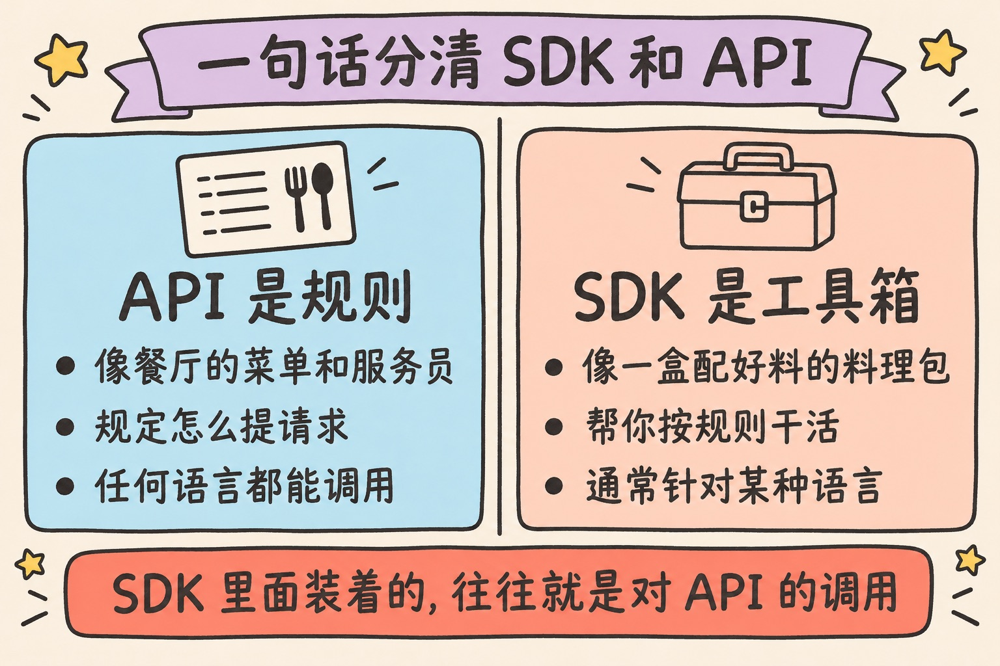
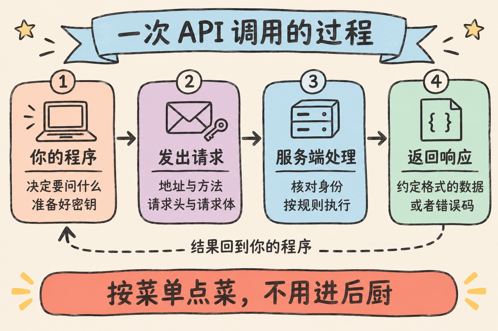
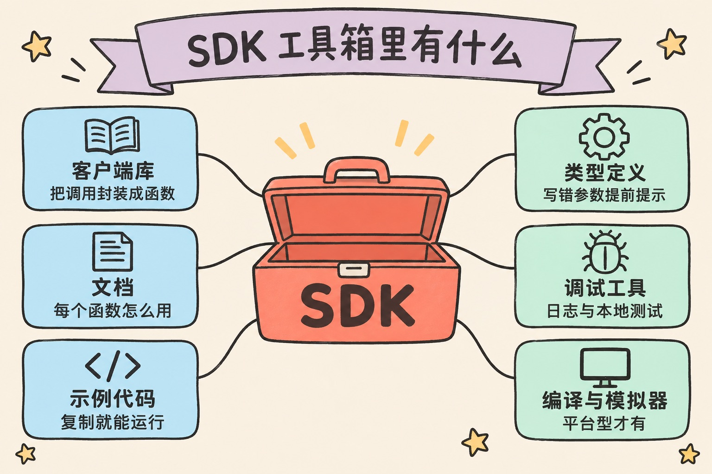
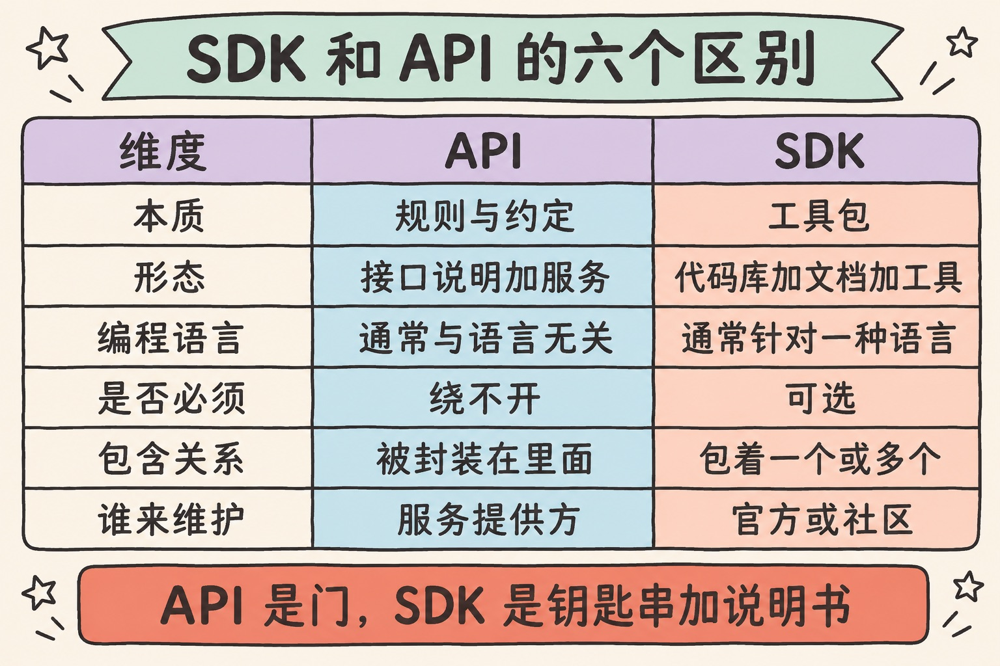
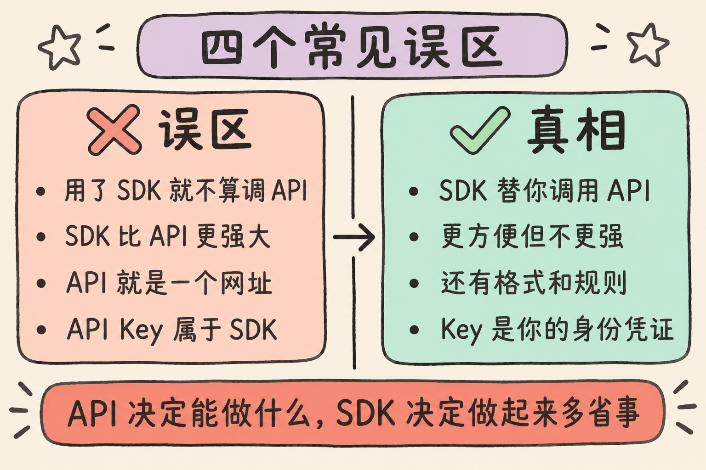
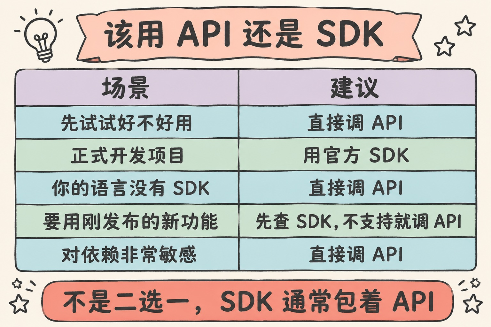

> API 告诉你「可以怎么跟我说话」，SDK 帮你「把话说好」。大多数时候，SDK 里面装着的，正是对 API 的调用。

---

## 先讲结论

1. **API 是约定，SDK 是工具**：API（应用程序编程接口）规定了「发什么请求、得到什么结果」；SDK（软件开发工具包）是一整套帮你按这个约定写程序的代码库、文档和工具。
2. **SDK 通常包着 API**：你调用 SDK 的一个函数，它在背后替你拼好请求、发给 API、再把结果整理好交给你。不用 SDK 也能直接调 API，只是要自己处理更多细节。
3. **怎么选**：临时试一下、或者没有你用的编程语言的 SDK，就直接调 API；正式做项目，优先用官方 SDK。

---

## 背景：为什么这两个词总让人犯迷糊

刚接触开发的人，经常在文档里同时看到这两个词：

- 「请先申请 **API** Key」
- 「推荐使用官方 **SDK** 接入」
- 「通过 **API** 调用模型」
- 「安装 Python **SDK**：`pip install ...`」

它们经常一起出现，又经常被混着说，很容易让人以为是同一个东西的两种叫法。其实它们是**两个层次**的东西：一个是「规则」，一个是「工具」。



---

## 什么是 API？

### 一句话定义

**API（Application Programming Interface，应用程序编程接口）是一个软件对外公开的「沟通规则」：别的程序可以按这个规则向它提出请求，并得到约定好的结果。**

### 人话解释

一个软件系统内部再复杂，外人也不需要知道。它只要公开一份说明：「你按这个格式来问，我就按那个格式回答。」这份说明就是 API。

### 类比：餐厅的菜单和服务员

想象你去一家餐厅吃饭：

| 餐厅 | 软件世界 |
|------|---------|
| 后厨 | 提供服务的系统（比如天气服务、AI 模型、支付系统） |
| 菜单 | API 文档：能点什么、每道菜要提供什么信息 |
| 服务员 | API 本身：接收你的点单，送到后厨，再把菜端回来 |
| 你点菜 | 你的程序发出请求 |
| 上菜 | 系统返回结果 |

你不用进后厨，也不用知道菜怎么做，只要**按菜单点菜**就能吃上饭。后厨换了厨师、换了灶台，只要菜单不变，你点菜的方式也不变。这正是 API 的价值：**把内部的复杂性藏起来，只暴露一个稳定的接口。**

### 现在最常见的 API：Web API

今天大家说「调 API」，多数时候指的是 **Web API**：你的程序通过网络向一个网址发送 HTTP 请求，对方返回数据（通常是 JSON 格式）。一次 API 调用一般包含这几样东西：



| 组成部分 | 作用 | 例子 |
|---------|------|------|
| 地址（Endpoint） | 往哪里发 | `https://api.anthropic.com/v1/messages` |
| 方法 | 做什么动作 | `POST`（提交）、`GET`（查询） |
| 请求头 | 身份和格式信息 | API Key、数据格式 |
| 请求体 | 具体要什么 | 用哪个模型、问什么问题 |
| 响应 | 返回的结果 | 一段 JSON，里面有模型的回答 |

> 补充：API 不只存在于网络上。操作系统提供给程序的「打开文件」「画一个窗口」，一个代码库公开给你的函数，也都叫 API。只要是「一个软件公开给另一个软件调用的规则」，都是 API。

---

## 什么是 SDK？

### 一句话定义

**SDK（Software Development Kit，软件开发工具包）是为某个平台或服务准备的一整套开发工具，通常包括代码库、文档、示例代码和调试工具，让你更快、更少出错地完成开发。**

### 人话解释

API 只告诉你规则，SDK 则直接把「按规则干活」的工具递到你手上。你不用自己拼网址、写请求头、处理各种出错情况，调用一个现成的函数就行。

### 类比：一盒配好料的料理包

还是吃饭的例子。如果说 API 是餐厅的菜单，那 SDK 更像**商家给你的一盒料理包**：

- 食材已经洗好切好、按份配好（封装好的代码库）；
- 附一张图文菜谱（文档和示例）；
- 甚至配了专用的锅铲和量勺（调试和构建工具）。

你照着做，很快就能做出一道菜，而且不容易翻车。

### 一个 SDK 里通常有什么



| 组成 | 作用 |
|------|------|
| 客户端库 | 把 API 调用封装成你所用编程语言里的函数，比如 Python 的一个方法 |
| 文档 | 告诉你每个函数怎么用 |
| 示例代码 | 可以直接复制运行的例子 |
| 类型定义 | 写代码时编辑器能自动提示、提前发现参数写错 |
| 调试与测试工具 | 本地模拟、日志、测试辅助 |
| 编译器、模拟器等 | 平台型 SDK 才有，比如 Android SDK 里有构建工具和手机模拟器 |

所以 SDK 的范围可大可小：

- **小的 SDK**：一个服务的官方客户端库，比如各家 AI 模型的 Python SDK、支付平台的 SDK，核心作用就是「帮你调用它的 API」。
- **大的 SDK**：一个平台的完整开发工具，比如开发安卓应用用的 Android SDK、开发苹果应用用的 iOS SDK，里面除了各种 API 的封装，还有编译、打包、调试、模拟运行的全套工具。

---

## 同一件事，两种写法

光讲概念容易飘，我们用一个真实例子对比：**让 Claude 回答一个问题。**

### 写法一：直接调 API

用命令行工具 `curl` 发一个 HTTP 请求：

```bash
# 直接调用 Claude 的 Messages API
# 需要自己写：地址、身份认证、版本号、数据格式、请求内容
curl https://api.anthropic.com/v1/messages \
  -H "x-api-key: $ANTHROPIC_API_KEY" \
  -H "anthropic-version: 2023-06-01" \
  -H "content-type: application/json" \
  -d '{
    "model": "claude-sonnet-5-5",
    "max_tokens": 1024,
    "messages": [{"role": "user", "content": "用一句话解释什么是 API"}]
  }'
```

返回的是一大段 JSON，你还要自己从里面把回答的文字取出来。

### 写法二：用官方 Python SDK

```python
# 先安装：pip install anthropic
import anthropic

# SDK 会自动从环境变量 ANTHROPIC_API_KEY 读取密钥
client = anthropic.Anthropic()

message = client.messages.create(
    model="claude-sonnet-5-5",
    max_tokens=1024,
    messages=[{"role": "user", "content": "用一句话解释什么是 API"}],
)

print(message.content[0].text)  # 直接拿到回答的文字
```

### 两种写法背后发生的事是一样的

SDK 的 `messages.create()` 在背后做的，正是写法一里那个 HTTP 请求。区别在于，SDK 还**顺手帮你做了很多杂事**：

| 杂事 | 直接调 API | 用 SDK |
|------|-----------|-------|
| 拼地址、写请求头 | 自己写 | 自动 |
| 读取和携带密钥 | 自己处理 | 自动从环境变量读取 |
| 网络抖动时重试 | 自己写重试逻辑 | 内置 |
| 超时设置 | 自己设 | 有默认值，可调 |
| 解析返回的 JSON | 自己解析 | 直接得到对象 |
| 出错时判断原因 | 自己看状态码 | 抛出有名字的异常，比如认证失败、请求过多 |
| 参数写错 | 运行时才发现 | 编辑器提前提示 |
| 流式输出（一个字一个字返回） | 自己解析数据流 | 提供现成的方法 |

**换句话说：API 决定了「能做什么」，SDK 决定了「做起来有多省事」。**

---

## 一张表看清区别



| 维度 | API | SDK |
|------|-----|-----|
| 本质 | 规则、约定、接口 | 工具包 |
| 形态 | 一份接口说明 + 一个可访问的服务 | 可以安装的代码库 + 文档 + 工具 |
| 和编程语言的关系 | 通常与语言无关，任何语言都能调用 | 通常针对某种语言或平台（Python SDK、Java SDK、Android SDK） |
| 是否必须 | 想使用服务就绕不开 | 可选，没有 SDK 也能直接调 API |
| 包含关系 | 被 SDK 封装在里面 | 通常包含对一个或多个 API 的调用 |
| 谁来维护 | 服务提供方 | 服务提供方（官方 SDK）或社区（第三方 SDK） |

一句话记住：**API 是门，SDK 是钥匙串加说明书。** 门只有一扇，钥匙可以有很多种语言的版本。

---

## 四个常见误区



**误区一：「用了 SDK，就不是在调 API 了。」**
其实还是在调。SDK 只是替你调，最终发出去的仍然是 API 请求，所以照样受 API 的规则约束：要密钥、有调用频率限制、按调用量计费。

**误区二：「SDK 比 API 更高级、更强大。」**
SDK 更**方便**，但能力不会超过它封装的 API。API 没提供的功能，SDK 也变不出来。反过来，有时 API 刚上线的新功能，SDK 还没来得及更新，这时只能直接调 API。

**误区三：「API 就是一个网址。」**
网址只是 API 的入口之一。完整的 API 还包括请求格式、参数含义、返回格式、错误码、认证方式和版本规则。只知道网址，并不等于会用这个 API。

**误区四：「API Key 是 SDK 的一部分。」**
API Key 是**你的身份凭证**，由服务方发给你，用来证明「是谁在调用、该向谁计费」。无论直接调 API 还是用 SDK，都需要它。它要像密码一样保管，不能写进代码提交到公开仓库。

---

## 什么时候用哪个？



| 场景 | 建议 | 原因 |
|------|------|------|
| 先试试这个服务好不好用 | 直接调 API（curl 或在线调试工具） | 不用装任何东西，几分钟就能看到结果 |
| 正式开发一个项目 | 用官方 SDK | 重试、超时、错误处理都现成，代码更短更稳 |
| 你用的语言没有官方 SDK | 直接调 API，或找口碑好的第三方 SDK | 任何能发 HTTP 请求的语言都能调 API |
| 要用刚发布的新功能 | 先看 SDK 是否已支持，没有就直接调 API | SDK 的更新可能比 API 稍晚 |
| 对依赖非常敏感的场景（比如嵌入式设备） | 直接调 API | 少装一个库，少一份依赖 |

---

## 延伸：AI 时代这两个词为什么更重要

如果你在用 AI 工具，会发现这两个词几乎无处不在：

- 调用大模型，本质上就是调用模型厂商的 API；
- 各家都提供 Python、TypeScript 等语言的 SDK，让接入只需要几行代码；
- 做 AI Agent 时，「让模型调用外部工具」，其实就是让模型去调用各种 API。像 MCP 这样的协议，就是在给「模型怎么发现和调用外部工具」制定统一规则，可以参考 [从文本到界面：一文讲透 MCP App](/posts/mcp-app-complete-guide/)；
- 而把模型、工具和循环组装成一个能干活的 Agent，又离不开一层层的 SDK 和框架，这部分在 [Agent 与 Harness](/posts/agent-harness-guide/) 里有详细展开。

理解了「API 是规则、SDK 是工具」，你再看这些新名词，就能很快判断它们处在哪一层。

---

## 总结

1. **API 是沟通规则**：规定了软件之间「怎么提请求、怎么给回应」，就像餐厅的菜单和服务员。
2. **SDK 是开发工具包**：把对 API 的调用和各种杂事打包好，再配上文档和工具，就像一盒配好料的料理包。
3. **两者是包含关系，不是二选一**：SDK 通常包着 API。试用时直接调 API，正式开发优先用官方 SDK。

如果你想马上动手：找一个你感兴趣的服务（天气、地图或者 AI 模型），先用 `curl` 按文档调一次它的 API，再用它的 Python SDK 把同样的事做一遍。对比两段代码，你对这两个词的理解就再也不会混了。

### 参考阅读

- Anthropic：[Messages API 文档](https://docs.anthropic.com/en/api/messages)
- Anthropic：[Python SDK（GitHub）](https://github.com/anthropics/anthropic-sdk-python)
- Android Developers：[Android SDK 平台工具说明](https://developer.android.com/tools)
- MDN Web Docs：[Web API 简介](https://developer.mozilla.org/en-US/docs/Learn_web_development/Extensions/Client-side_APIs/Introduction)
- [从文本到界面：一文讲透 MCP App 的原理、协议与企业落地](/posts/mcp-app-complete-guide/)
- [Agent 与 Harness：模型是发动机，Harness 才是整台车](/posts/agent-harness-guide/)
