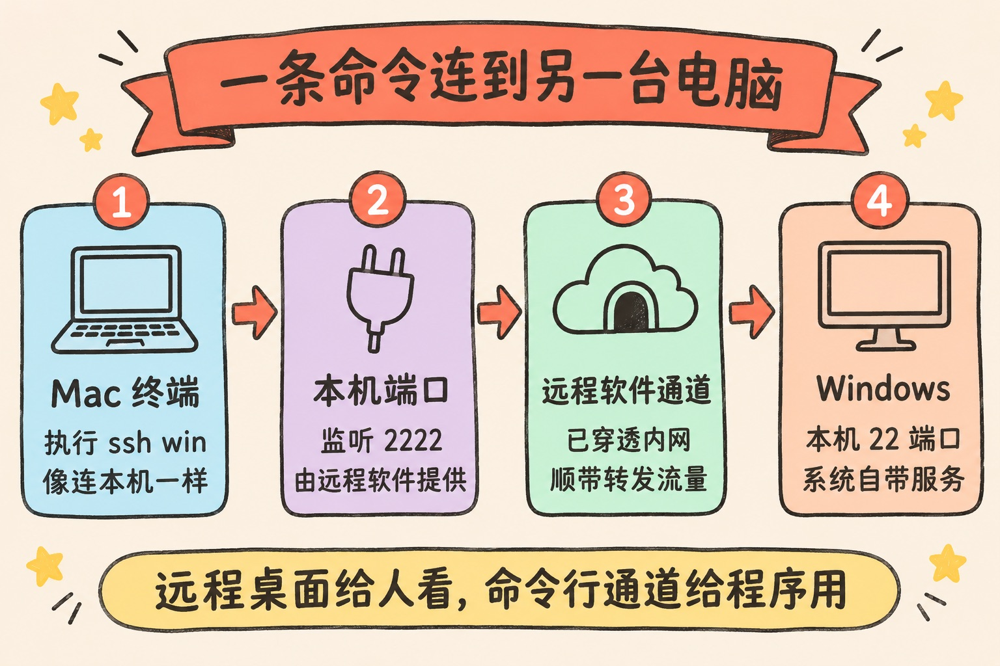
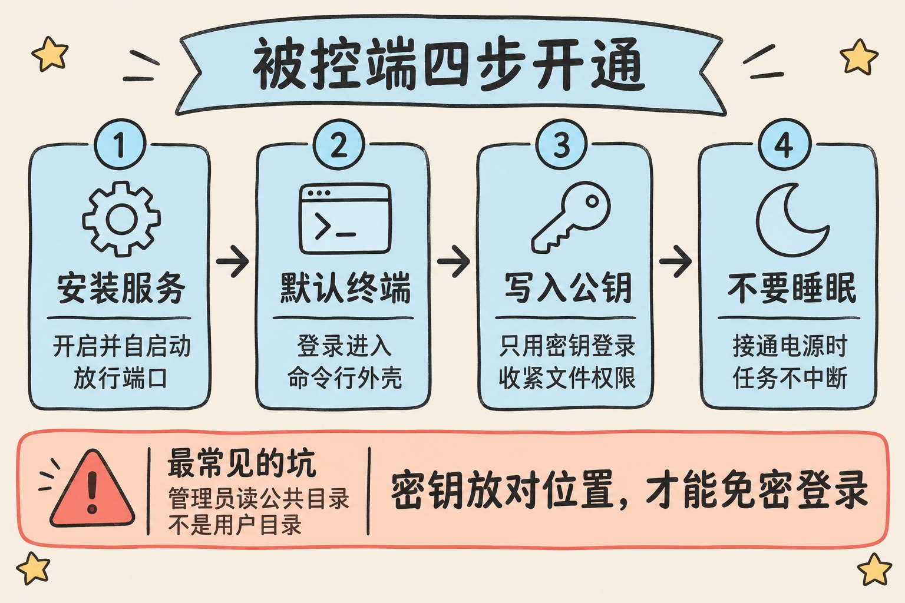
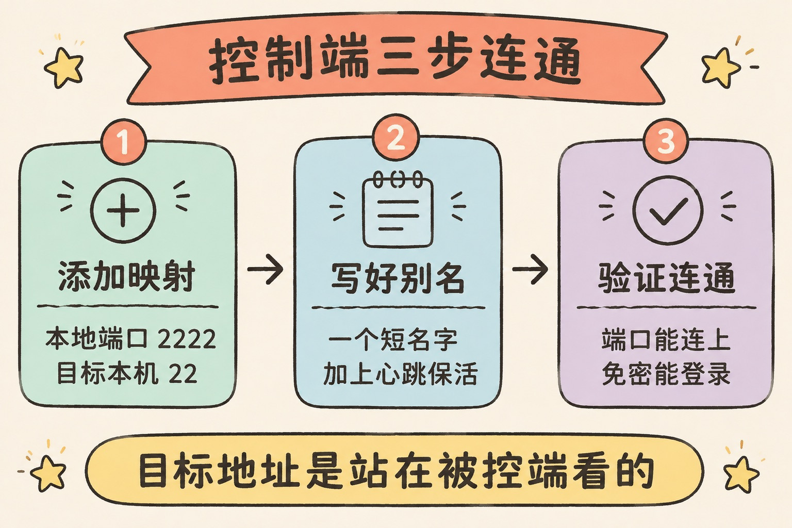

> 远程桌面让人能“看到”另一台电脑，SSH 才让脚本和 AI Agent 能“操作”它——而把两者接起来，可能只需要远程桌面软件里一个不起眼的“端口映射”按钮。

---

## 先讲结论

1. **想让 Mac 上的工具链（包括 AI Agent）在 Windows 上编译、运行、看日志，需要的是一条 SSH 通道，不是一个远程桌面窗口。** 远程桌面只适合人眼看、人手点。
2. **没有公网 IP、组网工具又走不通时，远程桌面软件自带的端口映射就是一条现成的隧道。** 本文用的是网易 UU 远程：在 Mac 端把本地 `2222` 映射到 Windows 的 `127.0.0.1:22`，之后 `ssh` 就像连本机一样。
3. **通道打通只是一半，另一半是“在 SSH 里能干活”。** Windows 的 SSH 会话有不少反直觉的地方：winget 不能用，部分安装器会卡死，中文会乱码。提前知道这些，能省下大半天。



---

## 背景：为什么非要 SSH 不可

我的日常开发环境是 Mac，但手上有一个老项目只能在 Windows 上编译和运行：.NET Framework 的 WinForms 程序，依赖 32 位的 Access 数据库驱动。要做的事情很具体：

- 装好编译环境（MSBuild、.NET 目标包、数据库驱动）；
- 把源码和数据传过去；
- 编译、运行、比对结果，出错就改了再跑。

这些事如果靠远程桌面，就得一直盯着屏幕手动点。更关键的是，我想让 Mac 上的 AI Agent（Claude Code）来做这些重复劳动，而 Agent 最擅长的交互方式是**命令行**：执行命令、读输出、根据结果决定下一步。

> 换句话说：远程桌面是给人用的，SSH 是给程序用的。只要目标是自动化，最终都会落到 SSH 上。

能把 Mac 和 Windows 连起来的办法不少，我依次试了几种：

| 方案 | 原理 | 我这次的结果 |
|------|------|-------------|
| 公网 IP + 端口转发 | 路由器把外网端口转到 Windows 22 | 没有公网 IP，直接排除；有也不建议把 22 暴露到公网 |
| Tailscale 组网 | 两端加入同一个虚拟局域网 | 理论上最优雅，但当时 Mac 端没登录、网络环境受限，没走通 |
| 蒲公英组网 | 同上，国内服务 | Mac 端拿不到虚拟网段地址，ping 不通 |
| 纯远程桌面 | 看画面、点鼠标 | 能用，但无法自动化，Agent 只能截图点击，又慢又容易错 |
| **远程桌面的端口映射 + OpenSSH** | 借远程软件的通道转发 TCP 端口 | **一次跑通，最终采用** |

如果你的网络环境允许，Tailscale 依然是我的首选，原理和配置见 [Tailscale + SSH + RustDesk：打造零配置远程访问方案](/posts/tailscale-ssh-rustdesk-guide/)。本文要解决的是另一种很常见的情况：**组网走不通，但两台机器上恰好都装了远程桌面软件。**

---

## 什么是“远程软件的端口映射”？

### 一句话定义

**端口映射是把控制端本机的一个端口，经远程软件已经建立好的连接，转发到被控端可达的某个地址和端口。**

### 人话解释

远程桌面软件为了传画面，本来就在两台机器之间打通了一条穿透 NAT 的通道。端口映射只是让这条通道额外“捎带”一路 TCP 流量：你在 Mac 上连 `127.0.0.1:2222`，数据会被送到 Windows 那头，再由它连向 `127.0.0.1:22`。

### 类比理解

可以把它理解成 `ssh -L` 本地端口转发的图形化版本：区别只是隧道由远程软件提供，不需要你先有一个能 SSH 的跳板。

```text
Mac 终端 ── ssh win ──> 127.0.0.1:2222 ──(远程软件的通道)──> Windows 127.0.0.1:22 (sshd)
```

> 注意“目标地址”的视角：它是**站在被控端看**的。映射到 Windows 自己的 sshd，目标地址就填 `127.0.0.1`，不是 Windows 的局域网 IP。


---

## 第一步：Windows 端开启 OpenSSH，只允许密钥登录

Windows 10 1809 之后就内置了 OpenSSH Server，只是默认没装。下面这段在**管理员 PowerShell**里执行一次即可，重复执行也没关系：

```powershell
# 1. 安装并启动 sshd，设为开机自启，放行 22 端口
Add-WindowsCapability -Online -Name OpenSSH.Server~~~~0.0.1.0
Set-Service -Name sshd -StartupType Automatic
Start-Service sshd
New-NetFirewallRule -Name 'OpenSSH-Server-In-TCP' -DisplayName 'OpenSSH Server (sshd)' `
    -Enabled True -Direction Inbound -Protocol TCP -Action Allow -LocalPort 22

# 2. SSH 登录后默认进入 PowerShell，而不是 cmd
New-ItemProperty -Path 'HKLM:\SOFTWARE\OpenSSH' -Name DefaultShell -PropertyType String -Force `
    -Value 'C:\Windows\System32\WindowsPowerShell\v1.0\powershell.exe'

# 3. 写入 Mac 的公钥（换成你自己的 .pub 内容）
$keys = 'C:\ProgramData\ssh\administrators_authorized_keys'
Add-Content -Path $keys -Value 'ssh-ed25519 AAAA...你的公钥... user@mac' -Encoding ascii
# 权限只留 Administrators 和 SYSTEM，否则 sshd 会直接忽略这个文件
icacls $keys /inheritance:r /grant 'Administrators:F' /grant 'SYSTEM:F'
Restart-Service sshd

# 4. 接通电源时不睡眠，免得远程任务跑到一半机器睡了
powercfg /change standby-timeout-ac 0
```

这里最容易踩的坑是第 3 步：**如果登录账号属于管理员组，sshd 读的是 `C:\ProgramData\ssh\administrators_authorized_keys`，而不是用户目录下的 `.ssh\authorized_keys`。** 很多人把公钥放进用户目录，结果怎么都提示要密码。这是微软官方文档里写明的行为，不是 bug。

密钥本身怎么生成、怎么管理，在 [SSH 密钥登录完全指南](/posts/ssh-key-login-config-guide/) 里写过，这里不重复。我建议给每台 Windows 单独生成一对密钥，比如 `~/.ssh/id_ed25519_win`，不和登录服务器的密钥混用，撤销起来也干净。

另外两件事要手动做：

- 在两台机器上装好远程软件，用同一个账号登录；
- 如果要跑中文的老程序，到“区域设置 → 管理 → 非 Unicode 程序的语言”里改成中文（简体），**不要**勾选“使用 Unicode UTF-8”的 Beta 选项，改完重启。



---

## 第二步：Mac 端建映射，写进 SSH config

### 在远程软件里加一条规则

以 UU 远程为例：在设备列表里选中那台 Windows，确认显示“在线”，然后点设备卡片下方工具栏的“端口映射”。这会弹出一个**独立窗口**，在里面点“添加”：

| 名称 | 本地端口 | 目标地址 | 目标端口 |
|------|---------|---------|---------|
| `win-ssh` | `2222` | `127.0.0.1` | `22` |

点“保存后立即启用”，列表里显示“成功”就好。几点说明：

- 规则**只在控制端（Mac）建**，被控端不需要；
- 本地端口先用 `lsof -nP -iTCP:2222 -sTCP:LISTEN` 确认没被占用；
- 通道依赖远程软件常驻，Mac 上的客户端关掉，SSH 也就断了。

其他远程软件如果也提供“端口映射”“端口转发”“TCP 隧道”之类的功能，原理相同，字段名可能不一样。

### 写一个 SSH 别名

```text
# ~/.ssh/config
Host win
  HostName 127.0.0.1
  Port 2222
  User Administrator
  IdentityFile ~/.ssh/id_ed25519_win
  IdentitiesOnly yes          # 只用这把钥匙，避免 agent 里的其他钥匙先试
  ServerAliveInterval 30      # 每 30 秒心跳一次，长任务时不掉线
  ServerAliveCountMax 6
  ConnectTimeout 15
```

### 验证三连

```bash
lsof -nP -iTCP:2222 -sTCP:LISTEN      # 监听进程应是远程软件
nc -vz -G 5 127.0.0.1 2222            # 应显示 succeeded
ssh -o BatchMode=yes win 'whoami; (Get-WinSystemLocale).Name'
```

`BatchMode=yes` 的意思是“不允许交互式输入密码”。如果这条命令能直接返回用户名，就证明走的是密钥，而且以后脚本和 Agent 都能无人值守地连上去。



---

## 第三步：在 SSH 里真正干活——这些坑提前知道

通道通了，接下来就是装环境、传文件、编译、运行。这一部分最花时间，因为 **Windows 的 SSH 会话和桌面会话不是一回事**：它是非交互的，没有桌面，很多为“人坐在电脑前”设计的东西都会出问题。

| 现象 | 原因 | 对策 |
|------|------|------|
| `winget` 报“系统无法访问此文件” | winget 通过“应用执行别名”启动，在 SSH 会话里不可用 | 用 `Invoke-WebRequest` 下载官方安装包，先 `Get-AuthenticodeSignature` 核对签名，再静默安装 |
| Visual Studio 安装器（`setup.exe modify`）一直不退出 | 它在无桌面的会话里卡住 | 只需要编译器时，VS 自带的 MSBuild 加上独立的 .NET Developer Pack 就够了；确实要改 VS 组件，请人在桌面上点 |
| 中文输出变成乱码 | 控制台默认是系统代码页（中文系统是 GBK） | 远程命令开头加 `[Console]::OutputEncoding=[Text.Encoding]::UTF8;` |
| 含中文路径的 `.ps1` 莫名报错 | Windows PowerShell 5.1 把不带 BOM 的脚本按系统代码页读取 | 脚本保存为 **UTF-8 带 BOM** |
| 32 位驱动明明装了，却“找不到提供程序” | SSH 默认进的是 64 位 PowerShell | 用 `C:\Windows\SysWOW64\WindowsPowerShell\v1.0\powershell.exe` 跑 32 位相关的检查 |
| 从 zsh 传过去的命令，引号乱了 | 两层 shell 各自解析一遍引号 | 整条命令用单引号包住，里面只用双引号；复杂逻辑写成 `.ps1`，`scp` 过去再用 `-File` 执行 |

传文件我用的是 `scp` 加 `tar`：Mac 上打包，Windows 上用系统自带的 `tar` 解开。中文文件名也能正常保留：

```bash
COPYFILE_DISABLE=1 tar --format pax -cf src.tar -C ./project .   # 不带 macOS 的 ._ 隐藏文件
scp src.tar win:C:/work/
ssh win 'cd C:\work; tar -xf src.tar'
```

装软件时，我坚持**先验签再安装**：

```powershell
$f = "C:\work\setup\installer.exe"
Invoke-WebRequest "<官方下载地址>" -OutFile $f -UseBasicParsing
$s = Get-AuthenticodeSignature $f
if ($s.Status -eq "Valid" -and $s.SignerCertificate.Subject -like "CN=Microsoft Corporation*") {
    Start-Process $f -ArgumentList "/q","/norestart" -Wait
}
```

这样做之后，Agent 就能自己完成“装环境 → 编译 → 运行 → 比对 → 修复”的循环了。我这次的老项目，从连上机器到编译通过、跑出与原程序逐字节一致的结果，几乎全部是在 SSH 里由 Agent 完成的。我做的只是在 Windows 上点了一次安装、在远程软件里加了一条规则。


---

## 风险与边界

这套方案方便，但要清楚它的边界：

- **安全性取决于两层。** 第一层是远程软件的账号：谁能登录这个账号，谁就能建映射。第二层是 SSH 的密钥：没有私钥，连上端口也登不进去。所以 Windows 上要**只留密钥登录**，远程账号要开二次验证。
- **映射端口只给本机用。** 如果软件允许选监听地址，选 `127.0.0.1`，不要选 `0.0.0.0`，否则同一局域网里的其他人也能连你的 2222。
- **它依赖第三方服务。** 通道的稳定性、带宽和可用性都取决于远程软件本身。传几百 MB 的文件没问题，但它不适合当长期的生产链路。生产环境还是应该走正式的 VPN 或堡垒机。
- **Agent 的权限就是这个账号的权限。** 让 Agent 用管理员账号操作 Windows 很省事，但也意味着它能做任何事。我的做法是：让 Agent 把每一步命令、每一处改动都记下来，涉及口令的地方只在运行时读取、从不打印。
- **用完就收。** 不用的时候在远程软件里关掉映射，或者从 `administrators_authorized_keys` 删掉那一行公钥，通道就彻底断了。


---

## 总结

1. **自动化要 SSH，不要远程桌面。** 远程桌面给人看，SSH 给脚本和 Agent 用。
2. **组网走不通时，远程软件的端口映射就是现成的隧道。** 控制端本地端口映射到被控端的 `127.0.0.1:22`，再配一个 SSH 别名，就和连本机一样。
3. **通道只是开始，SSH 会话里的坑才是重点。** winget 不能用、安装器会卡、中文要设编码、脚本要带 BOM、32 位要用 32 位的 PowerShell，提前知道能省下大半天。

如果你想马上开始：

1. 在 Windows 上用管理员 PowerShell 执行第一步的脚本，公钥写进 `administrators_authorized_keys`；
2. 在 Mac 的远程软件里建一条 `2222 → 127.0.0.1:22` 的映射；
3. 写好 `~/.ssh/config`，用 `ssh -o BatchMode=yes` 验证能免密登录。

### 参考阅读

- [Microsoft Learn：Get started with OpenSSH for Windows](https://learn.microsoft.com/en-us/windows-server/administration/openssh/openssh_install_firstuse)
- [Microsoft Learn：Key-based authentication in OpenSSH for Windows](https://learn.microsoft.com/en-us/windows-server/administration/openssh/openssh_keymanagement)（`administrators_authorized_keys` 的说明）
- [Microsoft Learn：OpenSSH Server configuration for Windows](https://learn.microsoft.com/en-us/windows-server/administration/openssh/openssh_server_configuration)（`DefaultShell` 的说明）
- [Microsoft Learn：about_Character_Encoding](https://learn.microsoft.com/en-us/powershell/module/microsoft.powershell.core/about/about_character_encoding)（PowerShell 5.1 的脚本编码）
- 站内：[SSH 密钥登录完全指南](/posts/ssh-key-login-config-guide/)、[Tailscale + SSH + RustDesk：打造零配置远程访问方案](/posts/tailscale-ssh-rustdesk-guide/)、[把 Agent 装进口袋：用 Telegram 遥控本机 Claude Code](/posts/claude-code-telegram-remote/)
